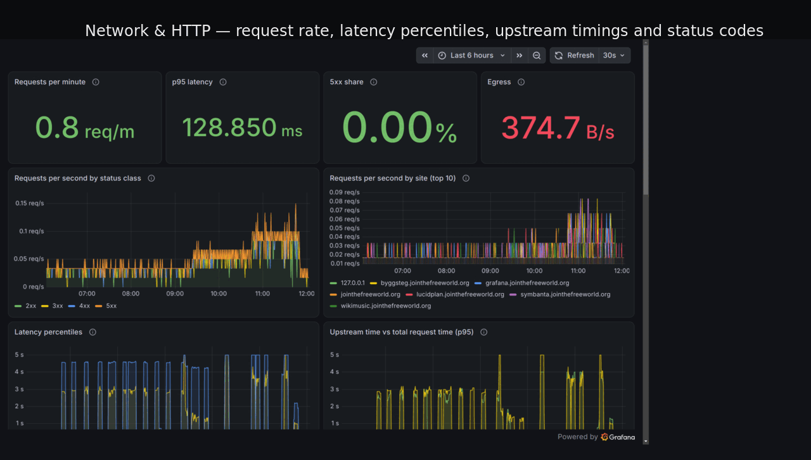
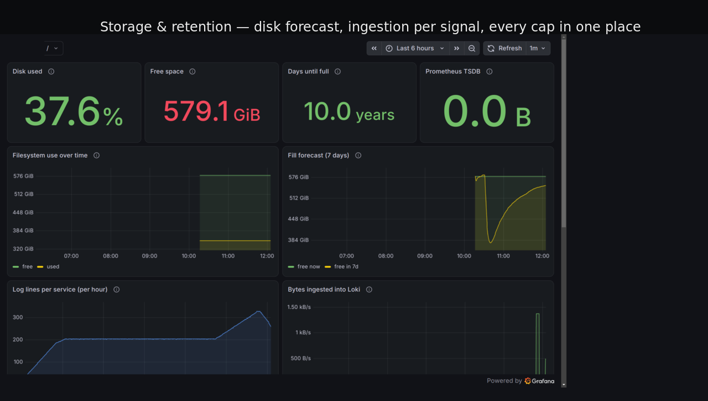
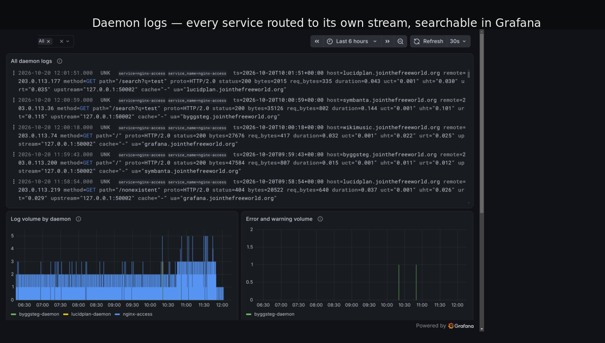
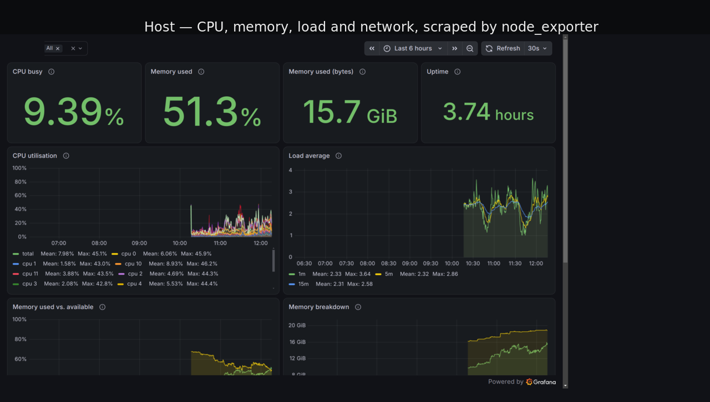

#+title: wolk-jjba
#+subtitle: my personal cloud, written as a Guile program
#+author: Josep Bigorra
#+email: jjbigorra@gmail.com
#+language: en
#+options: toc:nil num:nil

#+begin_export html

  
  
  
  
  

#+end_export

* ⚠️ THIS REPOSITORY WAS ARCHIVED HERE AND MOVED TO GITHUB, GO TO: https://github.com/jjba23/wolk-jjba  ⚠️

*One repository, one machine, one language.*

#+attr_html: :width 100%

#+begin_quote
A tour of the dashboards this repository provisions: request rate and
latency per site, disk and retention budgets, per-daemon logs, and host
CPU/memory.  Every panel is generated from the same config you are
reading — see [[#monitoring-and-observability][Monitoring and observability]].
#+end_quote

wolk-jjba is a complete web and build server — nginx vhosts, automatic
HTTPS, a CI runner, six web applications, PostgreSQL, a Minecraft
server, an Opus radio stream, encrypted backups and a full
Prometheus/Loki/Tempo/Grafana observability stack — all described by the
Guile Scheme in this repository and deployed with GNU Guix.  There is no
Ansible tree, no Dockerfiles, no shell script that drifts: =config.scm=
*is* the server, and =guix system reconfigure= turns the code into the
running machine, atomically and reversibly.

It is also my playground. 🇳🇱 /Wolk/ is the Dutch word for cloud, /jjba/
are my initials, and the machine is where I experiment with treating a
server as a Lisp machine: every capability is a module, every operational
task is a Scheme program, and the whole system can be rebuilt from a
pinned Guix channel and a git commit.

If this repository is useful to you, you can
[[https://bmc.link/jjbigorra][buy me a cup of coffee ☕]] — it buys more of these experiments.

*Screenshots:*  ·
 ·
 ·

* About this project
:PROPERTIES:
:CUSTOM_ID: about-this-project
:END:

** What is this, exactly?
:PROPERTIES:
:CUSTOM_ID: what-is-this-exactly
:END:

This is not a library and not a distributable product.  It is a
*real, running server configuration*, published because reading a
complete one is the fastest way to learn how Guix System fits together
beyond the manual's examples.  It demonstrates, in one place:

- a multi-vhost nginx setup with HTTP/2 + HTTP/3, per-vhost rate limits
  and hardened proxy headers ([[file:src/wolk-jjba/nginx.scm][nginx.scm]]);
- a certificate lifecycle with no cron babysitting
  ([[file:src/wolk-jjba/certbot.scm][certbot.scm]]);
- Shepherd services for native binaries, including a Guix-native
  observability stack pinned by version and hash
  ([[file:src/wolk-jjba/monitoring.scm][monitoring.scm]]);
- log routing that gives every facility and every daemon its own file
  ([[file:src/wolk-jjba/logging.scm][logging.scm]]);
- encrypted, pruned, verified, off-site backups as Shepherd timer jobs
  ([[file:src/wolk-jjba/jobs.scm][jobs.scm]]);
- periodic disk hygiene — store garbage collection, container and cache
  pruning, `/tmp` cleanup — that also publishes its own metrics
  ([[file:src/wolk-jjba/maintenance.scm][maintenance.scm]]);
- a desktop home environment in the same language
  ([[file:home/joe.scm][home/joe.scm]]).

** Who is it for?
:PROPERTIES:
:CUSTOM_ID: who-is-it-for
:END:

- *Guix users* who want a worked example of a non-trivial system: many
  services, custom Shepherd daemons, pinned channel, reproducible
  monitoring binaries.
- *Self-hosters* curious about the shape of a hand-built server in 2026:
  what the vhosts, backups and dashboards actually look like.
- *Scheme people* who enjoy seeing configuration, deployment and
  operations expressed as one program.

It is *not* a turnkey distribution: domain names, users, secrets, disk
UUIDs and the Storage Box are mine.  Read it, steal the parts you like,
and adapt the rest.

** What you get
:PROPERTIES:
:CUSTOM_ID: what-you-get
:END:

- *Web hosting* — nginx serves static sites and reverse-proxies the
  applications, with HTTP/2 and HTTP/3 (QUIC), gzip, cached static
  assets, HSTS and a strict header baseline, per-IP connection and rate
  limits, and basic auth for private vhosts.
- *Automatic HTTPS* — Certbot issues and renews every certificate with
  the HTTP-01 challenge and reloads nginx through a deploy hook.
- *Applications* — [[https://byggsteg.jointhefreeworld.org/][Byggsteg]] (Lisp CI/CD),
  [[https://lucidplan.jointhefreeworld.org/projects][Lucidplan]] (project management),
  [[https://wikimusic.jointhefreeworld.org/][WikiMusic]] (music knowledge base), PingWing,
  Torikomi and Symbanta.
- *A radio station* — MPD plays from the Storage Box and encodes into
  Icecast on three mounts at once (128 kbit/s Opus, 64 kbit/s Opus for
  mobile data, 96 kbit/s MP3 for everything that cannot play Opus),
  reachable over TLS and HTTP/3 at =/radio/= and guarded by a
  five-minute health check that restarts what it can and alerts on what
  it cannot.
- *A game server* — Minecraft (Forge, with mods), supervised by the
  Shepherd.
- *PostgreSQL 16* for the applications that outgrew SQLite.
- *Observability* — Prometheus, Loki, Tempo, Grafana and Alloy run
  natively under the Shepherd: dashboards for logs, daemon health,
  network/HTTP latency and disk budgets, alert rules by e-mail, and an
  OpenTelemetry entry point for anything else on the host.
- *Backups* — encrypted archives twice a day, each with a sha256
  sidecar and taken from a consistent snapshot (SQLite `.backup`,
  `pg_dumpall`), pruned and mirrored hourly to a Hetzner Storage Box,
  verified weekly, and rolled up nightly into a long-term tree that
  keeps one archive per week and per month.
- *Disk hygiene* — Shepherd timers that garbage-collect the Guix and
  Nix stores, prune container images and caches, clean `/tmp`, and
  publish the numbers as Prometheus metrics with alerts on them
  (`src/wolk-jjba/maintenance.scm`).
- *Rootless containers* — Podman for `joe` and for `byggsteg-runner`,
  with the subuid ranges, the storage driver and the cgroup delegation
  a user namespace needs, a Docker-compatible API socket per account for
  testcontainers, and no container on the machine owned by root
  (`src/wolk-jjba/containers.scm`).
- *Reproducibility* — a pinned Guix channel, every command a Scheme
  program, and atomic upgrades you can roll back.

** Configuration map
:PROPERTIES:
:CUSTOM_ID: configuration-map
:END:

The usual changes, and the one file each of them lives in:

| I want to change…            | Edit                                                        |
|------------------------------+-------------------------------------------------------------|
| a website or reverse proxy   | [[file:src/wolk-jjba/nginx.scm][nginx.scm]] (=make-static-site-conf=, =make-reverse-proxied-service-conf=, =nginx-upstreams=) |
| a certificate or domain      | [[file:src/wolk-jjba/nginx.scm][nginx.scm]] and [[file:src/wolk-jjba/certbot.scm][certbot.scm]] (the ACME vhost lists every name) |
| a Shepherd daemon            | =make-guile-server-shepherd-daemon= in [[file:config.scm][config.scm]]           |
| a system package             | [[file:src/wolk-jjba/packages.scm][packages.scm]]                                    |
| rootless containers          | [[file:src/wolk-jjba/containers.scm][containers.scm]] (accounts, storage, API sockets) |
| the firewall rules           | [[file:src/wolk-jjba/iptables.scm][iptables.scm]]                                    |
| kernel network hardening     | [[file:src/wolk-jjba/sysctl.scm][sysctl.scm]]                                      |
| users, hostname, bootloader  | [[file:config.scm][config.scm]]                                      |
| the kernel and its initrd modules | =wolk-jjba-kernel= and =wolk-jjba-initrd-modules= in [[file:config.scm][config.scm]] |
| secrets                      | =maak secrets= writes =/etc/secrets/*= (see [[#secrets][Secrets]]); never in git |
| a backup or upload job       | [[file:src/wolk-jjba/jobs.scm][jobs.scm]]                                        |
| a garbage collection, cache or `/tmp` cleanup | [[file:src/wolk-jjba/maintenance.scm][maintenance.scm]]              |
| backup or directory metrics  | =disk-report-job= in [[file:src/wolk-jjba/maintenance.scm][maintenance.scm]]            |
| a dashboard                  | =monitoring/dashboards/*.json= + the =copy-file= lines in [[file:src/wolk-jjba/monitoring.scm][monitoring.scm]] |
| retention or scrape targets  | =prometheus.yml=, =loki.yml=, =tempo.yml= in [[file:src/wolk-jjba/monitoring][monitoring/]] |
| an alert                     | =monitoring/alerting/*.yml=                                 |
| my shell or desktop          | [[file:home/joe.scm][home/joe.scm]], [[file:src/wolk-jjba/bash.scm][bash.scm]] and [[file:home/bash/shell-lib.bash][shell-lib.bash]] |

After any of these: =maak sr=, then watch =sudo herd status=.

** Start here
:PROPERTIES:
:CUSTOM_ID: start-here
:END:

| I want to…                          | Read                                              |
|-------------------------------------+---------------------------------------------------|
| understand how the machine fits together | [[#architecture-at-a-glance][Architecture at a glance]]                  |
| run this on a fresh VPS             | [[#deploying-a-new-machine][Deploying a new machine]]                          |
| try the config without deploying    | [[#quick-start][Quick start]]                                    |
| know what listens where             | [[#services-and-ports][Services and ports]]                            |
| find a log                          | [[#logging-and-log-routing][Logging and log routing]]                      |
| understand the dashboards           | [[#monitoring-and-observability][Monitoring and observability]]            |
| keep the disk from filling up       | [[#disk-hygiene-and-garbage-collection][Disk hygiene and garbage collection]] |
| listen to the radio, or fix it      | [[#the-radio][The radio]]                                    |
| restore lost data                   | [[#restoring-a-backup][Restoring a backup]]                            |
| fix a broken service                | [[#troubleshooting][Troubleshooting]]                                |
| contribute a fix                    | [[#contributing][Contributing]]                                    |

* Conventions
:PROPERTIES:
:CUSTOM_ID: conventions
:END:

A few conventions are used throughout this document:

- Commands are run as the regular user =joe= unless they start with
  =sudo= or a different user is mentioned.  =joe= has passwordless
  =sudo= on this machine.
- Repository tasks are run with [[https://codeberg.org/jjba23/maak][maak]], the Guile task runner used by
  the whole Jointhefreeworld stack.  The task definitions live in
  =maak.scm=; run =maak= with no arguments to list them.
- Every Byggsteg-managed application checkout lives in
  =/etc/byggsteg/job-clone/<project>/trunk=.  This path is produced by
  =byggsteg-managed-project-dir= in [[file:src/wolk-jjba/prelude.scm][prelude.scm]].
- =/srv/http= is the nginx web root, =/srv/games= holds the Minecraft
  server and =/wolk-jjba-backups= holds the local backup archives.

* Quick start
:PROPERTIES:
:CUSTOM_ID: quick-start
:END:

You do not need a spare VPS to see whether this configuration makes
sense.  Check it out, evaluate it, and read the generated plan without
touching the machine you are on:

#+begin_src shell
git clone https://codeberg.org/jjba23/wolk-jjba
cd wolk-jjba

# config.scm reads the MPD passwords while it is evaluated, so the two
# secret files must exist even for a read-only build
sudo install -d -m 700 /etc/secrets
openssl rand -base64 24 | tr -d '\n' | sudo tee /etc/secrets/mpd-admin      >/dev/null
openssl rand -base64 24 | tr -d '\n' | sudo tee /etc/secrets/mpd-read       >/dev/null
openssl rand -base64 24 | tr -d '\n' | sudo tee /etc/secrets/icecast-source >/dev/null
openssl rand -base64 24 | tr -d '\n' | sudo tee /etc/secrets/icecast-admin  >/dev/null
sudo chmod 600 /etc/secrets/mpd-admin /etc/secrets/mpd-read \
               /etc/secrets/icecast-source /etc/secrets/icecast-admin

# what would this machine become?  (no changes to the running system)
# sudo because the secrets above are root-only and evaluation reads them
sudo ~/.config/guix/current/bin/guix system build -L src --dry-run config.scm

# all the repository tasks (maak comes from the dev environment)
guix shell -m manifest.scm -- maak
#+end_src

Three details that cost an hour if you miss them: =-L src= puts the
=wolk-jjba= modules on the load path (=maak sr= does the same), the
dry run has to run as root — a plain =guix system build= by a normal
user stops at =open-file: Permission denied: "/etc/secrets/mpd-admin"= —
and the guix has to be the one you pulled.  =sudo guix= runs root's Guix,
whose channel list is root's own and has no jointhefreeworld channel; the
import of =(wolk-jjba packages)= then fails quietly and =config.scm= stops
with =wolk-jjba-system-packages: variabele niet gebonden= ("unbound
variable" in a Dutch locale).  =maak sr= and =maak fr= name the pulled
binary themselves, so the task does the right thing without the absolute
path.

~guix system build~ needs the channels pinned in
[[file:channels.scm][channels.scm]]: the Guix commit and the
[[https://codeberg.org/jjba23/guix-jointhefreeworld][jointhefreeworld]] channel.
That channel is where =maak=, the Guile library stack (=guile-kracht=,
=guile-scriba=, =guile-veritas=, =guile-bewaking=, =guile-hygguile=,
=guile-orgwebalchemy=, =guile-openapi-generator= and =guile-olive-css=) and
the version of =veritas= the test suite runs on come from, so the machine and
the applications cloned under =/etc/byggsteg= share one release of each.
Pull the channels once before the first build, and again whenever that file
moves:

#+begin_src shell
guix pull --channels=channels.scm
#+end_src

The first run fetches and builds that Guix revision; later ones reuse it.  It
also installs the channel's modules into the Guix profile, which is what lets
~maak test~ and ~maak repl~ import ~(jointhefreeworld packages applications)~
and ~(jointhefreeworld packages guile)~ -- without the pull, a plain ~guile~
stops at =no code for module (jointhefreeworld packages applications)=.

Guix only pulls a channel that carries an introduction if the channel is one
of your *trusted* channels, which it reads from
=~/.config/guix/trusted-channels.scm= and otherwise takes from the channels the
running guix already has.  On a machine whose guix was pulled before this
channel existed, the first pull warns =channel 'jointhefreeworld' is not
trusted= (it still pulls).  =maak guix-pull= writes that file as a copy of
[[file:channels.scm][channels.scm]] before pulling; doing it by hand is the
same one-liner:

#+begin_src shell
install -D -m 644 channels.scm ~/.config/guix/trusted-channels.scm
#+end_src

On a distribution that keeps its CA bundle where OpenSSL does not look —
openSUSE has =/etc/ssl/ca-bundle.pem=, not
=/etc/ssl/certs/ca-certificates.crt= — the fetch stops at =guix
time-machine: fout: Git-fout: the SSL certificate is invalid= before a
single object moves.  Guix links its Git support against OpenSSL, whose
compiled-in trust store is its own store directory and therefore empty, so
libgit2 falls back to a path this system does not have.  [[file:maak.scm][maak.scm]]
exports =SSL_CERT_FILE= and =GIT_SSL_CAINFO= when it loads, picking whichever
bundle the machine has, so ~maak guix-pull~, ~maak test~ and every task that
runs in the pinned shell fetch normally; an =SSL_CERT_FILE= you exported
first is left alone.

When you are ready to install for real, follow
[[#deploying-a-new-machine][Deploying a new machine]] from step 1 — it covers
the machine-specific values (disk UUIDs, users, domains, Storage Box)
that this quick start deliberately skips.

** Explore the running stack locally
:PROPERTIES:
:CUSTOM_ID: explore-the-running-stack-locally
:END:

The observability stack is the part you can try without any of the
applications: the configs under
[[file:src/wolk-jjba/monitoring][src/wolk-jjba/monitoring/]] are
plain upstream files (Prometheus YAML, Loki YAML, Tempo YAML, Alloy
River, Grafana provisioning) and can be run against a scratch directory
with the upstream binaries.  The paths in those files are absolute and
point at =/var/lib/*=, so copy them and rewrite the paths first:

#+begin_src shell
mkdir -p /tmp/monitoring && cd /tmp/monitoring
cp ~/wolk-jjba/src/wolk-jjba/monitoring/{prometheus,loki,tempo}.yml .
sed -i 's#/var/lib/#/tmp/monitoring/#g' *.yml
# then point your own Prometheus/Loki/Tempo binaries at these copies
#+end_src

That is the approach used while writing the dashboards in this README:
synthetic access-log lines pushed into a scratch Loki, then every panel
query executed until it returned the numbers you see in the GIF.

* Repository layout
:PROPERTIES:
:CUSTOM_ID: repository-layout
:END:

#+begin_example
.
├── config.scm                  the operating-system declaration
├── channels.scm                pinned channels (Guix commit + jointhefreeworld)
├── manifest.scm                development environment (guix shell -m)
├── maak.scm                    repository tasks (maak sr, jr, fr, ...)
├── home/
│   ├── joe.scm                 Guix Home environment for user joe
│   ├── bash/shell-lib.bash     shared prompt, git segment and helpers
│   ├── bash/lesskey            Emacs keymap for the pager (shared)
│   └── nix/
│       ├── nix.conf            nix-command + flakes
│       └── nixpkgs.nix         allowUnfree
├── scripts/
│   ├── gfs-backup.scm          command-line wrapper for (wolk-jjba gfs)
│   ├── secrets.scm             push GPG-encrypted secrets to the machine (maak secrets)
│   ├── secrets-apply.scm       command-line wrapper for (wolk-jjba secrets)
│   ├── install-nix-packages.scm  install the Nix dev profile
│   └── update-nix-packages.scm   upgrade the Nix dev profile
├── screenshots/                README screenshots + demo.gif (regenerate
│                               with screenshots/make-screenshots.sh)
└── src/wolk-jjba/
    ├── prelude.scm             shared helpers + Shepherd daemon factory
    ├── bash.scm                shell identity, greetings, shortcuts, aliases
    ├── containers.scm          rootless Podman, session dirs, API sockets
    ├── secrets.scm             the secrets contract: /etc/secrets and what
    │                           is derived from it (podman auth.json)
    ├── logging.scm             syslog routing
    ├── nginx.scm               web hosting, TLS and hardened reverse proxy
    ├── certbot.scm             automatic HTTPS
    ├── jobs.scm                Shepherd timers + the weekly mcron upgrade
    ├── gfs.scm                 long-term (GFS) retention on the Storage Box
    ├── radio.scm               MPD + Icecast: three mounts, health check,
    │                           library scan, stream metrics
    ├── maintenance.scm         garbage collection, cache/tmp cleanup,
    │                           backup verification, disk metrics
    ├── monitoring.scm          native Prometheus/Loki/Grafana/Alloy services
    ├── monitoring-packages.scm pinned upstream monitoring binaries
    ├── monitoring/
    │   ├── prometheus.yml      scrape configuration
    │   ├── loki.yml            single-node Loki configuration
    │   ├── tempo.yml           single-binary Tempo (trace store)
    │   ├── datasources.yml     Grafana datasource provisioning
    │   ├── alloy.alloy         log shipping + OTLP pipelines
    │   ├── dashboards/
    │   │   ├── herd-daemons-logs.json
    │   │   ├── shepherd-daemons-health.json
    │   │   ├── network-http.json
    │   │   ├── storage-retention.json
    │   │   └── host-cpu-memory.json
    │   └── alerting/
    │       ├── contact-points.yml
    │       ├── notification-policies.yml
    │       └── alert-rules.yml
    ├── minecraft.scm           Minecraft Shepherd service
    ├── iptables.scm            host firewall (packet filter)
    ├── sysctl.scm              kernel network hardening (sysctl)
    └── packages.scm            system-wide packages (maak comes from the
                                jointhefreeworld channel)
#+end_example

The modules are capabilities: each one exports a service (or a service
type) that =config.scm= adds to the system service list.  The only file
that knows about *all* of them is =config.scm=; keep it that way.

* Architecture at a glance
:PROPERTIES:
:CUSTOM_ID: architecture-at-a-glance
:END:

One machine, three rings: a public edge (nginx + Certbot), the
applications behind it (Shepherd daemons on loopback ports), and the
supporting cast (backups, monitoring, the radio stream).  Three small
diagrams cover the whole box: the edge and its vhosts, the data and
backup pipeline, and the monitoring stack.
[[#services-and-ports][Services and ports]] gives the exact ports, and
[[#repository-layout][Repository layout]] maps each box to the module that
implements it.

The palette is a terminal: green for the network edge, magenta for the
packet filter, cyan for nginx, amber for the Shepherd daemons, violet for
data and jobs, teal for monitoring, red for the Storage Box.  Each
diagram is drawn on its own dark canvas, so it reads the same whatever
theme the viewer uses.

*Edge and request path.*  Who connects, on which port, and which vhost
answers.

#+begin_src mermaid
%%{init: {"theme": "base", "themeVariables": {"darkMode": true, "fontFamily": "monospace", "fontSize": "14px", "background": "#05070a", "mainBkg": "#05070a", "primaryColor": "#05070a", "primaryTextColor": "#39ff14", "primaryBorderColor": "#39ff14", "secondaryColor": "#0b0f14", "tertiaryColor": "#0b0f14", "lineColor": "#39ff14", "textColor": "#c9ffd4", "edgeLabelBackground": "#05070a", "clusterBkg": "#0b0f14", "clusterBorder": "#00e5ff"}}}%%
graph LR
    classDef ttyUser fill:#001a0f,stroke:#39ff14,stroke-width:2px,color:#39ff14
    classDef ttyFilter fill:#1e0026,stroke:#ff2bd6,stroke-width:2px,color:#ff9cf2
    classDef ttyFront fill:#00121a,stroke:#00e5ff,stroke-width:2px,color:#7df9ff
    classDef ttyDaemon fill:#1a1200,stroke:#ffb000,stroke-width:2px,color:#ffd27d
    classDef ttyData fill:#100020,stroke:#b967ff,stroke-width:2px,color:#d9a6ff

    subgraph canvas ["[ wolk-jjba :: edge ]"]
        User(("> web users"))
        Admin(("> admin"))
        Gamers(("> minecraft"))

        subgraph Edge ["[ iptables ]"]
            Web["80 / 443"]
            SSH["2323 :: ssh"]
            Game["25565 :: game"]
            MPD["6600 :: mpd"]
            Ice["6690 :: icecast"]
        end

        subgraph Front ["[ nginx ]"]
            Nginx["nginx reverse proxy"]
            Cert["certbot"]
            Static["/srv/http"]
        end

        subgraph Apps ["[ shepherd :: daemons ]"]
            Byggsteg["byggsteg"]
            Lucidplan["lucidplan"]
            Wikimusic["wikimusic"]
            Pingwing["pingwing"]
            Torikomi["torikomi"]
            Symbanta["symbanta api"]
            MC["minecraft"]
        end

        Radio["mpd + icecast"]

        User --> Web
        Admin --> SSH
        Gamers --> Game
        Web --> Nginx
        Game --> MC
        MPD --> Radio
        Ice --> Radio
        Nginx -.->|certificates| Cert
        Nginx --> Static
        Nginx --> Byggsteg
        Nginx --> Lucidplan
        Nginx --> Wikimusic
        Nginx --> Pingwing
        Nginx --> Torikomi
        Nginx --> Symbanta
    end

    class User,Admin,Gamers ttyUser
    class Web,SSH,Game,MPD,Ice ttyFilter
    class Nginx,Cert,Static ttyFront
    class Byggsteg,Lucidplan,Wikimusic,Pingwing,Torikomi,Symbanta,MC ttyDaemon
    class Radio ttyData

    style canvas fill:#05070a,stroke:#39ff14,stroke-width:2px,color:#39ff14
    style Edge fill:#0b0010,stroke:#ff2bd6,stroke-width:2px
    style Front fill:#000b10,stroke:#00e5ff,stroke-width:2px
    style Apps fill:#100b00,stroke:#ffb000,stroke-width:2px
    linkStyle default stroke:#39ff14,stroke-width:1.5px
#+end_src

*Data, backups and the Storage Box.*  What the Shepherd timers archive,
encrypt and mirror, and what comes back over CIFS for the radio.

#+begin_src mermaid
%%{init: {"theme": "base", "themeVariables": {"darkMode": true, "fontFamily": "monospace", "fontSize": "14px", "background": "#05070a", "mainBkg": "#05070a", "primaryColor": "#05070a", "primaryTextColor": "#39ff14", "primaryBorderColor": "#39ff14", "secondaryColor": "#0b0f14", "tertiaryColor": "#0b0f14", "lineColor": "#39ff14", "textColor": "#c9ffd4", "edgeLabelBackground": "#05070a", "clusterBkg": "#0b0f14", "clusterBorder": "#00e5ff"}}}%%
graph LR
    classDef ttyDaemon fill:#1a1200,stroke:#ffb000,stroke-width:2px,color:#ffd27d
    classDef ttyData fill:#100020,stroke:#b967ff,stroke-width:2px,color:#d9a6ff
    classDef ttyStore fill:#1a0005,stroke:#ff3860,stroke-width:2px,color:#ff9aa9

    subgraph canvas ["[ wolk-jjba :: data ]"]
        subgraph Apps ["[ shepherd :: daemons ]"]
            Byggsteg["byggsteg"]
            Lucidplan["lucidplan"]
            Wikimusic["wikimusic"]
            Pingwing["pingwing"]
        end

        subgraph Data ["[ data :: jobs ]"]
            Timers["shepherd timers"]
            Local["/wolk-jjba-backups"]
            DBs[("sqlite + postgres")]
        end

        Mount["/mnt/wolkenschlosslagerung"]
        Radio["mpd + icecast"]
        Box[("hetzner storage box")]

        Byggsteg --> DBs
        Lucidplan --> DBs
        Wikimusic --> DBs
        Pingwing --> DBs

        Timers -->|tar + openssl| Local
        Timers -->|restart| Byggsteg
        Timers -->|restart| Lucidplan
        Timers -->|restart| Wikimusic
        Timers -->|restart| Pingwing
        Local -->|rsync every 3h| Box
        Box -->|SMB/CIFS| Mount
        Mount -->|music library| Radio
    end

    class Byggsteg,Lucidplan,Wikimusic,Pingwing ttyDaemon
    class Timers,Local,DBs,Mount,Radio ttyData
    class Box ttyStore

    style canvas fill:#05070a,stroke:#39ff14,stroke-width:2px,color:#39ff14
    style Apps fill:#100b00,stroke:#ffb000,stroke-width:2px
    style Data fill:#0a0014,stroke:#b967ff,stroke-width:2px
    linkStyle default stroke:#39ff14,stroke-width:1.5px
#+end_src

*Monitoring and telemetry.*  What nginx exposes, and how logs, metrics
and traces flow through Alloy into Grafana.

#+begin_src mermaid
%%{init: {"theme": "base", "themeVariables": {"darkMode": true, "fontFamily": "monospace", "fontSize": "14px", "background": "#05070a", "mainBkg": "#05070a", "primaryColor": "#05070a", "primaryTextColor": "#39ff14", "primaryBorderColor": "#39ff14", "secondaryColor": "#0b0f14", "tertiaryColor": "#0b0f14", "lineColor": "#39ff14", "textColor": "#c9ffd4", "edgeLabelBackground": "#05070a", "clusterBkg": "#0b0f14", "clusterBorder": "#00e5ff"}}}%%
graph LR
    classDef ttyFront fill:#00121a,stroke:#00e5ff,stroke-width:2px,color:#7df9ff
    classDef ttyData fill:#100020,stroke:#b967ff,stroke-width:2px,color:#d9a6ff
    classDef ttyMon fill:#001a1a,stroke:#00ffd0,stroke-width:2px,color:#8dfff0

    subgraph canvas ["[ wolk-jjba :: monitoring ]"]
        Nginx["nginx reverse proxy"]

        subgraph Mon ["[ monitoring :: otel ]"]
            Prom["prometheus"]
            Loki["loki"]
            Grafana["grafana"]
            Tempo["tempo"]
            Alloy["grafana alloy"]
            NodeExp["node exporter"]
        end

        MonData["/var/lib"]

        Nginx --> Grafana
        Nginx --> Prom
        Nginx --> NodeExp

        Prom --> NodeExp
        Alloy --> Loki
        Alloy -->|OTLP traces| Tempo
        Alloy -->|remote write| Prom
        Grafana --> Prom
        Grafana --> Loki
        Grafana --> Tempo

        Prom --> MonData
        Loki --> MonData
        Tempo --> MonData
        Grafana --> MonData
        Alloy --> MonData
    end

    class Nginx ttyFront
    class Prom,Loki,Grafana,Tempo,Alloy,NodeExp ttyMon
    class MonData ttyData

    style canvas fill:#05070a,stroke:#39ff14,stroke-width:2px,color:#39ff14
    style Mon fill:#001010,stroke:#00ffd0,stroke-width:2px
    linkStyle default stroke:#39ff14,stroke-width:1.5px
#+end_src

A request arrives on port 80 or 443, hits nginx, and is either served
from =/srv/http= or proxied to a Shepherd daemon on localhost.  The
daemons keep their data in SQLite files inside their checkout (or in
PostgreSQL).  Shepherd timer jobs archive and encrypt that data locally,
then the =backer-upper= user mirrors =/wolk-jjba-backups= to the Hetzner
Storage Box.  The same Storage Box is mounted over CIFS to provide the MPD music
library.  The monitoring services run as Shepherd daemons: nginx proxies
Grafana, Prometheus and the node exporter, Alloy tails the routed log
files and pushes them to Loki, and Grafana reads Prometheus, Loki and
Tempo as data sources.  Alloy is also the single OpenTelemetry entry
point: daemons export OTLP to it and it fans metrics, logs and traces out
to Prometheus, Loki and Tempo respectively.

* Services and ports
:PROPERTIES:
:CUSTOM_ID: services-and-ports
:END:

Everything except nginx, SSH and the game server listens on
=127.0.0.1=.  The table is the quickest way to answer "what is on this
port?" without =ss=, and it is kept in sync with the modules.

| Port       | Proto   | Service                          | Exposure                                  |
|------------+---------+----------------------------------+-------------------------------------------|
| 80         | tcp     | nginx: ACME + HTTP->HTTPS        | public                                    |
| 443        | tcp     | nginx: HTTPS                     | public                                    |
| 443        | udp     | nginx: HTTP/3 (QUIC)             | public                                    |
| 81         | tcp     | nginx: stub_status               | not in iptables; status limited to 127.0.0.1 |
| 2323       | tcp     | OpenSSH (=openssh-sans-x=)       | public, public-key auth only              |
| 25565      | tcp/udp | Minecraft                        | public                                    |
| 6600       | tcp/udp | MPD                              | opened in iptables, password required     |
| 6690       | tcp/udp | Icecast (three stream mounts)    | public, and proxied by nginx at =/radio/= |
| 5432       | tcp     | PostgreSQL 16                    | local only, not opened                    |
| 50002      | tcp     | byggsteg                         | =127.0.0.1=, proxied by nginx             |
| 50025      | tcp     | lucidplan                        | =127.0.0.1=, proxied by nginx             |
| 50027      | tcp     | torikomi                         | =127.0.0.1=, proxied by nginx             |
| 50050      | tcp     | wikimusic                        | =127.0.0.1=, proxied by nginx             |
| 50077      | tcp     | pingwing                         | =127.0.0.1=, proxied by nginx             |
| 8080       | tcp     | symbanta API                     | =127.0.0.1=, proxied by nginx             |
| 9100       | tcp     | node exporter                    | =127.0.0.1=, scraped and proxied          |
| 4317       | tcp     | Alloy OTLP receiver (gRPC)       | =127.0.0.1=, for local daemons            |
| 4318       | tcp     | Alloy OTLP receiver (HTTP)       | =127.0.0.1=, for local daemons            |
| 12345      | tcp     | Grafana Alloy debug UI           | =127.0.0.1=                               |
| 14317      | tcp     | Tempo OTLP receiver (gRPC)       | =127.0.0.1=, Alloy only                   |
| 14318      | tcp     | Tempo OTLP receiver (HTTP)       | =127.0.0.1=                               |
| 53000      | tcp     | Grafana                          | =127.0.0.1=, proxied by nginx             |
| 53100      | tcp     | Loki                             | =127.0.0.1=, Alloy push and nginx         |
| 53200      | tcp     | Tempo HTTP                       | =127.0.0.1=, scraped                      |
| 53201      | tcp     | Tempo gRPC (internal)            | =127.0.0.1=                               |
| 59090      | tcp     | Prometheus                       | =127.0.0.1=, proxied by nginx             |

Unrelated to the network: each account that builds in containers has a
=podman= API socket under =/run/user/<uid>/podman/podman.sock=.  A unix
socket is not a port, so the firewall has nothing to say about it; it is
reachable only by the account that owns it (mode =0600=, directory
=0700=) and by root.  See [[#containers-rootless-podman][Containers: rootless Podman]].

The firewall opens exactly the ports listed above, and only those.  It is
not a bare port list, though: [[file:src/wolk-jjba/iptables.scm][iptables.scm]]
also drops malformed packets, rate limits new SSH connections per source
address, caps how many connections one address may hold on each served
port, and rate limits ICMP echo.  The kernel side of the same defence
(SYN cookies, reverse-path filtering, ICMP behaviour) is in
[[file:src/wolk-jjba/sysctl.scm][sysctl.scm]]; see
[[#firewall-and-kernel-hardening][Firewall and kernel hardening]].

There is no SMTP service on this host, so port 25 is not opened; the
original ruleset carried a =25/udp= rule that served nothing and has
been removed.

node exporter (9100) used to listen on every interface by default; it
is now bound to =127.0.0.1= in [[file:config.scm][config.scm]], which
is what the table has always claimed.  Its vhost
(=prometheus-exporter.jointhefreeworld.org=) is behind basic auth like
the other two administrative vhosts: it publishes a map of the machine
-- uptime, disks, interfaces, processes -- and nothing outside the
machine needs it, because Prometheus scrapes it over loopback.

The authoritative list is split between four files: the firewall rules
in [[file:src/wolk-jjba/iptables.scm][iptables.scm]], the upstream
ports in [[file:src/wolk-jjba/nginx.scm][nginx.scm]], the monitoring
ports in [[file:src/wolk-jjba/monitoring.scm][monitoring.scm]] and the
daemon commands in [[file:config.scm][config.scm]].  Change a port in
every place that uses it.

* Firewall and kernel hardening
:PROPERTIES:
:CUSTOM_ID: firewall-and-kernel-hardening
:END:

The firewall is two files, because it is two layers:
[[file:src/wolk-jjba/iptables.scm][iptables.scm]] decides what a packet
may do, and [[file:src/wolk-jjba/sysctl.scm][sysctl.scm]] decides how
much work the kernel does before a packet gets there.  Together they are
what keeps a public host from being *found* by somebody else's
automation and then spending its CPU answering.

** The ruleset
:PROPERTIES:
:CUSTOM_ID: the-ruleset
:END:

| Layer                                   | What it does                                                  |
|-----------------------------------------+---------------------------------------------------------------|
| =-i lo=, then =--ctstate INVALID=        | loopback is trusted; malformed and out-of-window packets are dropped, not parsed |
| SSH rate limit                           | =hashlimit --hashlimit-above 20/minute --hashlimit-burst 30= on new connections to 2323 |
| SSH concurrency                          | =connlimit --connlimit-above 8= per source address             |
| HTTP concurrency                         | =connlimit --connlimit-above 40= on 80, =60= on 443 (tcp and udp) |
| Game, radio and MPD concurrency          | =connlimit --connlimit-above 20= on 25565 and 6690, =8= on 6600 |
| ICMP                                     | echo requests are accepted at 10/s per host, the excess is dropped; everything else ICMP carries is still accepted |
| default deny                             | whatever is left is rejected with =icmp-port-unreachable=      |

Two details are load-bearing:

- loopback is accepted *first*, which is what keeps the proxied radio
  working: nginx connects to Icecast on =127.0.0.1:6690=, so the
  =connlimit= on 6690 counts direct external listeners only and never
  the listeners arriving through =https://jointhefreeworld.org/radio/=;
- the rate and concurrency rules come *before* the port =ACCEPT=s, so a
  packet that trips one of them never reaches the accept line.

Connections are also capped at the HTTP layer by nginx
([[#abuse-limits][Abuse limits]]); the firewall catches what happens
before nginx, and the nginx limits catch what happens after.

** The kernel settings
:PROPERTIES:
:CUSTOM_ID: the-kernel-settings
:END:

=sysctl.scm= is applied once at boot by Guix's =sysctl-service-type=,
extending the configuration =%base-services= already provides (the
Guix defaults such as =fs.protected_hardlinks= are kept).  It sets:

- *SYN flood survival*: =tcp_syncookies=, a =2048= SYN backlog, a
  =1024=-entry accept queue, and short SYN/close retries so half-open
  state expires in seconds rather than minutes;
- *anti-spoofing*: strict =rp_filter= on =all= and =default=, no
  source-routed packets, and no ICMP redirects accepted or sent -- this
  host is not a router and must not be usable as one;
- *ICMP*: broadcast echo ignored, bogus error responses not logged, and
  a kernel-side rate limit that mirrors the iptables one;
- *information leaks*: =kptr_restrict=2=, =dmesg_restrict=1=, and
  =unprivileged_bpf_disabled=1=.

Deliberately *not* set: =ip_forward= and the IPv6 equivalents (rootless
Podman owns those), router advertisements (NetworkManager owns those),
and non-network knobs such as =vm.swappiness=.

Check it on the running machine:

#+begin_src shell
sudo herd status sysctl
sudo sysctl net.ipv4.tcp_syncookies net.ipv4.conf.all.rp_filter \
             kernel.kptr_restrict
# the counters that show the limits working
sudo nft list ruleset | head -40          # or: sudo iptables -L -n -v
#+end_src

* Containers: rootless Podman
:PROPERTIES:
:CUSTOM_ID: containers-rootless-podman
:END:

Podman is the one container runtime on this host, and it is used by two
kinds of process: =joe=, for a scratch container or a project's suite
that starts a database in one, and =byggsteg-runner=, because a Byggsteg
job that names an image is built in it.  Both are rootless: no container
on this machine is owned by root, and no build borrows the daemon's
privileges.

Everything about it lives in
[[file:src/wolk-jjba/containers.scm][containers.scm]], which is
declared in =config.scm= as two lines:

#+begin_src scheme
(service rootless-podman-service-type (podman-configuration))
(containers-capability)
#+end_src

** The five pieces of a rootless runtime
:PROPERTIES:
:CUSTOM_ID: the-five-pieces-of-a-rootless-runtime
:END:

Each of them fails in its own way when it is missing, which is why they
are listed together:

| Piece                        | What it is                                              | Who provides it |
|------------------------------+---------------------------------------------------------+-----------------|
| subuid / subgid ranges       | the 65536 IDs a user namespace maps                      | =podman-configuration=, for =joe= and =byggsteg-runner= |
| =/sys/fs/cgroup=             | owned by the =cgroup= group, controllers delegated       | =rootless-podman-service-type= |
| storage                      | =overlay= with =fuse-overlayfs= as its mount program     | =podman-configuration= writes =storage.conf= |
| an XDG runtime directory     | =/run/user/<uid>=, which a daemon never gets from a login | the activation and =podman-user-sessions= |
| a Docker API socket          | =podman system service=, one per account                  | =podman-api-joe= and =podman-api-byggsteg-runner= |

The storage driver is =overlay= with
=/run/current-system/profile/bin/fuse-overlayfs=, rather than the
kernel's own overlay support: whether a kernel allows overlay inside a
user namespace depends on the kernel and the filesystem below it, and
=fuse-overlayfs= works on all of them.  It is in both
=wolk-jjba-system-packages= and the profile this capability installs.

=containers.conf= (the fourth file under =/etc/containers=, beside the
three Guix writes) names =pasta= as the rootless network and =cgroupfs=
as the cgroup manager, because Guix System has no systemd to ask for a
cgroup.  The registry order is =docker.io= first, which is where the
images this CI pulls live.

** Sessions, and the account that never logs in
:PROPERTIES:
:CUSTOM_ID: sessions-and-the-account-that-never-logs-in
:END:

Rootless Podman needs =XDG_RUNTIME_DIR= to exist and to belong to the
user.  A login gets one from elogind through PAM; =byggsteg-runner= has
no login, so nothing would ever create it.  The activation creates
=/run/user/<uid>= for both accounts at boot, and the =podman-user-sessions=
one-shot asks elogind to keep it (=loginctl enable-linger=) so its own
cleanup does not remove it.  Both steps are idempotent.

** The Docker API socket, and testcontainers
:PROPERTIES:
:CUSTOM_ID: the-docker-api-socket-and-testcontainers
:END:

testcontainers -- and docker compose, and any Docker SDK -- does not run
the CLI: it speaks the Docker API over a socket named by =DOCKER_HOST=.
Each account therefore gets one:

| Account           | Socket                                 |
|-------------------+----------------------------------------|
| =joe=             | =/run/user/<uid-of-joe>/podman/podman.sock= |
| =byggsteg-runner= | =/run/user/<uid-of-byggsteg-runner>/podman/podman.sock= |

The socket is served by =podman system service --time=0=, run as that
user by the Shepherd (=podman-api-joe=, =podman-api-byggsteg-runner=),
and its log is =/var/log/wolk-jjba/podman-api-<user>.log=.

=joe='s interactive shell exports =DOCKER_HOST= when the socket exists
(see =bashrc-postlude= in [[file:src/wolk-jjba/bash.scm][bash.scm]]), so a
=maak test= that uses testcontainers needs no extra setup.  Podman's own
command ignores the variable unless it is asked to go remote, so setting
it does not redirect a local build.

#+begin_src shell
# does the socket answer?
curl --unix-socket /run/user/$(id -u)/podman/podman.sock http://d/version

# what a suite would see
echo "$DOCKER_HOST"
podman system df
#+end_src

The uid is allocated by Guix and is not necessarily 1000; ask the
machine instead of assuming: =id -u joe=, =id -u byggsteg-runner=.

** Byggsteg builds in containers
:PROPERTIES:
:CUSTOM_ID: byggsteg-builds-in-containers
:END:

A Byggsteg job that names an =image= has its build and test steps run
in it; a job that names none runs on the machine.  The daemon itself
stays =root=, because every application's =maak= task builds in the
Guix store and =/gnu/store= is writable by root and the build users
only — but the *containers* are not root's.  The daemon is started with

#+begin_src scheme
#:group "users"
#:file-creation-mask #o002
#:extra-env (list "BYGGSTEG_CONTAINER_RUNTIME=podman"
                  "BYGGSTEG_CONTAINER_USER=byggsteg-runner")
#+end_src

so byggsteg runs the runtime through =sudo -u byggsteg-runner=, and the
image, the containers and the build cache are that account's.  The
group is =users= for both accounts and the umask is =002=, so a clone
the daemon writes is writable by the container that builds it (and by
=joe=, who runs =maak sr= from the same checkout).

Read what a deployment would do with =maak container-check= in the
Byggsteg checkout; the environment variables it reads are documented in
[[https://codeberg.org/jjba23/byggsteg][Byggsteg's own manual]], under
"Building in containers".

The only thing this repository has to keep true of it is that the
socket exists and belongs to the account: the API socket service above,
the runtime directory at boot, and the group-writable
=/etc/byggsteg= tree.

** Pruning
:PROPERTIES:
:CUSTOM_ID: pruning
:END:

Images and build cache are never given back on their own, so
=podman-prune= (Saturday 04:00) runs =podman system prune --force
--build --filter until=168h= for both accounts, with each user's own
=XDG_RUNTIME_DIR= and =DOCKER_HOST=.  Volumes are deliberately not
pruned, and nothing touched in the last week is removed, so a build that
is running now is left alone.  See
[[#disk-hygiene-and-garbage-collection][Disk hygiene]].

#+begin_src shell
sudo herd status podman-api-joe podman-api-byggsteg-runner podman-user-sessions
sudo herd trigger podman-prune
sudo -u byggsteg-runner env XDG_RUNTIME_DIR=/run/user/$(id -u byggsteg-runner) \
  podman system df
#+end_src

** Registry credentials
:PROPERTIES:
:CUSTOM_ID: registry-credentials
:END:

Pulling an image that is not anonymous needs a credential, and Podman
has no flag to take one: it reads =$HOME/.config/containers/auth.json=.
That file is per-account, so "log the machine in" means writing it twice
-- once as =joe=, once as =byggsteg-runner= -- which the machine does by
itself from a secret.  The secret is =/etc/secrets/dockerhub-token= and
the whole flow -- including how the token gets there without being typed
on the server -- is in [[#secrets][Secrets]]; in short:

#+begin_src shell
# on the machine you keep your secrets on (a GPG key is all it needs)
maak secrets set dockerhub-token

# on the machine, or over ssh, the derived files and who podman is:
sudo herd trigger secrets-apply
podman login --get-login docker.io                 # joe: jjba23
sudo -u byggsteg-runner -i \
  podman login --get-login docker.io               # byggsteg-runner: jjba23
#+end_src

* Secrets
:PROPERTIES:
:CUSTOM_ID: secrets
:END:

A secret is a value that must exist in exactly one place on the machine
and must not exist anywhere in this repository.  Both halves are easy to
get wrong by hand -- a token pasted into a shell to run =podman login=
lands in the history file; a password typed into =config.scm= lands in
git -- so the whole path from "a value I know" to "a file the machine
uses" is three small rules.

** The three copies
:PROPERTIES:
:CUSTOM_ID: the-three-copies
:END:

| Where                                          | What it is                                  | Who writes it |
|------------------------------------------------+---------------------------------------------+---------------|
| =~/.config/wolk-jjba/secrets/<name>.gpg=       | the source of truth: one GPG file per secret, mode 0600, never in git | =maak secrets set= |
| =/etc/secrets/<name>= on the machine           | the canonical plaintext copy, root-only, mode 0600 | =maak secrets=, over ssh |
| derived files, e.g. =~joe/.config/containers/auth.json= | what a program actually reads | the machine, from the canonical copy |

Two programs own the ends of that table:

- [[file:scripts/secrets.scm][scripts/secrets.scm]] runs where a human is
  sitting.  It encrypts, it pushes over ssh, and it never puts a
  plaintext on a disk: =gpg --decrypt= writes into a pipe that goes
  straight into =ssh ... install /dev/stdin=, and the value is never an
  argument, so it does not reach a shell history, an argv or =ps=.
- [[file:src/wolk-jjba/secrets.scm][(wolk-jjba secrets)]] runs on the
  machine.  It knows what is *derived* from a secret -- today the Podman
  registry login of both accounts that build containers -- and
  [[file:src/wolk-jjba/containers.scm][containers.scm]] runs it from the
  =secrets-apply= timer (every 15 minutes, log in
  =/var/log/wolk-jjba/secrets-apply.log=).  A derived file is never the
  source of truth: delete a home, reinstall the account, reboot, and the
  next run puts the login back.

The radio passwords and the Storage Box credentials from
[[#3-create-the-secrets][step 3]] are still made with =openssl= and =sudo
tee=.  They can be pushed the same way once they are encrypted
(=/etc/secrets/mpd-admin= is just a file with one line in it), and
=config.scm= reads them from the same directory either way.

** First time
:PROPERTIES:
:CUSTOM_ID: secrets-first-time
:END:

The encrypted copies are encrypted *to a key*, so decryption is the
GnuPG agent's job and a human only unlocks the key once in a while:

#+begin_src shell
# is there a key already?
gpg --list-secret-keys --keyid-format=long

# no key?  make one (it asks for a passphrase, which protects every secret)
maak secrets keygen
#+end_src

=secrets-keygen= creates an ed25519 key that never expires and prints its
fingerprint.  To encrypt to *other* keys as well -- a backup machine, a
second laptop -- write their fingerprints into
=~/.config/wolk-jjba/secrets/recipients=, one per line.  That file also
replaces the default key entirely, which is how a machine that holds no
private key of its own can still encrypt for the machine that does.

Then store the first secret.  Take the token from Docker Hub
(*Account settings → Security → New access token*; a read-only token is
enough for a build host) and give it to =maak= on stdin, where it stays
out of your shell's history and out of =ps=:

#+begin_src shell
printf '%s' "$TOKEN" | maak secrets set dockerhub-token
#+end_src

Without a pipe it prompts and does not echo:

#+begin_example
$ maak secrets set dockerhub-token
value for dockerhub-token (not echoed):
~/.config/wolk-jjba/secrets/dockerhub-token.gpg: encrypted to 83BC6E1C…
→ wolk-jjba:/etc/secrets/dockerhub-token
wolk-jjba: secrets-apply ran

--- wolk-jjba:/var/log/wolk-jjba/secrets-apply.log ---
docker.io: written /home/joe/.config/containers/auth.json
docker.io: written /home/byggsteg-runner/.config/containers/auth.json

--- podman on wolk-jjba ---
  docker.io: logged in as jjba23
#+end_example

The machine it pushes to is the ssh alias in =WOLK_JJBA_HOST=, and every
other knob is an environment variable as well, so the same task works
from a laptop and from the machine itself:

| Variable                   | Default                              |
|----------------------------+--------------------------------------|
| =WOLK_JJBA_HOST=            | =wolk-jjba= (the alias in =~/.ssh/config=) |
| =WOLK_JJBA_SECRETS_LOCAL=   | =~/.config/wolk-jjba/secrets=         |
| =EDITOR=                    | =vi= (only =maak secrets edit= uses it) |

** The daily flow
:PROPERTIES:
:CUSTOM_ID: secrets-daily-flow
:END:

| Task                        | What it does                                                        |
|-----------------------------+---------------------------------------------------------------------|
| =maak secrets=              | push every encrypted secret, then apply them on the machine (the common case: no argument) |
| =maak secrets list=         | what is encrypted here, and what =/etc/secrets= on the machine holds |
| =maak secrets set NAME=     | encrypt a new value (hidden prompt, or stdin when piped), then push it |
| =maak secrets edit NAME=    | edit the value in =$EDITOR=, then push it -- for the secrets that are not one line |
| =maak secrets get NAME=     | print the decrypted value here                                      |
| =maak secrets push [NAME…]= | push every secret, or only the ones named                           |
| =maak secrets apply=        | only run the machine's =secrets-apply= job                          |
| =maak secrets keygen=       | create the GPG key the secrets are encrypted to                      |

=maak secrets edit= is the one command that puts a plaintext on a disk:
it writes the decrypted file into a 0700 directory under
=$XDG_RUNTIME_DIR= (a tmpfs), and removes it when the editor exits,
whether it succeeded or not.  That is what multi-line secrets --
=grafana-smtp= is four lines -- need.

** What the machine derives
:PROPERTIES:
:CUSTOM_ID: what-the-machine-derives
:END:

[[file:src/wolk-jjba/secrets.scm][(wolk-jjba secrets)]] holds the list
of registry credentials (=wolk-jjba-registries=) and writes, for each
account that builds containers, that account's own
=~/.config/containers/auth.json=:

#+begin_src json
{"auths": {"docker.io": {"auth": "jjba23:<token in base64>"}}}
#+end_src

So the file holds the token in base64, which is not encryption.  That is
why it is 0600, why the directory it lands in is 0700, and why it is
rebuilt from =/etc/secrets= rather than kept anywhere else.  Podman
looks for the file in two places and prefers the first:

| Order | Path                                   | Notes                                        |
|-------+----------------------------------------+----------------------------------------------|
| 1     | =$XDG_RUNTIME_DIR/containers/auth.json= | tmpfs, written by =podman login= in a session; can shadow the managed file after a manual login |
| 2     | =$HOME/.config/containers/auth.json=    | what this machine manages, and what survives a reboot |

Because the file is generated, a manually added registry would be
dropped by the next run: add it to =wolk-jjba-registries= in
[[file:src/wolk-jjba/secrets.scm][secrets.scm]] instead, with its token
in =/etc/secrets=.  Adding a registry is one entry:

#+begin_src scheme
(list (registry-credential #:registry "docker.io"
                           #:username "jjba23"
                           #:secret "dockerhub-token")
      (registry-credential #:registry "ghcr.io"
                          #:username "jjba23"
                          #:secret "github-token"))
#+end_src

Check it by hand on the machine:

#+begin_src shell
sudo herd status secrets-apply
sudo herd trigger secrets-apply
sudo tail -n 20 /var/log/wolk-jjba/secrets-apply.log

# who does podman think it is, for each account?
podman login --get-login docker.io          # joe
sudo -u byggsteg-runner -i \
  podman login --get-login docker.io        # byggsteg-runner
#+end_src

** Troubleshooting
:PROPERTIES:
:CUSTOM_ID: secrets-troubleshooting
:END:

| Symptom                                                       | Cause and fix |
|---------------------------------------------------------------+---------------|
| =no GPG key to encrypt to=                                     | No secret key on this machine: =maak secrets keygen=, or list other machines' fingerprints in =recipients=. |
| =gpg: public key decryption failed: No secret key=             | The file was encrypted to a key this machine does not have (a colleague's, or an old key).  Re-encrypt with =maak secrets edit NAME= using a key you hold. |
| =could not install /etc/secrets/<name> on wolk-jjba (exit 255)= | =ssh wolk-jjba= does not work from here, or =sudo= asks for a password there.  Test =ssh wolk-jjba sudo true=. |
| =herd: error: service 'secrets-apply' could not be found=      | The machine has not been reconfigured with this service yet: run =maak sr= once.  The secrets are already installed; the timer picks them up at its next run. |
| =docker.io: not logged in (yet)= after a push                    | Read =/var/log/wolk-jjba/secrets-apply.log=: an empty token file, a token only whitespace, or an account that does not exist are the usual reasons. |
| =unauthorized: incorrect username or password= on a pull        | The token is wrong or expired, or a manual =podman login= left =$XDG_RUNTIME_DIR/containers/auth.json= behind.  Replace the secret with =maak secrets set dockerhub-token= and delete the runtime file. |

* Domains and virtual hosts
:PROPERTIES:
:CUSTOM_ID: domains-and-virtual-hosts
:END:

| Domain                                        | Kind       | Backend / root                        | Basic auth |
|-----------------------------------------------+------------+---------------------------------------+------------|
| =jointhefreeworld.org=                        | static     | =/srv/http/jointhefreeworld.org=      | no         |
| =symbanta.jointhefreeworld.org=               | static SPA | =/srv/symbanta.jointhefreeworld.org=  | no         |
| =api.symbanta.jointhefreeworld.org=           | proxy      | =127.0.0.1:8080=                      | no         |
| =carvoeirowaterfun.com=                       | static     | =/srv/http/carvoeirowaterfun.com=     | no         |
| =hygguile.jointhefreeworld.org=               | static     | =/srv/http/hygguile.jointhefreeworld.org= | no         |
| =visus-aeternus.jointhefreeworld.org=         | static     | =/srv/torikomi= (autoindex)           | no         |
| =wip-site.jointhefreeworld.org=               | static     | =/srv/http/wip-site.jointhefreeworld.org= | no         |
| =byggsteg.jointhefreeworld.org=               | proxy      | =127.0.0.1:50002=                     | no         |
| =lucidplan.jointhefreeworld.org=              | proxy      | =127.0.0.1:50025=                     | no         |
| =wikimusic.jointhefreeworld.org=              | proxy      | =127.0.0.1:50050=                     | no         |
| =pingwing.jointhefreeworld.org=               | proxy      | =127.0.0.1:50077=                     | yes        |
| =torikomi.jointhefreeworld.org=               | proxy      | =127.0.0.1:50027=                     | yes        |
| =grafana.jointhefreeworld.org=                | proxy      | =127.0.0.1:53000=                     | yes, then Grafana login |
| =prometheus.jointhefreeworld.org=             | proxy      | =127.0.0.1:59090=                     | yes        |
| =prometheus-exporter.jointhefreeworld.org=    | proxy      | =127.0.0.1:9100=                      | yes        |

Most vhosts also list a =www.= alias.  The certificates for
=api.symbanta.jointhefreeworld.org= and =pingwing.jointhefreeworld.org=
cover the bare domain only; if you ever need the =www.= names, add them in
[[file:src/wolk-jjba/certbot.scm][certbot.scm]] as well.  The list of
names that may be validated by Let's Encrypt is in the
=certbot-nginx-conf= vhost in
[[file:src/wolk-jjba/nginx.scm][nginx.scm]]; the certificates themselves
are declared in [[file:src/wolk-jjba/certbot.scm][certbot.scm]].  When
you add a domain, update both, then reconfigure.

** Basic auth
:PROPERTIES:
:CUSTOM_ID: basic-auth
:END:

Some sites are protected with HTTP basic auth.  The hash file is
=/srv/.htpasswd=:

#+begin_src shell
sudo htpasswd -c /srv/.htpasswd joe
#+end_src

This creates a file with one line per user:

#+begin_example
joe:$apr1$JmpYt3...$w28x...
sarah:$2y$10$vP...
#+end_example

* Nginx performance and security
:PROPERTIES:
:CUSTOM_ID: nginx-performance-and-security
:END:

Every vhost is generated from
[[file:src/wolk-jjba/nginx.scm][nginx.scm]] by two helpers,
=make-static-site-conf= and =make-reverse-proxied-service-conf=, so the
same performance and security defaults apply to every site.  The
global =http= block is assembled by =nginx-capability=.

** Global performance defaults
:PROPERTIES:
:CUSTOM_ID: global-performance-defaults
:END:

| Directive / setting                     | Value                         | Why                                          |
|-----------------------------------------+-------------------------------+----------------------------------------------|
| =worker_processes=                      | =auto=                        | use all CPUs                                 |
| =worker_connections=                    | =8192=                        | concurrent connections per worker            |
| =worker_rlimit_nofile=                  | =16384=                       | headroom above worker_connections            |
| =multi_accept=                          | =on=                          | accept as many new connections as possible   |
| =pcre_jit=                              | =on=                          | JIT-compile the regex locations              |
| =sendfile=, =tcp_nopush=, =tcp_nodelay= | =on=                          | efficient static-file and header writes      |
| =keepalive_timeout=                     | =65s=                         | keep client connections reusable             |
| =keepalive_requests=                    | =2000=                        | requests per keepalive connection            |
| =reset_timedout_connection=             | =on=                          | free sockets from stuck clients              |
| =client_body_timeout= etc.              | =30s=                         | do not hold workers for slow clients         |
| =client_body_buffer_size=               | =256k=                        | keep ordinary uploads out of temp files      |
| =client_max_body_size=                  | =20M= global, =1m= static     | upload cap; static sites do not need uploads |
| =types_hash_max_size=                   | =2048=                        | MIME type table                              |
| =server_names_hash_bucket_size=         | =64=                          | many long vhost names                        |
| =server_names_hash_max_size=            | =512=                         | same                                         |
| =open_file_cache=                       | =20000= entries, 30s inactive | cache static-file metadata                   |
| =gzip=                                  | on, level 5, =vary=, static   | compress text assets, keep caches correct    |
| static asset cache                      | =2d=, public, must-revalidate | avoid re-fetching CSS/JS/images              |
| HTTP/2 / HTTP/3                         | =on= / =quic=                 | multiplexing and QUIC where supported        |
| upstream =keepalive=                    | 64 connections                | reuse backend connections                    |
| =proxy_http_version=                    | =1.1=                         | required for upstream keepalive              |
| =proxy_buffers=                         | =16 x 16k=, busy =64k=        | absorb slow upstream responses in memory     |

The static-asset location turns access logging and missing-file logging
off, because those requests are numerous and uninteresting; errors go to
the vhost error log.

** TLS and security headers
:PROPERTIES:
:CUSTOM_ID: tls-and-security-headers
:END:

| Setting / header                     | Value                                           |
|--------------------------------------+-------------------------------------------------|
| =server_tokens=                      | =off= (no nginx version in =Server=)            |
| =ssl_protocols=                      | =TLSv1.2 TLSv1.3=                               |
| =ssl_prefer_server_ciphers=          | =off=                                           |
| =ssl_ecdh_curve=                     | =X25519:prime256v1:secp384r1=                   |
| =ssl_session_cache=                  | =shared:SSL:10m=                                |
| =ssl_session_tickets=                | =on= (needed for 0-RTT)                         |
| =ssl_early_data=                     | =on=, plus =proxy_set_header Early-Data ...=    |
| =Strict-Transport-Security=          | =max-age=31536000; includeSubDomains=           |
| =X-Content-Type-Options=             | =nosniff=                                       |
| =X-Frame-Options=                    | =DENY=                                          |
| =Content-Security-Policy=            | =frame-ancestors 'none'=                        |
| =Referrer-Policy=                    | =strict-origin-when-cross-origin=               |
| =Permissions-Policy=                 | sensors, camera, microphone, payment, USB off   |
| =X-XSS-Protection=                   | =0= (legacy filter off; CSP is the real control)|
| dotfiles                             | denied except =/.well-known=                    |
| upstream headers                     | =X-Powered-By= and =X-AspNet-Version= hidden    |

Three details matter:

- =add_header= does not inherit into a location that defines its own
  =add_header=.  The static-asset location therefore repeats the
  security headers; otherwise CSS/JS/images would be served without
  HSTS or =nosniff=.
- HSTS deliberately does not include =preload=.  Preload is hard to undo
  and should be a conscious, separate decision.

** Abuse limits
:PROPERTIES:
:CUSTOM_ID: abuse-limits
:END:

- =limit_conn_zone $binary_remote_addr zone=conn_per_ip:20m= and
  =limit_conn conn_per_ip 50= per vhost, returning =429=.
- =limit_req_zone=: 50 requests/second for reverse proxies, 100
  requests/second for static sites; burst 200 with =nodelay=, returning
  =429=.  The logs record these at =warn= level.  The limits are per
  client address, so one busy browser or API client draining a page of
  assets is served from the burst, while a scraper still gets cut off.
- The three administrative vhosts (Grafana, Prometheus, the node
  exporter) are locked down harder, with
  =#:with-admin-lockdown? #t= on
  =make-reverse-proxied-service-conf=: one shared
  =admin_rate_limited= bucket of 10 requests/second with a burst of 60
  (=limit_req_zone $binary_remote_addr zone=admin_rate_limited:16m
  rate=10r/s=), =limit_conn conn_per_ip 10=, and a 2M request-body cap.
  The bucket is shared, so it is one budget per client address across the
  whole admin surface, and it is two orders of magnitude below what a
  password guesser needs.  All three also carry HTTP basic auth
  (=/srv/.htpasswd=), so a request is rejected before Grafana or
  Prometheus allocates anything for it.
- Static assets are exempt from the admin bucket: the static-asset
  location sets =limit_req zone=static_rate_limited burst=200=, which
  *replaces* the inherited limit for that location (nginx inherits
  =limit_req= only when the location defines none).  A Grafana page load
  opens dozens of files at once, and a 10 r/s bucket would 429 the very
  dashboard it is protecting; the strict bucket then applies to the
  application's own endpoints, where the work is.
- The port-80 vhost -- the only one nobody authenticates for -- gets
  =limit_conn conn_per_ip 20= and the static request bucket too, so a
  redirect loop ("GET /" as fast as sockets can be opened) is not free
  CPU.
- Static sites cap request bodies at 1M; proxied sites inherit the 20M
  global cap.  Raise the global or per-vhost value if an application
  needs larger uploads.
- Client, header and send timeouts are 30s, and idle connections are
  reset, so slow clients cannot pin workers indefinitely.

These are per-address limits, so they bound what one source can do.
What bounds *everyone at once* is the firewall in front of nginx: see
[[#firewall-and-kernel-hardening][Firewall and kernel hardening]].

** Static sites versus reverse proxies
:PROPERTIES:
:CUSTOM_ID: static-sites-versus-reverse-proxies
:END:

- Static vhosts serve from =/srv/http/<name>= (or a custom =#:root=),
  get a 2-day cache for assets, and allow
  =Access-Control-Allow-Origin: *= on those assets by default.
- Reverse-proxied vhosts forward =Host=, =X-Real-IP=,
  =X-Forwarded-For= (set to the edge client address, not appended from
  client input), =X-Forwarded-Proto=, =X-Forwarded-Host= and
  =X-Forwarded-Port=; they do **not** add CORS headers by default.
- WebSocket upgrades are preserved by a =map $http_upgrade
  $connection_upgrade= block, while ordinary requests still use
  upstream keepalive.
- =with-cors?=, =with-gzip?=, =with-rate-limit?= and
  =with-static-asset-cache?= are per-vhost switches on the two helper
  procedures.
- Basic auth is added per vhost via =raw-content= (see the
  =torikomi=, =pingwing= and =prometheus= vhosts).

** HTTP redirect and ACME
:PROPERTIES:
:CUSTOM_ID: http-redirect-and-acme
:END:

The port 80 vhost serves =/.well-known= for Certbot and returns a
cacheable =301= to HTTPS for everything else.  Certificates are renewed
by Certbot and nginx is reloaded through the deploy hook in
[[file:src/wolk-jjba/certbot.scm][certbot.scm]].

** Validating nginx changes
:PROPERTIES:
:CUSTOM_ID: validating-nginx-changes
:END:

#+begin_src shell
cd /etc/byggsteg/job-clone/wolk-jjba/trunk
maak sr                      # activation runs nginx -t
sudo herd status nginx
sudo herd configuration nginx   # print the generated config path
sudo herd reload nginx

# security headers and version hiding
curl -sI https://jointhefreeworld.org | grep -Ei \
  '^(server|strict-transport|x-content-type|x-frame|referrer|permissions|content-security):'

# static asset cache and headers
curl -sI https://jointhefreeworld.org/style.css | grep -Ei \
  '^(cache-control|strict-transport|x-content-type|alt-svc):'

# dotfiles must be denied
curl -s -o /dev/null -w '%{http_code}\n' \
  https://jointhefreeworld.org/.git/config   # 403
#+end_src

=guix system reconfigure= runs =nginx -t= as part of its activation, so
a syntax error stops the switch instead of leaving nginx down.

** Tuning notes
:PROPERTIES:
:CUSTOM_ID: tuning-notes
:END:

- HTTP/3 needs an nginx built with =--with-http_v3_module=.  The pinned
  Guix channel provides nginx 1.31.1, which has it; the older nginx
  1.28 would reject =listen 443 quic=.
- =ssl_session_tickets on= and =ssl_early_data on= are a performance
  choice for 0-RTT.  The =Early-Data= header lets upstreams reject
  replayable non-idempotent requests.  Set =ssl_session_tickets off= if
  you do not need 0-RTT.
- The CSP here is intentionally minimal (=frame-ancestors= only).  Add
  application-specific CSPs per vhost once you know what each app
  needs.
- OCSP stapling is intentionally not configured: Let's Encrypt no
  longer runs OCSP responders for its certificates.
- If nginx reports =could not build server_names_hash=, raise
  =server_names_hash_bucket_size= from 64 to 128.
- CORS is intentionally limited to static assets.  Add
  =#:with-cors? #t= to a reverse-proxied vhost only if a browser app on
  another origin really needs it.
- If CI or an API client hits the rate limits, raise the zones in
  =nginx-capability= (see [[#abuse-limits][Abuse limits]]) or add a
  dedicated vhost with a higher rate.

* Storage: the Hetzner Storage Box
:PROPERTIES:
:CUSTOM_ID: storage-the-hetzner-storage-box
:END:

There is *no S3 bucket* in this setup.  The old object-storage backend
was replaced by a Hetzner Storage Box, which is a plain remote file
service (SFTP/rsync/SMB), not an object store.  There is no bucket, no
endpoint URL and no S3 access key anywhere in the repository.  Because a
Storage Box has no bucket policies or server-side encryption, backups
are encrypted on the server *before* they leave it (see
[[#backups-and-retention][Backups and retention]]).

** Two ways the box is used
:PROPERTIES:
:CUSTOM_ID: two-ways-the-box-is-used
:END:

| Path                                 | Protocol    | Used for                                    |
|--------------------------------------+-------------+---------------------------------------------|
| =wolkenschlosslagerung:= SSH alias   | SFTP/rsync  | backup mirror and GFS pruning               |
| =/mnt/wolkenschlosslagerung=         | SMB / CIFS  | MPD music library (=.../music=)             |

The CIFS mount is part of the operating-system declaration in
[[file:config.scm][config.scm]]:

#+begin_src scheme
(file-system
  (mount-point "/mnt/wolkenschlosslagerung")
  (device "//u600604.your-storagebox.de/backup")
  (type "cifs")
  (options "credentials=/etc/samba/credentials,uid=1000,gid=1000,iocharset=utf8,vers=3.0")
  (mount? #t)
  (create-mount-point? #t)
  (shepherd-requirements '(networking)))
#+end_src

The ~uid=1000~ and ~gid=1000~ mount options assume that =joe= is the
first regular user (which is the case on this machine); adjust them to
the local uid/gid if your user numbering differs.  The mount is declared with
=(shepherd-requirements '(networking))=, so it is only mounted once the
network is up.  MPD reads its library from
=/mnt/wolkenschlosslagerung/music=, so the radio goes silent if the
mount is missing.

Create the credentials file on the server, not in git:

#+begin_src conf
username=u600604
password=<the storage box password>
#+end_src

#+begin_src shell
sudo install -d -m 700 /etc/samba
sudo install -m 600 /dev/stdin /etc/samba/credentials <<'EOF'
username=u600604
password=CHANGE-ME
EOF
sudo mount /mnt/wolkenschlosslagerung
findmnt /mnt/wolkenschlosslagerung
#+end_src

** SSH access for backups
:PROPERTIES:
:CUSTOM_ID: ssh-access-for-backups
:END:

The upload and GFS jobs talk to the box over SSH.  The alias
=wolkenschlosslagerung= must exist for every user that runs them:

- =joe=, because =maak gfs-backup= runs as =joe= when you run it by
  hand;
- =backer-upper=, because the =backup-upload= and =gfs-backup= Shepherd
  timers run as that user (see
  [[file:src/wolk-jjba/jobs.scm][jobs.scm]] and
  [[file:src/wolk-jjba/gfs.scm][gfs.scm]]);
- =root= only if you run a backup job by hand as root.

Add this to each user's =~/.ssh/config=:

#+begin_src shell
Host wolkenschlosslagerung
     HostName u600604.your-storagebox.de
     User u600604
     Port 23
     IdentityFile ~/.ssh/wolk_id
     IdentitiesOnly yes
#+end_src

Copy the private key to =~/.ssh/wolk_id= and make it readable only by its
owner:

#+begin_src shell
chmod 600 ~/.ssh/wolk_id
chmod 700 ~/.ssh
#+end_src

Hetzner's Storage Box SSH endpoint listens on port =23= (not =22=), which
is why the port is explicit in the alias.

* Backups and retention
:PROPERTIES:
:CUSTOM_ID: backups-and-retention
:END:

Two things are backed up: the application state (SQLite databases,
uploaded media, the PostgreSQL cluster, the Minecraft world) and the
backups themselves, which are encrypted locally and mirrored off-site.
Losing the VPS should cost minutes, not data;
[[#restoring-a-backup][Restoring a backup]] is the half of this section that matters when
something has already gone wrong.

** How a backup is made
:PROPERTIES:
:CUSTOM_ID: how-a-backup-is-made
:END:

Every backup timer is generated by =make-backups-job= or
=make-dump-backups-job= in [[file:src/wolk-jjba/jobs.scm][jobs.scm]],
and every archive goes through the same five steps:

1. *capture a consistent input*: a SQLite database is copied with
   =sqlite3 .backup= (a read transaction, so the copy is one instant of
   the database) and the copy is checked with =PRAGMA quick_check=; a
   directory is tarred as it is; PostgreSQL is dumped with =pg_dumpall
   --clean --if-exists=;
2. =tar -czvf= the capture into =<project>-backup-<unix-timestamp>.tar.gz=
   (an SQL dump is gzipped straight to =.sql.gz= instead);
3. encrypt it with =openssl enc -aes-256-cbc -salt -pbkdf2 -iter 100000=
   into a =.part= file, which is only renamed to =.enc= once openssl has
   exited successfully;
4. write a =.sha256= sidecar next to it;
5. move the archive and its checksum to =/wolk-jjba-backups/<project>/=.

Archives are named =<project>-backup-<unix-timestamp>.tar.gz.enc= (or
=.sql.gz.enc=), with a =.sha256= sidecar of the same name plus
=.sha256=.  The encryption password is read from
=$HOME/.backup-password= of the user running the job.  All
backup-creation timers run as =root=, so the file that matters is
=/root/.backup-password=:

#+begin_src shell
sudo install -m 600 /dev/stdin /root/.backup-password <<'EOF'
<long random passphrase>
EOF
#+end_src

Why the snapshot matters: an application keeps its database open, so
tarring =wikimusic.db=, =wikimusic.db-wal= and =wikimusic.db-shm= copies
three files at three different moments.  The result is not corrupt --
SQLite cannot even detect it -- it is a consistent view of three
separate instants, which is exactly the kind of damage that is found on
the day of a restore.  =sqlite3 .backup= reads one transaction instead,
so the archive holds one database, and =PRAGMA quick_check= fails the
job early if the source is already damaged.

** Schedule
:PROPERTIES:
:CUSTOM_ID: schedule
:END:

Backup, prune, mirror and application-restart jobs are Shepherd timer
services.  The only remaining mcron job is the weekly auto-upgrade: it
reconfigures the system and reboots, so it is deliberately kept outside
the Shepherd service graph instead of risking the reconfigure stopping
the timer that launched it.  Each backup/restart job can be inspected
and triggered independently:

| Project      | Backup service      | Backup schedule   | Prune service      | Prune schedule | Keep | Max age |
|--------------+---------------------+-------------------+--------------------+----------------+------+---------|
| wikimusic    | backup-wikimusic    | 00:00 and 12:00   | prune-wikimusic    | hourly at :15  | 6    | 45 days |
| static-sites | backup-static-sites | 00:00 and 12:00   | prune-static-sites | hourly at :10  | 6    | 90 days |
| lucidplan    | backup-lucidplan    | 00:15 and 12:15   | prune-lucidplan    | hourly at :25  | 6    | 45 days |
| torikomi     | backup-torikomi     | 00:30 and 12:30   | prune-torikomi     | hourly at :35  | 6    | 90 days |
| byggsteg     | backup-byggsteg     | 00:45 and 12:45   | prune-byggsteg     | hourly at :50  | 6    | 45 days |
| pingwing     | backup-pingwing     | 00:45 and 12:45   | prune-pingwing     | hourly at :55  | 6    | 45 days |
| postgres     | backup-postgres     | 00:30 and 12:30   | prune-postgres     | hourly at :40  | 6    | 45 days |
| minecraft    | backup-minecraft    | 05:00 Sun/Tue/Thu | prune-minecraft    | hourly at :00  | 3    | 30 days |

"Keep" is the number of archives kept by count; "Max age" is the second
limit, so a project whose backups stopped is eventually emptied instead
of keeping six archives forever.

Two non-backup Shepherd timers are also defined there, plus the weekly
mcron upgrade:

| Service             | Schedule          | User          | What it does                                          |
|---------------------+-------------------+---------------+-------------------------------------------------------|
| backup-upload       | hourly at :58     | =backer-upper= | =rsync -av --delete= to the Storage Box               |
| restart-app-daemons | hourly at :00     | =root=         | restarts byggsteg, lucidplan, wikimusic, pingwing, torikomi and the symbanta API |
| auto-upgrade        | Monday at 00:00   | =joe=          | mcron: =git pull=, =guix pull --channels=channels.scm=, =maak fr=, reboot |

One more timer belongs to the same story even though it lives in
[[file:src/wolk-jjba/maintenance.scm][maintenance.scm]]: =gfs-backup=
runs every night at 02:45 as =backer-upper= and maintains the
long-term tree on the box (see
[[#long-term-archives-on-the-storage-box-gfs][Long-term archives]]).

Backup *creation* stays twice a day (Minecraft three times a week), but
pruning and mirroring are hourly: the newest archive is offsite within
about an hour, and stale local archives are removed every hour instead
of twice a day.

After editing =jobs.scm=, run =maak sr=; the reconfigure updates the
timer services and the mcron upgrade job.  Inspect the timers with
=herd= and run one immediately with =herd trigger=:

#+begin_src shell
sudo herd status
sudo herd status backup-wikimusic
sudo herd trigger backup-wikimusic
sudo herd status backup-upload
sudo herd trigger backup-upload
#+end_src

** Local retention
:PROPERTIES:
:CUSTOM_ID: local-retention
:END:

Each project has a backup timer and a matching prune timer.  The prune
timer runs hourly and keeps the newest =N= archives -- and, separately,
drops anything older than the project's maximum age -- with:

#+begin_src shell
cd <backup-dir>
find . -maxdepth 1 -type f -name '*.enc' -printf '%T@\t%p\n' \
  | sort -t "$(printf '\t')" -k1,1 -rn \
  | tail -n +<N+1> \
  | cut -f2- \
  | while IFS= read -r archive; do
      rm -v -- "$archive" "$archive.sha256"
    done
find . -maxdepth 1 -type f -name '*.enc' -mtime +<days> \
  | while IFS= read -r archive; do
      rm -v -- "$archive" "$archive.sha256"
    done
find . -maxdepth 1 -type f \
     \( -name '*.tar.gz' -o -name '*.sql.gz' -o -name '*.part' \) \
     -mtime +1 -print -delete
#+end_src

Three details matter:

- Only *regular files* whose name ends in =.enc= are candidates.  The
  previous version pruned with =ls -A1t | tail -n +N | xargs rm=,
  which deleted whatever happened to sort last: a stray directory, a
  README, or the checksum of an archive that was kept.
- The =.sha256= sidecar is deleted with its archive, so the directory
  never fills up with orphaned checksums (the mirror would happily copy
  those forever).
- The last =find= removes the leftovers of an interrupted run -- an
  unencrypted tarball, a half-written =.part= -- but only once they are
  a day old, so an archive that is still being written is never
  touched.

This only touches the local directory; the remote copy is corrected by
the mirror (below).

** Remote mirror
:PROPERTIES:
:CUSTOM_ID: remote-mirror
:END:

The =backup-upload= timer runs hourly at :58 as =backer-upper=, after
the last backup and prune jobs of the hour:

#+begin_src shell
rsync -av --delete --timeout=600 --contimeout=30 --exclude '/archive' /wolk-jjba-backups/ wolkenschlosslagerung:wolk-jjba-backups
#+end_src

Three details matter:

- =--delete= makes the Storage Box an exact mirror of the local tree.
  The local prune timers are the retention policy; without =--delete= the
  remote copy would keep every archive ever uploaded (this is what used
  to make the static-site backup grow without bound).
- =--exclude '/archive'= protects the long-term tree that lives only on
  the Storage Box.  That tree is the only place an archive older than a
  few days exists, so the mirror must never delete from it -- see
  [[#long-term-archives-on-the-storage-box-gfs][Long-term archives]].
- =--timeout=600= and =--contimeout=30= bound a stalled transfer or
  connection, so a hung upload does not overlap the next hourly run
  indefinitely.

The hourly cadence keeps the Storage Box within about an hour of the
newest archive.  For a 30-minute window, use =20,50 * * * *= instead of
=58 * * * *= in =jobs.scm=.

Test the mirror by hand with the same user:

#+begin_src shell
sudo -u backer-upper ssh wolkenschlosslagerung 'ls wolk-jjba-backups'
sudo -u backer-upper rsync -av --dry-run --delete --exclude '/archive' \
  /wolk-jjba-backups/ wolkenschlosslagerung:wolk-jjba-backups
#+end_src

** Long-term archives on the Storage Box (GFS)
:PROPERTIES:
:CUSTOM_ID: long-term-archives-on-the-storage-box-gfs
:END:

The local prune timers keep about three days of archives, and the
hourly mirror is an exact copy of the local tree (=--delete=), so on its
own the box also holds three days and nothing else.  Long-term
retention therefore needs a second tree that the mirror does not touch:

| Tree on the box                     | Owner        | Contents                        |
|-------------------------------------+--------------+---------------------------------|
| =wolk-jjba-backups/<project>/=       | the mirror   | rolling copy of the local tree  |
| =wolk-jjba-backups/archive/<project>/= | =gfs-backup= | one archive per week and per month |

Every night at 02:45 the =gfs-backup= timer
([[file:src/wolk-jjba/gfs.scm][gfs.scm]]) *promotes*: it copies the
newest mirror archive of each project into =archive/<project>/= when the
ISO week or the month it belongs to has no archive there yet, and then
prunes that tree with the three classic rules:

- *son*: everything up to 7 days old is kept;
- *father*: one archive per ISO week, up to 28 days;
- *grandfather*: one archive per month, up to 365 days;
- everything else is deleted.

Promotion is idempotent, which is what makes a *daily* run safe: running
it twice in an hour changes nothing, and a year of daily runs leaves
about twelve monthly archives per project rather than 365.  A week
missed (the box unreachable, the job broken) is a week without a
promotion, and the =gfs-backup-stale= alert says so after three days.

Nothing outside =archive/= is ever deleted by this job: the rolling tree
belongs to the mirror, and the job never touches it.  A stray file in
the archive tree (=README=, a hand-kept copy) is never a candidate
either -- only names that end in =.enc= with a timestamp in front are.

Run it by hand to see the plan; the default is a dry run:

#+begin_src shell
maak gfs-backup                     # dry run, prints keep/promote/delete
maak gfs-backup --apply             # do it
guile -L ./src ./scripts/gfs-backup.scm --help

sudo herd trigger gfs-backup        # what the server runs at 02:45
sudo tail -n 40 /var/log/wolk-jjba/gfs-backup.log
#+end_src

The job runs as =backer-upper= -- the same user as the mirror, because
that is whose =~/.ssh/config= has the =wolkenschlosslagerung= alias and
whose key is authorised on the box.  It keeps two small files in
=/var/lib/wolk-gfs= (the epoch of its last success and the archive count
per project); the hourly =disk-report= turns them into
=wolk_gfs_last_success_timestamp_seconds= and =wolk_archive_backups=, so
"the long-term job stopped" and "this project has no long-term archive"
are alerts rather than surprises.

The policy itself -- parsing, the three rules, the promotion plan -- is
a pure function in [[file:src/wolk-jjba/gfs.scm][gfs.scm]] and is
covered by =test/veritas/unit/gfs-spec.scm=, which runs the whole thing
against a fake Storage Box: the rules are tested as properties (every
archive is kept or deleted, never both; one per week; one per month;
nothing over a year), and a failed connection is tested to be a
*failure* and not an empty directory.

** Weekly verification
:PROPERTIES:
:CUSTOM_ID: weekly-verification
:END:

The =verify-backups= timer (Sunday 04:00, see
[[#disk-hygiene-and-garbage-collection][Disk hygiene and garbage collection]]) takes the newest archive of
every project and actually reads it back:

1. the =.sha256= sidecar is checked, so a copy that rotted on the
   Storage Box or on the disk is caught;
2. the archive is decrypted with =/root/.backup-password=, so a rotated
   passphrase is caught;
3. the plaintext is walked through a pipe -- =tar -tzf -= for an
   archive, =gzip -t= for an SQL dump -- so a truncated stream is
   caught.  Nothing is written to disk, so a multi-gigabyte Minecraft
   archive costs no temporary space.

A project that fails is named in =/var/log/wolk-jjba/verify-backups.log=
and the job exits non-zero.  Each success is published as
=wolk_backup_verified_timestamp_seconds{project=...}=, and
[[#alerting][Alerting]] fires when that timestamp stops advancing.

Run it by hand, any time:

#+begin_src shell
sudo herd trigger verify-backups
sudo tail -f /var/log/wolk-jjba/verify-backups.log
#+end_src

** Restoring a backup
:PROPERTIES:
:CUSTOM_ID: restoring-a-backup
:END:

Backups are encrypted, so a restore always starts by checking and
decrypting.  For a SQLite-backed application, stop the daemon first:

#+begin_src shell
sudo herd stop wikimusic-daemon
cd /wolk-jjba-backups/wikimusic
ls -1t                                   # newest archive first

sudo sha256sum -c wikimusic-backup-<timestamp>.tar.gz.enc.sha256
sudo openssl enc -d -aes-256-cbc -salt -pbkdf2 -iter 100000 \
  -in wikimusic-backup-<timestamp>.tar.gz.enc \
  -out /tmp/wikimusic.tar.gz \
  -pass file:/root/.backup-password

tar -tzvf /tmp/wikimusic.tar.gz          # what is inside?
sudo tar -xzvf /tmp/wikimusic.tar.gz \
  -C /etc/byggsteg/job-clone/wikimusic/trunk

sudo herd start wikimusic-daemon
#+end_src

Because the database was snapshotted, the archive contains a *single*
=wikimusic.db= -- no =-shm=, no =-wal= -- and that is the whole point:
there is nothing to reconcile after the extract.  Remove any stale
=-shm= / =-wal= files left over from the stopped daemon before starting
it again.

For a file-backed project, extract into the directory it came from:
=Minecraft= into =/srv/games=, the static sites into =/srv=, the
Torikomi media tree into =/srv=.

PostgreSQL is a plain SQL dump, so it restores with =psql= rather than
=tar=, and it recreates the roles and databases it contains:

#+begin_src shell
sudo herd stop byggsteg-daemon            # and any other writer
cd /wolk-jjba-backups/postgres
sudo sha256sum -c postgres-backup-<timestamp>.sql.gz.enc.sha256
sudo -u postgres sh -c 'openssl enc -d -aes-256-cbc -salt -pbkdf2 \
  -iter 100000 -in <abs-path>/postgres-backup-<timestamp>.sql.gz.enc \
  -pass file:/root/.backup-password | gunzip | psql -v ON_ERROR_STOP=1'

sudo herd start byggsteg-daemon
#+end_src

Check any archive in a few seconds without writing anything to disk:

#+begin_src shell
cd /wolk-jjba-backups/<project>
sudo openssl enc -d -aes-256-cbc -salt -pbkdf2 -iter 100000 \
  -in <archive>.enc -pass file:/root/.backup-password | tar -tzf - >/dev/null \
  && echo "archive is readable"
#+end_src

* Disk hygiene and garbage collection
:PROPERTIES:
:CUSTOM_ID: disk-hygiene-and-garbage-collection
:END:

One fixed disk holds the store, the databases, the logs, the traces and
the backups, and several of those grow on their own.  Six things grow,
and each has a Shepherd timer in
[[file:src/wolk-jjba/maintenance.scm][maintenance.scm]]:

| What grows      | Why it grows                                    | Job          | Schedule            |
|-----------------+-------------------------------------------------+--------------+---------------------|
| =/gnu/store=    | every =guix pull= and every reconfigure adds a generation | =guix-gc=     | Sunday 03:00   |
| =/nix/store=    | the Nix dev profile of =joe=                    | =nix-gc=      | Sunday 03:30        |
| podman storage  | a job that names an image is built in a container | =podman-prune= | Saturday 04:00    |
| user caches     | npm, pip, yarn and node-gyp download caches     | =cache-clean=  | Saturday 04:30    |
| =/tmp=, =/var/tmp= | files nobody has touched for a week          | =tmp-clean=    | daily 04:45         |
| the backup tree | archives, bounded by the prune timers in =jobs.scm= | =verify-backups= and =disk-report= | Sunday 04:00, hourly at :07 |

The Storage Box has its own two timers, because retention there is a
retention question and not a disk-space one: =gfs-backup= keeps the
long-term tree (nightly at 02:45, see
[[#long-term-archives-on-the-storage-box-gfs][Long-term archives]])
and =backup-upload= mirrors the rolling one (hourly at :58).

None of these delete anything that a restore needs.  The two that touch
=/wolk-jjba-backups= only *read* from it: =verify-backups= proves the
newest archive of each project is readable, =disk-report= publishes what
is there.

** What each job does
:PROPERTIES:
:CUSTOM_ID: what-each-job-does
:END:

=guix-gc= is the one that reclaims the most, and the order matters:

#+begin_src shell
guix system delete-generations 30d          # rollback targets older than a month
sudo -u joe env HOME=/home/joe \
     guix home delete-generations 30d       # joe's home generations are his own
guix gc -d 30d                              # per-user profile generations
guix gc                                     # everything unreachable, as root
#+end_src

Generations are what pin the store: =guix gc= cannot delete an object
that an old system generation still references, so a plain =guix gc= on
a machine that reconfigures weekly frees almost nothing until the
generations are gone.  The retention rule is a duration -- =30d= --
rather than a count, because
=guix system delete-generations 5= means "delete generation 5", not
"keep five" (a number names a generation; a duration like =30d= matches
everything older).  The job then writes =wolk_guix_store_bytes=, so a
store that stops shrinking (something still pinning it) shows up on the
[[#monitoring-and-observability][Storage & retention dashboard]].

=podman-prune= runs =podman system prune --force --build --filter until=168h=
for =joe= and =byggsteg-runner=: unused containers, images and build
cache that nothing has touched for a week.  Volumes are deliberately
*not* pruned -- =--volumes= would delete named volumes a container may
own data in.  Rootless podman needs a runtime directory; the accounts
that build have one from boot (see
[[#containers-rootless-podman][Containers: rootless Podman]]), and a
machine without that capability logs a skip instead of failing.

=cache-clean= deletes =~/.npm/_cacache=, =~/.cache/pip=,
=~/.cache/yarn= and =~/.cache/node-gyp= for the same two users.  These
exist only to avoid downloading the same tarball twice, so the cost of
deleting them is a slower first build.

=tmp-clean= removes entries in =/tmp= and =/var/tmp= that are a week
old -- but never sockets (=! -type s=).  A long-running daemon creates
its socket once and never touches it again, so its mtime is as old as
the daemon; deleting the inode would silently make that daemon
unreachable while it is still running.

** The metrics
:PROPERTIES:
:CUSTOM_ID: the-metrics
:END:

The jobs publish into node exporter's textfile directory
(=/var/lib/prometheus/node-exporter=, the default of
=prometheus-node-exporter-configuration=), one =.prom= file per job,
written to a temporary file and renamed into place so a scrape never
reads half a line:

| Metric                                        | From            | Means                                              |
|-----------------------------------------------+-----------------+----------------------------------------------------|
| =wolk_backup_archive_count{project}=           | disk-report     | archives kept locally for a project                |
| =wolk_backup_bytes{project}=                   | disk-report     | bytes those archives occupy                        |
| =wolk_backup_newest_timestamp_seconds{project}=| disk-report     | mtime of the newest archive (0 when there is none)  |
| =wolk_backup_verified_timestamp_seconds{project}= | verify-backups | last time an archive was decrypted and read back |
| =wolk_dir_bytes{path}=                         | disk-report     | size of =/var/lib/*=, =/var/log= and the backup tree |
| =wolk_guix_store_bytes=                        | guix-gc         | size of =/gnu/store= after the last collection     |
| =wolk_gfs_last_success_timestamp_seconds=      | gfs-backup      | when the long-term retention last succeeded        |
| =wolk_archive_backups{project}=                | gfs-backup      | archives in the long-term tree on the box          |
| =wolk_disk_report_timestamp_seconds=           | disk-report     | when the report last ran (the canary)              |

A project with no archive reports a timestamp of =0=, so
=time() - wolk_backup_newest_timestamp_seconds= is enormous and the
staleness alert fires -- "there is no backup" and "the backup is old"
are the same condition, and both are worth an e-mail.

node exporter itself listens on =127.0.0.1:9100=; it has no
authentication, and everything that scrapes it runs on the host.

** Alerts
:PROPERTIES:
:CUSTOM_ID: disk-and-backup-alerts
:END:

The =disk-and-backups= group in
[[file:src/wolk-jjba/monitoring/alerting/alert-rules.yml][alert-rules.yml]]
turns those series into mail:

| Alert                     | Fires when                                              | Severity |
|---------------------------+---------------------------------------------------------+----------|
| =disk-space-low=          | =/= is more than 85% full for 15 minutes                | warning  |
| =disk-space-critical=     | =/= is more than 93% full for 5 minutes                 | critical |
| =disk-fill-forecast=      | =predict_linear(...[6h], 24h)= crosses zero             | warning  |
| =backup-stale=            | a project's newest archive is older than 26 hours       | critical |
| =backup-verified-stale=   | =verify-backups= has not succeeded for eight days        | warning  |
| =gfs-backup-stale=        | the nightly long-term retention has not succeeded for three days | warning |
| =long-term-archive-missing= | a project has no archive in the long-term tree       | warning  |
| =disk-report-stale=       | the hourly report has not run for two hours             | warning  |

The last one is the canary: if =disk-report= stops running (or node
exporter stops reading its textfile directory), every other =wolk_*=
alert would sit in "no data" instead of firing, so the missing report
is alerted on explicitly.

** By hand
:PROPERTIES:
:CUSTOM_ID: disk-hygiene-by-hand
:END:

#+begin_src shell
sudo herd status                       # every timer, and whether it is running
sudo herd trigger guix-gc              # free space now
sudo herd trigger disk-report          # refresh the numbers
sudo herd trigger verify-backups       # check every newest archive
sudo tail -n 40 /var/log/wolk-jjba/guix-gc.log

# how much did each one reclaim?
sudo du -sh /gnu/store /nix/store /var/lib/* /var/log /wolk-jjba-backups
df -h /
curl -s 127.0.0.1:9100/metrics | grep '^wolk_'
#+end_src

=maak full-gc= still exists for the manual version: it deletes home and
system generations without the age limit, garbage-collects both stores,
and is what the weekly =guix-gc= timer automates.

* The radio: MPD, Icecast and three streams
:PROPERTIES:
:CUSTOM_ID: the-radio
:END:

The music lives on the Storage Box (CIFS), MPD reads it and encodes it
into Icecast, and Icecast serves it to whatever is listening — a laptop,
a phone on mobile data, a car head unit.  The whole chain is one
capability, [[file:src/wolk-jjba/radio.scm][radio.scm]].

** Three mounts, one library
:PROPERTIES:
:CUSTOM_ID: three-mounts
:END:

One MPD instance encodes the same audio into three mounts at the same
time, so a listener picks the one that fits their connection and
nothing else differs:

| Mount             | Encoder | Bitrate | A three-minute track | Why it exists |
|-------------------+---------+---------+----------------------+---------------|
| =/radio.opus=      | Opus    | 128 kbit/s | ≈ 2.9 MB | the default: transparent for most people on a decent link |
| =/radio-low.opus=  | Opus    | 64 kbit/s  | ≈ 1.4 MB | mobile data: half the bytes, still good |
| =/radio.mp3=       | LAME    | 96 kbit/s  | ≈ 2.2 MB | reach: every phone, car radio and browser plays MP3, while Ogg-Opus is missing from Safari's HTML5 player |

The same audio on all three also means the encoder cost is paid once per
listener profile rather than per listener: Icecast fans the stream out,
so ten phones on the low mount cost the box one 64 kbit/s upload.

Each output is =always-on=: MPD keeps the shout connection open even
when nothing is playing, so the queue running out does not drop every
listener and force them to buffer again.

** Two ways to listen
:PROPERTIES:
:CUSTOM_ID: two-ways-to-listen
:END:

| URL                                                    | Path |
|--------------------------------------------------------+------|
| =http://<host>:6690/radio.opus=                         | Icecast directly, plain HTTP |
| =https://jointhefreeworld.org/radio/radio.opus=          | nginx in front: TLS, HTTP/2, HTTP/3 |
| =https://jointhefreeworld.org/radio/radio-low.opus=      | the mobile mount over TLS |
| =https://jointhefreeworld.org/radio/=                    | the Icecast status page |

Both work; the nginx path is the one to give to a phone, for three
reasons: TLS (no middlebox rewriting an unencrypted stream on a captive
or carrier network), HTTP/3 — QUIC recovers from packet loss on a
moving connection much better than TCP does, which is the difference
between a stutter and a gap on a train — and a name that survives the
VPS being replaced.

Four details make a live stream work behind a proxy, and each of them is
a stutter rather than an error page when it is wrong:

- =proxy_buffering off=: nginx must not hold audio back to build a
  buffer;
- =proxy_read_timeout 3600s=: a stream is one request that never ends,
  and the 60 s default would cut it every minute;
- =location ^~ /radio/=: the static-asset regex location matches
  =*.mp3= and would otherwise serve the request from disk as a 404.
  =^~= takes precedence over every regex location;
- Icecast's burst and queue sizes are raised (128 KiB / 1 MiB) from
  their 64 KiB / 512 KiB defaults, so a client on a high-latency link
  fills its buffer in one burst instead of stuttering through the first
  minute.

The status page at =/radio/= is Icecast's own (=status.xsl=); the
webroot is spliced in from the package at build time, which is what
makes it work at all — the hand-written config used to point at a path
that does not exist.

** Staying up
:PROPERTIES:
:CUSTOM_ID: radio-staying-up
:END:

Two Shepherd timers in the same capability:

| Job            | Schedule  | What it does |
|----------------+-----------+--------------|
| =radio-health=  | every 5 min | probes Icecast, MPD and the mount, publishes the metrics, starts a queue that is empty and nothing else, and restarts icecast -- then mpd, if it is down or was playing -- after three bad checks in a row |
| =mpd-scan=      | daily 04:20 | `mpc update --wait`, so music added on the Storage Box appears |

Both authenticate with the MPD password read from
=/etc/secrets/mpd-admin= at run time: MPD refuses every command —
including =status= — until a client authenticates, so a health check
without the password would report a healthy daemon as dead.

Seven things make the chain survive a bad day:

- *The index is local.*  The database (=/var/lib/mpd/tag_cache=), the
  state file and the playlists live on the VPS, not on the mount.  A
  network blip cannot take the queue with it, and the state file is
  what makes a watchdog restart harmless: MPD comes back with the same
  queue in the same position.
- *A soft, noatime CIFS mount.*  Reading a file must not write to the
  box, and a read that cannot be served has to fail in seconds instead
  of blocking the reader forever.  With the default (hard) a Storage
  Box that goes away puts MPD into uninterruptible sleep: =herd restart
  mpd= cannot even kill it and the radio stays silent until the box
  comes back.  See the mount options in [[file:config.scm][config.scm]].
- *An empty database heals itself.*  When the mount is up and MPD
  reports zero songs — a first boot, or an MPD that started before the
  mount — the health job runs one =update= rather than waiting for the
  night.
- *A pause is a pause.*  Pause and stop are the listener's decisions, and
  MPD keeps the queue and the position across both, so the health job
  leaves a player it finds paused or stopped exactly as it is.  It used
  to press =play= for any player that was not playing, which turned a
  paused station back on five minutes later and dropped a stopped one
  back at the top of the queue; and it bounced MPD after three bad
  checks, which unpaused a paused one too, because MPD resumes from its
  state file on startup.  Now =play= is reached only from an empty
  queue -- a first boot, or a database rebuild that emptied it -- and
  MPD is restarted only when it is down or was playing.  Silence that
  was asked for is reported by the =radio-silent= alert instead, and a
  listener who wants the radio back says so with =mpc play=.
- *A station is not a playlist.*  The queue this job builds is put into
  repeat mode (=mpc repeat on=), so the library loops instead of running
  out.  That is what keeps the station up without the job having to
  guess whether a silence was asked for -- which it cannot do: after the
  queue ends and after a stop on the first track, MPD reports song
  position 0 and no current song in both cases.  Turning repeat off is
  yours to do, and the job does not turn it back on for a queue that is
  already there.
- *inotify does not cross CIFS*, so the nightly scan is what makes an
  album uploaded from elsewhere appear.
- *Restarts are staged.*  One bad check is what an unreachable box for
  a minute looks like; three in a row is not.  Icecast is restarted
  before MPD, because an MPD that reconnects to a dead Icecast just
  fails its shout connection again.

** The numbers
:PROPERTIES:
:CUSTOM_ID: radio-metrics
:END:

=radio-health= writes =wolk_radio.prom= into node exporter's textfile
directory every five minutes:

| Metric                                | Means                                        |
|---------------------------------------+----------------------------------------------|
| =wolk_radio_up=                        | Icecast answered on its status endpoint      |
| =wolk_radio_source_connected{mount}=   | a source is pushing that mount (1/0)         |
| =wolk_radio_listeners{mount}=          | listeners on that mount right now            |
| =wolk_radio_listener_peak{mount}=      | the peak since the source connected          |
| =wolk_radio_bitrate_kbps{mount}=       | what the mount is actually encoding at       |
| =wolk_radio_listeners_total=           | listeners across the mounts                  |
| =wolk_radio_library_mounted=           | the CIFS mount is there                      |
| =wolk_mpd_up=                          | MPD accepts connections                      |
| =wolk_mpd_playing=                     | 1 playing, 0 paused or stopped               |
| =wolk_mpd_songs=                       | rows in MPD's database                       |
| =wolk_radio_check_timestamp_seconds=   | when the check last ran (the canary)         |

The =Radio= dashboard plots them: mounts with a source, listeners per
mount, the bitrate of each mount, and library-mounted next to
MPD-playing — the two ways the station goes silent without an error.
[[file:src/wolk-jjba/monitoring/alerting/alert-rules.yml][alert-rules.yml]]
turns them into mail: =radio-icecast-down=, =radio-source-missing= (per
mount), =radio-mpd-down=, =radio-library-unmounted=,
=radio-library-empty=, =radio-silent= (six hours of nothing) and
=radio-metrics-stale=.

** By hand
:PROPERTIES:
:CUSTOM_ID: radio-by-hand
:END:

#+begin_src shell
# what is playing, and what is queued
MPD_HOST="$(sudo cat /etc/secrets/mpd-admin)@127.0.0.1" mpc status
MPD_HOST="$(sudo cat /etc/secrets/mpd-admin)@127.0.0.1" mpc play

# who is connected, on which mount
curl -s http://127.0.0.1:6690/status-json.xsl | head -c 400

# through the TLS path (what a phone uses)
curl -sI https://jointhefreeworld.org/radio/radio-low.opus

# run the checks now
sudo herd trigger radio-health
sudo herd trigger mpd-scan
sudo tail -n 40 /var/log/wolk-jjba/radio-health.log

# the two daemons and their logs
sudo herd status mpd icecast
sudo tail -n 40 /var/log/wolk-jjba/icecast.log
sudo tail -n 40 /var/log/icecast/error.log
#+end_src

** When it goes silent
:PROPERTIES:
:CUSTOM_ID: when-the-radio-goes-silent
:END:

| Symptom                                        | Look at |
|------------------------------------------------+---------|
| nothing plays at all, all mounts empty          | =wolk_mpd_up= / =sudo herd status mpd=, then /var/log/wolk-jjba/mpd.log |
| some mounts up, one empty                       | =wolk_radio_source_connected= — that output lost its shout connection; =sudo herd restart mpd= |
| connected but silent everywhere                 | =wolk_mpd_playing=: someone paused or stopped it (=radio-health= leaves it alone on purpose), or playback stopped on an undecodable file — =mpc play= puts it back on |
| mount up, MPD up, playback stalls on one track  | the Storage Box: =wolk_radio_library_mounted=, =findmnt /mnt/wolkenschlosslagerung= |
| songs = 0 although the mount is up              | =sudo herd trigger mpd-scan=, then check =ls /mnt/wolkenschlosslagerung/music= |
| clients buffer constantly on mobile             | use =/radio-low.opus=; check the burst sizes in [[file:src/wolk-jjba/radio.scm][radio.scm]] |
| a mount answers 404 from nginx                  | the =^~ /radio/= location is missing from the vhost (see [[#two-ways-to-listen][two ways to listen]]) |

* Logging and log routing
:PROPERTIES:
:CUSTOM_ID: logging-and-log-routing
:END:

Logs used to all land in a single =/var/log/messages= file, which made the
file impossible to read or filter.  Since GNU Guix's =%base-services= run the
Shepherd's in-process system log, wolk-jjba now routes messages by syslog
facility and gives every supervised daemon its own file.

** How routing works
:PROPERTIES:
:CUSTOM_ID: how-routing-works
:END:

- The Shepherd's system log service (the =shepherd-system-log-service-type=
  documented in the Guix manual) reads everything daemons write to =/dev/log=
  and asks a =message-destination= procedure where to put each message.
- [[file:src/wolk-jjba/logging.scm][logging.scm]] replaces the default =message-destination= with
  =wolk-jjba-message-destination=, which dispatches on the message facility and
  priority.  It is applied to the whole service list by =system-log-capability=,
  which wraps the result of =%base-services= in =config.scm= with
  =modify-services=.
- [[file:src/wolk-jjba/prelude.scm][prelude.scm]] redirects the stdout/stderr of every
  =make-guile-server-shepherd-daemon= instance to its own file through the
  Shepherd's =#:log-file= constructor argument, so a chatty daemon never touches
  =/var/log/messages= at all.  The Minecraft and Icecast services do the same in
  [[file:src/wolk-jjba/minecraft.scm][minecraft.scm]] and =config.scm=.

** Log file map
:PROPERTIES:
:CUSTOM_ID: log-file-map
:END:

| File                                | Contents                                                       |
|-------------------------------------+----------------------------------------------------------------|
| =/var/log/messages=                 | Catch-all: any unrouted facility, plus emergency/alert copies  |
| =/var/log/auth.log=                 | Authentication and authorization (=sshd=, =sudo=, PAM, ...)    |
| =/var/log/mail.log=                 | Mail subsystem                                                 |
| =/var/log/kern.log=                 | Kernel messages                                                |
| =/var/log/cron.log=                 | Weekly auto-upgrade (mcron)                                    |
| =/var/log/daemon.log=               | Daemons that log through syslog (for example =mpd=)            |
| =/var/log/wolk-jjba/<service>.log=  | stdout/stderr of each Shepherd daemon, one file per service    |
| =/var/log/wolk-jjba/<job>.log=      | output of each Shepherd timer job (backup, prune, upload)      |
| =/var/log/nginx/=                   | Web server access and error logs                               |
| =/var/log/postgresql/=              | PostgreSQL                                                     |
| =/var/log/icecast/=                 | Icecast's own logs                                             |

Change the dispatch rules in [[file:src/wolk-jjba/logging.scm][logging.scm]]; change a daemon's log file by
passing =#:log-file= to =make-guile-server-shepherd-daemon=.

** Retention and rotation
:PROPERTIES:
:CUSTOM_ID: retention-and-rotation
:END:

Guix's =%base-services= also run the Shepherd's log rotation service.  It knows
about the files the system log creates and about the =#:log-file= files, so the
routed files are rotated (weekly, =zstd=-compressed, above a size threshold)
without any extra configuration.  The timer logs under
=/var/log/wolk-jjba/<job>.log= are registered explicitly by
[[file:src/wolk-jjba/jobs.scm][jobs.scm]].

#+begin_src shell
sudo herd status log-rotation     # next scheduled run
sudo herd files log-rotation      # files that will be rotated
sudo herd trigger log-rotation    # rotate now
#+end_src

** Reading the logs
:PROPERTIES:
:CUSTOM_ID: reading-the-logs
:END:

The routed files are the log store.  Alloy tails them and pushes them to
Loki, so the same lines are also queryable in Grafana (the
=Herd daemons — logs= dashboard is built for exactly that); the files
remain the source of truth and are available with =tail= and =grep=.
Prometheus, Loki, Grafana, Tempo and Alloy write their own stdout/stderr
to =/var/log/wolk-jjba/<name>.log=, and those files are rotated like the
system logs.

The system log files are created by the Shepherd as root, and so are the
per-daemon files: every file the Shepherd opens for a service is
=root:root= mode =0640=, whether it is a =/var/log/wolk-jjba/<daemon>.log=
or a routed file such as =/var/log/auth.log=.  That is why the Alloy
service, in
[[file:src/wolk-jjba/monitoring.scm][monitoring.scm]], prepares
=/var/log/wolk-jjba= before it starts: the directory is owned by group
=alloy= with the set-group-ID bit set, so every log file created in it
from then on is group-owned by =alloy= and is readable at =0640= by the
(unprivileged) Alloy service, and the files that already exist are
re-chowned and set to =0644= in the same step.  The routed system files
are re-chowned the same way when they exist at that point.

The practical consequence is that =tail= and =grep= work as the login
user right after a boot, but a file that the rotation service recreates
later goes back to =root:root 0640=: Alloy keeps reading it (it is in the
=alloy= group), whereas a human has to repeat the small =chmod= below, or
read it as root:

#+begin_src shell
sudo chmod 644 /var/log/*.log /var/log/messages
sudo chmod 644 /var/log/wolk-jjba/*.log
#+end_src

A file whose mode or group was not fixed, or a daemon that never wrote
anything, is invisible in Grafana: Alloy tails from the end of the file
(like =tail -F=), so only lines written after it started are shipped.
Restart the daemon and its next lines appear; there is no back-fill of
the old content.

* Monitoring and observability
:PROPERTIES:
:CUSTOM_ID: monitoring-and-observability
:END:

The monitoring stack is native: Prometheus, Loki, Grafana, Tempo and
Grafana Alloy are five Shepherd services in
[[file:src/wolk-jjba/monitoring.scm][monitoring.scm]].  None of them runs
in a container -- Podman on this machine is Byggsteg's and joe's, not the
observability stack's -- so a monitoring daemon that stops is a Shepherd
daemon to restart, not a container to recreate.  Because Guix 1.5 does
not package these programs, the binaries come from pinned upstream
release artifacts defined in
[[file:src/wolk-jjba/monitoring-packages.scm][monitoring-packages.scm]]:
each package fixes the version and SHA-256, so the system closure is
reproducible.

| Component      | Port / endpoint                      | Notes                                |
|----------------+--------------------------------------+--------------------------------------|
| node exporter  | =127.0.0.1:9100=                     | Guix service, scraped by Prometheus  |
| Prometheus     | =127.0.0.1:59090=                    | scrapes node, Loki, Tempo, Alloy     |
| Loki           | =127.0.0.1:53100=                    | receives logs from Alloy             |
| Grafana        | =127.0.0.1:53000=                    | dashboards, see [[#monitoring-and-observability][Monitoring and observability]] |
| Tempo          | =127.0.0.1:53200= (HTTP), 53201 gRPC | trace store, fed by Alloy            |
| Grafana Alloy  | =127.0.0.1:12345= (debug UI)         | tails logs, OTLP entry point         |

Nginx proxies Grafana, Prometheus and the node exporter; Alloy runs
without a proxy and pushes to Loki, Prometheus and Tempo over localhost.
Grafana's Prometheus, Loki and Tempo data sources are provisioned from
[[file:src/wolk-jjba/monitoring/datasources.yml][datasources.yml]], and
the UI's dashboards are provisioned too, so a fresh install has working
data sources and dashboards without manual setup.

** Configuration files
:PROPERTIES:
:CUSTOM_ID: configuration-files
:END:

- [[file:src/wolk-jjba/monitoring/prometheus.yml][prometheus.yml]] —
  scrape jobs for Prometheus, node exporter, Loki, Tempo and Alloy
  (every 30s, with a per-scrape sample limit), and the retention caps
  (15 days / 2 GB).
- [[file:src/wolk-jjba/monitoring/loki.yml][loki.yml]] — single-node Loki with filesystem storage under =/var/lib/loki=,
  seven days of retention, and the ingestion and query limits described
  in [[#resource-limits][Resource limits]].
- [[file:src/wolk-jjba/monitoring/tempo.yml][tempo.yml]] — single-binary Tempo with local trace storage under
  =/var/lib/tempo= and three days of retention.
- [[file:src/wolk-jjba/monitoring/alloy.alloy][alloy.alloy]] — tails the files routed by
  [[#logging-and-log-routing][Logging and log routing]], pushes them to Loki, and runs the
  OpenTelemetry pipelines.
- =datasources.yml= — Grafana's Prometheus, Loki and Tempo data sources.
- =dashboards/= — the provisioned dashboards (JSON).
- =alerting/= — the provisioned contact point, notification policies and
  alert rules.

Data directories are =/var/lib/prometheus=, =/var/lib/loki=,
=/var/lib/grafana=, =/var/lib/tempo= and =/var/lib/alloy=.  Each service
creates and chowns its directory at start.  Tempo also needs
=/var/lib/tempo/blocks= (trace storage), =/var/lib/tempo/wal=,
=/var/lib/tempo/live-store= (live-store WAL and shutdown marker) and
=/var/lib/tempo/work= (backend scheduler cache): Tempo 3 defaults those
scratch paths to =/var/tempo=, which the =tempo= user cannot write, so
=tempo.yml= points them at the data directory instead.

** Logs
:PROPERTIES:
:CUSTOM_ID: logs
:END:

The five services write their stdout/stderr to
=/var/log/wolk-jjba/<name>.log=; those files are registered with the
Shepherd log rotation service.  Logs from the rest of the machine are
shipped to Loki by Alloy.

** Dashboards
:PROPERTIES:
:CUSTOM_ID: dashboards
:END:

Grafana is configured entirely from the store: the data sources come
from =datasources.yml= (with fixed uids =prometheus=, =loki= and
=tempo=), and a generated provider file loads every JSON in
=dashboards/json/= into the =wolk-jjba= folder.  Those uids are part of
the interface: Grafana matches a provisioned data source by uid and
never adopts one it provisioned earlier under another uid, so
=datasources.yml= also lists =deleteDatasources= for the two that were
first provisioned without a uid.  Five dashboards ship:

| Dashboard                 | uid                       | What it shows                                                       |
|---------------------------+---------------------------+---------------------------------------------------------------------|
| Herd daemons — logs       | =herd-daemons-logs=       | Live logs per daemon, log and error volume, errors per daemon       |
| Shepherd daemons — health | =shepherd-daemons-health= | Crash/restart markers, silent and missing log streams, targets      |
| Network & HTTP            | =network-http=            | Request rates, latency percentiles, upstream timings, status codes  |
| Storage & retention       | =storage-retention=       | Disk use, fill forecast, ingestion per signal, backup bytes and age, retention table |
| Radio                     | =radio=                   | Mounts with a source, listeners per mount, bitrate per mount, library mounted, MPD playing |
| Host — CPU & memory       | =host-cpu-memory=         | CPU busy %, per-core CPU, load, memory used/available, disk, net    |

=Host — CPU & memory= is also the Grafana home dashboard.  The logs
dashboard's =Daemon= selector is built from the =service= label, so a
new daemon appears in it as soon as Alloy has seen its log file (no
Grafana edit needed).

To add a dashboard, drop its JSON into
[[file:src/wolk-jjba/monitoring/dashboards][monitoring/dashboards]]
and add the matching =copy-file= line to =grafana-provisioning= in
[[file:src/wolk-jjba/monitoring.scm][monitoring.scm]].  Keep the
dataset uids and the dashboard uid stable: provisioned dashboards are
matched by uid.

** Showing Shepherd daemon logs in Grafana
:PROPERTIES:
:CUSTOM_ID: showing-shepherd-daemon-logs-in-grafana
:END:

Alloy tails =/var/log/wolk-jjba/*.log= (and the routed syslog files)
and gives every line three labels:

- =job="host"= — everything from the file router;
- =service=<file stem>= — =byggsteg-daemon=, =lucidplan-daemon=, ...
  and =nginx-access=, =auth=, =messages= for the system files;
- =filename= — the absolute path, useful in Explore.

The =Herd daemons — logs= dashboard queries the same LogQL that Explore
uses, so anything visible there can be put on a panel:

#+begin_src shell
# Query Loki directly, without Grafana
curl -sG http://127.0.0.1:53100/loki/api/v1/query_range \
  --data-urlencode 'query={job="host", service="byggsteg-daemon"}' \
  | jq -r '.data.result[].values[][1]'

# Every error-like line from every daemon
{job="host"} |~ "(?i)\\b(error|fatal|panic|exception|failed|critical)\\b"
#+end_src

Alloy reads these files as the =alloy= user, so they have to be
world-readable: the Shepherd creates them mode =0644= inside a =0755=
directory, which is enough.  If a file has been tightened, fix it and
restart Alloy:

#+begin_src shell
sudo chmod 755 /var/log/wolk-jjba
sudo chmod 644 /var/log/wolk-jjba/*.log
sudo herd restart alloy
#+end_src

Alloy remembers where it stopped reading in =/var/lib/alloy=, so a
restart resumes where it left off.  A file it has never seen before is
read from the end (=tail_from_end=true=): lines written before Alloy
first saw the file are not shipped.

Shepherd's own messages (start, stop, respawn) go through the system log
router, so they appear as =service="messages"= or =service="daemon"=.

** Access logs and request metrics
:PROPERTIES:
:CUSTOM_ID: access-logs-and-request-metrics
:END:

nginx writes a logfmt access log, not the default combined format.
The format is defined once in
[[file:src/wolk-jjba/nginx.scm][nginx.scm]] (=access-log-format=) and
selected with =(log-format 'wolk)=; every vhost inherits it, and static
assets keep =access_log off;= so they never reach Loki at all.

| Field      | nginx variable            | Use                                        |
|------------+---------------------------+--------------------------------------------|
| =ts=       | =$time_iso8601=           | Lexicographic timestamp                    |
| =host=     | =$host=                   | Site (one series per vhost)                |
| =remote=   | =$remote_addr=            | Client address                             |
| =method=   | =$request_method=         | Request method                             |
| =path=     | =$uri=                    | Endpoint, quoted because it may contain spaces |
| =status=   | =$status=                 | HTTP status code                           |
| =bytes=    | =$body_bytes_sent=        | Response body bytes                        |
| =req_bytes= | =$request_length=        | Request bytes                              |
| =duration= | =$request_time=           | Total seconds, including the client's download |
| =uct=      | =$upstream_connect_time=  | Time to connect to the backend             |
| =uht=      | =$upstream_header_time=   | Time until the backend's first header byte |
| =urt=      | =$upstream_response_time= | Time the backend took to answer            |
| =upstream= | =$upstream_addr=          | Backend address (=-= for static replies)   |
| =cache=    | =$upstream_cache_status=  | Cache status if a cache is in front        |
| =ua=       | =$http_user_agent=        | User agent, quoted                         |

The =Network & HTTP= dashboard parses it with =| logfmt= and unwraps
the numeric fields.  The same queries work in Explore:

#+begin_src shell
# Requests per second, split by status class
sum(rate({service="nginx-access"} | logfmt | __error__="" | status=~"5.." [1m]))

# p95 of $request_time over five minutes
quantile_over_time(0.95, {service="nginx-access"} | logfmt | keep duration | unwrap duration [5m])

# p95 per site (the `keep` drops the other parsed labels so the
# quantile is computed per host instead of per individual request)
quantile_over_time(0.95, {service="nginx-access"} | logfmt | keep host, duration | unwrap duration [5m])

# Slowest endpoints: paths that took longer than a second
 topk(20, sum by (path) (count_over_time({service="nginx-access"} | logfmt | __error__="" | duration > 1.0 [1h])))
#+end_src

Lines written before the format change are still in Loki as combined
format and fail the =logfmt= parse; =| __error__=""= filters them out,
so the dashboard simply starts at the moment nginx was restarted with
the new format.  The raw =Herd daemons — logs= dashboard still shows
them, since it does not parse.

Two details matter when writing these.  First, =keep= is required
before =unwrap= whenever the result should be grouped: the parser
attaches every field to the sample, so without it a quantile is computed
over each unique =path=/=remote=/=ua= combination.  Second, =urt= is
=-= for requests that never reached a backend, so =unwrap urt= needs
=| __error__=""= after it to filter the conversion failures.

** Resource limits
:PROPERTIES:
:CUSTOM_ID: resource-limits
:END:

Five Go processes that each believe the machine is theirs is how an
observability stack becomes the biggest consumer of the box it is
supposed to be watching.  On a four-vCPU machine that is not a
hypothetical: the default `GOMAXPROCS` lets each of them use every core,
and the default garbage-collection target lets the heap double until the
OOM killer notices.

Every service is therefore started with three bounds, all of them set in
[[file:src/wolk-jjba/monitoring.scm][monitoring.scm]] (the `-cpus` and
`-memory-limit` defines at the top of the service section are the single
place to tune them):

| Component  | `nice` | `GOMAXPROCS` | `GOMEMLIMIT` | Extra caps                                                          |
|------------+--------+--------------+--------------+---------------------------------------------------------------------|
| Prometheus | 10     | 2            | 448 MiB      | `--web.max-connections=40`, `--query.max-concurrency=2`, `--query.timeout=2m`, `--query.max-samples=10000000`, `--log.level=warn` |
| Loki       | 10     | 2            | 512 MiB      | `limits_config` ingestion and query caps (below), `-log.level=warn`  |
| Grafana    | 10     | 1            | 320 MiB      | admin vhost in nginx: basic auth, 10 r/s, 10 connections            |
| Tempo      | 10     | 1            | 192 MiB      | 3 days of traces                                                     |
| Alloy      | 10     | 1            | 256 MiB      | scoped drop rules, 60s file-match sync, `--disable-reporting`        |

`nice -n 10` is the important one on a loaded machine: when nginx, an
application or a login shell wants the CPU, they get it and the stack
waits.  Monitoring work is deferrable by definition -- nobody is paged
because a graph is forty seconds late.

The *work* limits live next to the numbers they limit:

- `prometheus.yml` scrapes every 30s (not 15s), evaluates rules every
  60s, fails a scrape after 10s, gives every job a `sample_limit`, and
  keeps 15 days / 2 GB;
- `loki.yml` sets `ingestion_rate_mb: 4` / `ingestion_burst_size_mb: 8`,
  `max_streams_per_user: 5000`, `max_query_series: 1000`,
  `max_entries_limit_per_query: 5000`, `max_query_parallelism: 2`,
  `querier.max_concurrent: 2`, `querier.query_timeout: 2m`, rejects
  samples older than the retention window, and turns off Grafana/Loki
  usage reporting;
- `alloy.alloy` re-globs `/var/log` once a minute instead of every six
  seconds, and scopes its two drop regexes to the streams they can match
  (`service="auth"` and `service=~"nginx-.*"`), so the nginx access-log
  volume pays for one regex check instead of two.

What that means in practice: when Loki's ingest limit is reached it
answers 429, Alloy drops the line, increments
`loki_process_dropped_lines_total`, and keeps running.  Nothing is
queued forever and nothing grows without a ceiling.

Inspect the limits on the running machine:

#+begin_src shell
sudo herd status prometheus loki grafana tempo alloy
ps -o pid,ni,rss,pcpu,args -C prometheus,loki,grafana,tempo,alloy
for p in prometheus loki grafana tempo alloy; do
  echo "== $p"
  sudo tr '\0' '\n' < /proc/"$(pgrep -x "$p" | head -1)"/environ \
    | grep -E 'GOMAXPROCS|GOMEMLIMIT'
done
#+end_src

If the machine has more cores or more RAM, raise the numbers in
`monitoring.scm` and the retention values in the two YAML files; there
is no other place they are defined.

** Dataset size and retention
:PROPERTIES:
:CUSTOM_ID: dataset-size-and-retention
:END:

The monitoring stack is bounded on purpose: the disk holds the same
machine as the applications, so every signal has a retention policy and
Prometheus additionally has a hard byte cap.

| Signal              | Kept for | Cap   | Configured in                              |
|---------------------+----------+-------+--------------------------------------------|
| Prometheus metrics  | 15 days  | 2 GB  | =storage.tsdb.retention= in =prometheus.yml= |
| Loki logs           | 7 days   | 4 MB/s ingest, 5000-entry queries | =limits_config= in =loki.yml= |
| Tempo traces        | 3 days   | none  | =backend_scheduler...block_retention= in =tempo.yml= |
| Service logs on disk | 7 days  | 20 MiB per file before rotation | =log-rotation-service-type= in =config.scm= |
| Backup archives     | 6 per project, 45 or 90 days | none | the prune timers in =jobs.scm= (see [[#local-retention][Local retention]]) |
| =/gnu/store=        | 30 days of generations | none | =guix-gc= in =maintenance.scm= (see [[#disk-hygiene-and-garbage-collection][Disk hygiene]]) |

Prometheus and Loki delete the oldest blocks/chunks when a limit is
reached, so crossing a cap costs history, never availability.  The caps
exist so that a runaway series count (a new label, a new exporter,
remote-write from a chatty application) cannot fill the disk before the
retention time expires, and they are set from the other direction too:
each day of retention is also a day of index for the querier to walk and
a day of compaction for the compactor, which is CPU the machine does not
have to spare.  Fifteen days of metrics and seven days of logs still
answer "what happened last week"; older evidence is in the encrypted
backups, not in a dashboards' retention window.

Three mechanisms keep the logs small before they ever reach Loki:

- static assets are not logged at all (=access_log off;= in
  =static-assets-cache-location=);
- vulnerability-scanner requests (=/wp-login.php=, =/.env=, =/.git/=, ...)
  and SSH scanner chatter are dropped in =loki.process= in
  [[file:src/wolk-jjba/monitoring/alloy.alloy][alloy.alloy]].  The
  drops are counted in
  =loki_process_dropped_lines_total{reason=...}=, which the
  =Network & HTTP= dashboard plots, so the noise is still measurable;
- Loki compacts chunks with a 2 MiB target and deletes expired ones with
the compactor rather than leaving them in =/var/lib/loki=.

The =Storage & retention= dashboard shows the current usage, a
seven-day fill projection and the ingestion rate of each signal, plus
the backup half of the budget: bytes held locally, hours since each
project's newest archive, how many archives each project keeps, and how
many the long-term tree on the Storage Box holds (all from the =wolk_*=
metrics described in
[[#disk-hygiene-and-garbage-collection][Disk hygiene and garbage collection]]).  To find the culprit by hand:

#+begin_src shell
sudo du -sh /var/lib/prometheus /var/lib/loki /var/lib/tempo /var/lib/alloy /var/lib/grafana
sudo du -sh /var/log/* /var/log/wolk-jjba | sort -h | tail -20
sudo du -sh /gnu/store /wolk-jjba-backups
#+end_src

Changing a retention value is a normal reconfigure (=maak sr=; then
=sudo herd restart prometheus loki tempo=).  Lowering Loki's
=retention_period= only takes effect on chunks older than the new
value; the compactor deletes them within a few hours, after the
=retention_delete_delay= safety window.  Tempo keeps blocks for
=block_retention= and deletes them on the compaction cycle.

** Alerting
:PROPERTIES:
:CUSTOM_ID: alerting
:END:

Grafana alerting is provisioned from
[[file:src/wolk-jjba/monitoring/alerting][monitoring/alerting]] and loaded
from the store on every start.  Nothing has to be created in the UI.

| Rule                             | Source     | Fires when                                                                 |
|----------------------------------+------------+----------------------------------------------------------------------------|
| Herd daemon crash markers        | Loki       | a daemon logs a backtrace, panic, core dump, segmentation fault, unhandled exception or fatal error (critical, immediately) |
| Herd daemon repeated errors      | Loki       | more than five error-like lines from one daemon in ten minutes (warning, after five minutes) |
| Herd daemon restarting repeatedly | Loki      | a daemon logs its start-up banner more than three times in an hour (warning, after ten minutes) |
| Monitoring target down           | Prometheus | a scrape target (Prometheus, Loki, Alloy, Tempo, node) has been down for five minutes (critical) |
| Log stream missing: <daemon>     | Prometheus | Alloy stopped tailing one of the eight daemon log files while Alloy itself is up (critical, after fifteen minutes) |
| Disk space low                   | Prometheus | =/= is more than 85% full (warning, after fifteen minutes)                 |
| Disk space critically low        | Prometheus | =/= is more than 93% full (critical, after five minutes)                   |
| Disk will fill within a day      | Prometheus | the last six hours of free space extrapolate to zero within 24 hours (warning) |
| Backup is stale                  | Prometheus | a project's newest local archive is older than 26 hours (critical)         |
| Backups have not been verified   | Prometheus | =verify-backups= has not reported a success for eight days (warning)        |
| Long-term retention has not run  | Prometheus | =gfs-backup= has not succeeded for three days (warning)                     |
| No long-term archive for a project | Prometheus | =wolk_archive_backups{project}= is 0 (warning, after six hours)            |
| Disk and backup metrics are stale | Prometheus | the hourly =disk-report= has not run for two hours (warning; =noDataState: Alerting=, because the missing metric *is* the problem) |
| Icecast is not answering        | Prometheus | =wolk_radio_up= is 0 for ten minutes, so every listener is disconnected (critical) |
| Radio mount has no source       | Prometheus | a mount has no source while Icecast is up — a partial outage, named by mount (critical) |
| MPD is not answering            | Prometheus | =wolk_mpd_up= is 0 for ten minutes (warning) |
| Music library is not mounted    | Prometheus | =wolk_radio_library_mounted= is 0 for fifteen minutes (critical; nothing is restarted on purpose) |
| MPD database is empty           | Prometheus | =wolk_mpd_songs= is 0 for an hour although the mount is up (warning) |
| Radio has been paused for hours | Prometheus | =wolk_mpd_playing= is 0 for six hours: the stream is up and silent — a pause left on, or a queue that ended (warning) |
| Radio metrics are stale         | Prometheus | =radio-health= has not written its textfile for twenty minutes (=noDataState: Alerting=, the canary) |

The two Loki rules alert per `service`, so the e-mail names the daemon.
The log-stream rules compare Alloy's per-file counter
(`loki_source_file_file_bytes_total`, exposed on `127.0.0.1:12345`) with
`absent()`, and are gated on `up{job="alloy"} == 1` so restarting Alloy
does not alert for every daemon at once.  The "monitoring target down"
rule covers the case where Alloy itself disappears.

Everything is delivered to the `wolk-jjba email` contact point
(=jjbigorra@gmail.com=).  Critical alerts use a nested policy: ten
seconds group wait, two minutes group interval, hourly repeats.
Warnings wait thirty seconds and repeat every four hours.

** Enabling e-mail delivery
:PROPERTIES:
:CUSTOM_ID: enabling-e-mail-delivery
:END:

Grafana needs an SMTP relay.  The credentials live in
=/etc/secrets/grafana-smtp=, four lines:

#+begin_src shell
sudo install -m 600 /dev/stdin /etc/secrets/grafana-smtp <<'EOF'
smtp.example.org:587
CHANGE-ME
CHANGE-ME
alerts@jointhefreeworld.org
EOF
sudo herd restart grafana
#+end_src

Four lines: =host:port=, user, password, sender address.  Lines are
trimmed, so a file edited with CRLF line endings is fine.  The Shepherd
start thunk reads the file as root before Grafana drops to the =grafana=
user, validates the sender, and exports =GF_SMTP_*= environment
variables, which override the safe defaults baked into =grafana.ini=, so
the password never enters the store.  The port belongs to the host line:
Grafana's SMTP =host= setting expects =host:port= (a separate =port=
key is ignored).

The fourth line must be a *bare address* like
=alerts@jointhefreeworld.org=: no display name (=Joe <joe@example.org>=
will not do), no surrounding quotes, and a domain with a dotted top-level
name — Grafana rejects =grafana@localhost=.  If that line is missing or
does not look like an address, the start thunk substitutes
=grafana@wolk-jjba.invalid= (a reserved TLD, so mail can never leave) and
turns SMTP off, with a warning at the top of
=/var/log/wolk-jjba/grafana.log=.  Dashboards and rules keep working; only
the mail out of them is gone.

Without the file Grafana still starts with SMTP disabled: rules evaluate
and show their state in the UI, but notification attempts fail.  After
changing the file, restart Grafana so the Shepherd re-reads it.

#+begin_quote
Grafana validates =[smtp] from_address= at startup even when SMTP is
disabled, and an empty or malformed value makes the process exit with
=invalid email address for SMTP from_address config=.  Because the
service respawns, that looks like a crash loop, which is why the thunk
never hands Grafana an address it would refuse.  Up to wolk-jjba's
2026-10 monitoring rework it did, and a machine without the secret
restarted Grafana every few seconds.
#+end_quote

To check delivery, open *Alerting → Alert rules* in Grafana: each rule
shows its state and the contact point.  The notifier log line to look for
is =Notify for alerts failed= in
=/var/log/wolk-jjba/grafana.log=; it names the SMTP error.

Two limitations are deliberate.  First, Prometheus being down cannot be
alerted on by a rule whose query goes to Prometheus; the rule would see
"no data".  Second, a daemon that is simply idle writes no logs and is
not "down"; silent log files are visible on the health dashboard, but
only lost files and crash markers alert.

** OpenTelemetry
:PROPERTIES:
:CUSTOM_ID: opentelemetry
:END:

Alloy is the single OpenTelemetry entry point for the host.  A daemon
only needs two variables:

#+begin_src shell
OTEL_EXPORTER_OTLP_ENDPOINT=http://127.0.0.1:4318  # or 127.0.0.1:4317 for gRPC
OTEL_SERVICE_NAME=byggsteg-daemon
#+end_src

Alloy fans the three signals out:

| Signal  | Path                                                  | Lands in                         |
|---------+-------------------------------------------------------+----------------------------------|
| metrics | =otelcol.exporter.prometheus= -> remote write         | Prometheus (uid =prometheus=)    |
| logs    | =otelcol.exporter.loki= -> =loki.write=               | Loki, stream ={job="otel"}=      |
| traces  | =otelcol.exporter.otlp= -> Tempo OTLP/gRPC on 14317   | Tempo (uid =tempo=)              |

Prometheus runs with =--web.enable-remote-write-receiver= so Alloy can
write OTLP metrics into it.  OTLP metric names are normalised by the
exporter: =demo.requests= with unit =1= becomes =demo_requests_ratio=.
OTLP logs are Loki entries under ={job="otel"}= whose line is the whole
record (body, severity, attributes, resources), so Grafana shows the
resource attributes in the line rather than as labels.

A smoke test for each signal, without instrumenting anything:

#+begin_src shell
NS=$(date +%s)000000000

# logs
curl -s -H 'Content-Type: application/json' http://127.0.0.1:4318/v1/logs -d \
  '{"resourceLogs":[{"resource":{"attributes":[{"key":"service.name","value":{"stringValue":"demo"}}]},"scopeLogs":[{"logRecords":[{"timeUnixNano":"'$NS'","body":{"stringValue":"hello"}}]}]}]}'

# metrics
curl -s -H 'Content-Type: application/json' http://127.0.0.1:4318/v1/metrics -d \
  '{"resourceMetrics":[{"resource":{"attributes":[{"key":"service.name","value":{"stringValue":"demo"}}]},"scopeMetrics":[{"metrics":[{"name":"demo.requests","unit":"1","gauge":{"dataPoints":[{"asDouble":1,"timeUnixNano":"'$NS'"}]}}]}]}]}'

# traces (32 hex chars for the trace id, 16 for the span id)
curl -s -H 'Content-Type: application/json' http://127.0.0.1:4318/v1/traces -d \
  '{"resourceSpans":[{"resource":{"attributes":[{"key":"service.name","value":{"stringValue":"demo"}}]},"scopeSpans":[{"spans":[{"traceId":"5b8efff798038103d269b633813fc60c","spanId":"eee19b7ec3c1b174","name":"GET /health","kind":2,"startTimeUnixNano":"'$NS'","endTimeUnixNano":"'$NS'"}]}]}]}'
#+end_src

Then check ={job="otel"}= in Grafana's Explore, =demo_requests_ratio= in
Prometheus, and the trace id in the Tempo data source.  A trace is
readable by id as soon as the live store flushes it (about ten seconds);
Tempo's tag search only sees it once the live store has cut a block,
which happens after =max_block_duration= (five minutes) or when
traces go idle.  Tempo 3 dropped
the =ingester= and =compactor= sections; =tempo.yml= configures the
=live_store= and =backend_scheduler= that replaced them.

** Updating the stack
:PROPERTIES:
:CUSTOM_ID: updating-the-stack
:END:

The versions and hashes live in
[[file:src/wolk-jjba/monitoring-packages.scm][monitoring-packages.scm]].
To update a component, bump its version, download the new release
artifact, run =guix hash= on it, and replace the =base32= hash.  Use
=nix-base32= (the default), not =base32=: Guix's =base32= format is not
the one package definitions use.  Then run =maak sr= and check the
services:

#+begin_src shell
guix hash -f nix-base32 prometheus-<version>.linux-amd64.tar.gz
sudo herd status prometheus
sudo herd status loki
sudo herd status grafana
sudo herd status tempo
sudo herd status alloy
sudo tail -f /var/log/wolk-jjba/prometheus.log /var/log/wolk-jjba/loki.log \
             /var/log/wolk-jjba/grafana.log /var/log/wolk-jjba/tempo.log \
             /var/log/wolk-jjba/alloy.log
#+end_src

The Grafana web interface is at
[[https://grafana.jointhefreeworld.org/][grafana.jointhefreeworld.org]].  It is behind HTTP basic auth
(=/srv/.htpasswd=, see [[#basic-auth][Basic auth]]) and then Grafana's own login; the
default Grafana login is =admin= / =admin=, so change it immediately.
Prometheus and the node exporter are behind the same basic auth, at
[[https://prometheus.jointhefreeworld.org/][prometheus.jointhefreeworld.org]]
and
[[https://prometheus-exporter.jointhefreeworld.org/][prometheus-exporter.jointhefreeworld.org]].
All three are also on the strict `admin_rate_limited` bucket; see
[[#abuse-limits][Abuse limits]].  If you do not need the node exporter's
vhost at all, delete `prometheus-exporter-nginx-conf` from
`nginx-capability` -- Prometheus scrapes it over loopback either way.

* Deploying a new machine
:PROPERTIES:
:CUSTOM_ID: deploying-a-new-machine
:END:

This is the end-to-end procedure for a fresh VPS.  It assumes Hetzner
(or any provider) with Guix System already installed.

** Requirements
:PROPERTIES:
:CUSTOM_ID: requirements
:END:

- *Guix System on the target machine.*  This repository configures a
  system; it does not install one.  A Hetzner Cloud or dedicated box
  booted with the Guix System installer is the assumed starting point.
- *A domain you control*, with DNS for the names in
  [[#domains-and-virtual-hosts][Domains and virtual hosts]] and the
  Certbot HTTP-01 challenge reachable on port 80.
- *An off-site target for backups*: a Hetzner Storage Box (the paths and
  SSH settings are in [[#storage-the-hetzner-storage-box][Storage]]), or
  any SSH/SFTP host plus a local directory to mount over CIFS.
- *Room to grow.*  PostgreSQL, the Minecraft world, the log/trace/metric
  stores and the encrypted backup staging tree all live on the same
  disk.  Retention is capped (see
  [[#dataset-size-and-retention][Dataset size and retention]]), but this
  is not a 10 GB VPS configuration.
- *One-time network access on first boot* for Grafana to install its
  Prometheus/Loki/Tempo data source plugins into
  =/var/lib/grafana/plugins=.

** 1. Prepare config.scm
:PROPERTIES:
:CUSTOM_ID: 1-prepare-config-scm
:END:

Before the first reconfigure, review the machine-specific values:

- the file-system UUIDs and devices in =wolk-jjba-filesystems= (they
  will not match a fresh install);
- the swap UUID in =wolk-jjba-swap-devices=;
- the Storage Box host and the ~uid=1000~ / ~gid=1000~ mount options;
- the =joe= user account and the SSH port (=2323=);
- the Certbot e-mail address in =certbot-capability=;
- the package list and the application daemons.

** 2. Clone the repository
:PROPERTIES:
:CUSTOM_ID: 2-clone-the-repository
:END:

As =root=, create the Byggsteg clone directory and fetch this repository:

#+begin_src shell
sudo mkdir -p /etc/byggsteg/job-clone/wolk-jjba
sudo guix shell git maak -- \
  git clone https://codeberg.org/jjba23/wolk-jjba /etc/byggsteg/job-clone/wolk-jjba/trunk
sudo chown -R joe:users /etc/byggsteg/job-clone/wolk-jjba
#+end_src

The checkout must be at
=/etc/byggsteg/job-clone/wolk-jjba/trunk=, because the upgrade job and
the shell helpers assume that path.

** 3. Create the secrets
:PROPERTIES:
:CUSTOM_ID: 3-create-the-secrets
:END:

=config.scm= reads the MPD passwords at evaluation time, so these files
must exist *before* the first =maak sr=, otherwise reconfigure fails:

#+begin_src shell
sudo install -d -m 700 /etc/secrets

# MPD control passwords (one line each)
openssl rand -base64 24 | tr -d '\n' | sudo tee /etc/secrets/mpd-admin      >/dev/null
openssl rand -base64 24 | tr -d '\n' | sudo tee /etc/secrets/mpd-read       >/dev/null
# Icecast: `icecast-source' is what MPD authenticates with, and
# `icecast-admin' guards the status page's admin interface.
openssl rand -base64 24 | tr -d '\n' | sudo tee /etc/secrets/icecast-source >/dev/null
openssl rand -base64 24 | tr -d '\n' | sudo tee /etc/secrets/icecast-admin  >/dev/null
sudo chmod 600 /etc/secrets/mpd-admin /etc/secrets/mpd-read \
               /etc/secrets/icecast-source /etc/secrets/icecast-admin

# Grafana alert e-mail delivery (optional, see "Alerting" below)
sudo install -m 600 /dev/stdin /etc/secrets/grafana-smtp <<'EOF'
smtp.example.org:587
CHANGE-ME
CHANGE-ME
alerts@jointhefreeworld.org
EOF

# Encryption passphrase for the backup archives
openssl rand -base64 48 | sudo tee /root/.backup-password >/dev/null
sudo chmod 600 /root/.backup-password

# Credentials for the CIFS mount of the Storage Box
sudo install -d -m 700 /etc/samba
sudo install -m 600 /dev/stdin /etc/samba/credentials <<'EOF'
username=u600604
password=CHANGE-ME
EOF
#+end_src

The radio's four passwords have to be *made*, so they are made here; the
rest you already know (a registry token, an SMTP password), and those are
better pushed from the machine that keeps them encrypted than pasted into
a shell on the server.  That is what =maak secrets= does --
[[#secrets][Secrets]] has the whole flow, and the one command that matters
on a fresh machine is

#+begin_src shell
# on your own machine, after `maak secrets keygen' if it has no GPG key
printf '%s' "$TOKEN" | maak secrets set dockerhub-token
#+end_src

Also add your SSH public key to =~joe/.ssh/authorized_keys= so you can
log in on port 2323:

#+begin_src shell
install -d -m 700 ~/.ssh
echo 'ssh-ed25519 AAAAC3Nz......' >> ~/.ssh/authorized_keys
chmod 600 ~/.ssh/authorized_keys
#+end_src

** 4. Clone the applications
:PROPERTIES:
:CUSTOM_ID: 4-clone-the-applications
:END:

Clone the stack as described in [[#jointhefreeworld-stack][Jointhefreeworld stack]].  Do
this *before* the first reconfigure: every daemon runs its own
=maak production-server= inside =/etc/byggsteg/job-clone/<project>/trunk=,
and a missing directory makes that service fail to start.

** 5. First reconfigure with a minimal nginx
:PROPERTIES:
:CUSTOM_ID: 5-first-reconfigure-with-a-minimal-nginx
:END:

Certbot can only issue a certificate once nginx answers on port 80.  The
full configuration, however, references certificate files that do not
exist yet, so nginx would fail to start.  Bootstrap in two passes.  Set
the minimal flag in =config.scm=:

#+begin_src scheme
(define wolk-jjba-minimal-nginx? #t)
#+end_src

That flag keeps the ACME and metrics vhosts only and defers the
application vhosts (Grafana, Prometheus, and the rest) until the
certificates exist.  Then, as =joe=:

#+begin_src shell
cd /etc/byggsteg/job-clone/wolk-jjba/trunk
guix shell maak -- maak sr
#+end_src

=maak sr= pulls the repository, provisions =/srv/http=, runs
=guix system reconfigure -L ./src config.scm --fallback= with the guix
=~/.config/guix/current/bin/guix= — the pulled one, whose channels include
jointhefreeworld — and activates the new Shepherd services.  Make sure DNS
for every domain already points at the machine; otherwise the HTTP-01
challenge fails.

Once the certificates exist, switch to the full configuration:

#+begin_src scheme
(define wolk-jjba-minimal-nginx? #f)
#+end_src

#+begin_src shell
guix shell maak -- maak sr
#+end_src

** 6. Home environment
:PROPERTIES:
:CUSTOM_ID: 6-home-environment
:END:

Reboot, then configure Guix Home for =joe= (not essential, but it brings
the shell setup and the Nix configuration):

#+begin_src shell
cd /etc/byggsteg/job-clone/wolk-jjba/trunk
guix shell maak -- maak jr
#+end_src

** 7. Set up the Storage Box users
:PROPERTIES:
:CUSTOM_ID: 7-set-up-the-storage-box-users
:END:

The SSH alias and key from [[#storage-the-hetzner-storage-box][Storage: the Hetzner Storage Box]] must be
in place for =joe= (GFS) and =backer-upper= (upload mirror).  Then test:

#+begin_src shell
sudo -u backer-upper ssh wolkenschlosslagerung 'ls wolk-jjba-backups'
sudo -u backer-upper rsync -av --dry-run --delete \
  /wolk-jjba-backups/ wolkenschlosslagerung:wolk-jjba-backups
#+end_src

** 8. Monitoring stack
:PROPERTIES:
:CUSTOM_ID: 8-monitoring-stack
:END:

The monitoring services start at boot.  Check them and the Grafana
login:

#+begin_src shell
sudo herd status prometheus
sudo herd status loki
sudo herd status grafana
sudo herd status tempo
sudo herd status alloy
# 401 is the expected answer: basic auth comes before the Grafana login
curl -I https://grafana.jointhefreeworld.org
#+end_src

=/srv/.htpasswd= must exist before this step: Grafana, Prometheus and the
node exporter all sit behind it on top of their own authentication, and
nginx answers 500 for a missing auth file.  Create it with
=sudo htpasswd -c /srv/.htpasswd joe= (see [[#basic-auth][Basic auth]]).

Grafana's default login is =admin= / =admin=; change it immediately.
The Prometheus, Loki and Tempo data sources, the five dashboards and
the alerting rules are provisioned automatically from
[[file:src/wolk-jjba/monitoring/datasources.yml][datasources.yml]],
[[file:src/wolk-jjba/monitoring/dashboards][monitoring/dashboards]] and
[[file:src/wolk-jjba/monitoring/alerting][monitoring/alerting]].  Add
the SMTP secret from step 3 before expecting alert e-mails.

** 9. Verify
:PROPERTIES:
:CUSTOM_ID: 9-verify
:END:

#+begin_src shell
sudo herd status
sudo herd status backup-upload
sudo herd status mcron
findmnt /mnt/wolkenschlosslagerung
curl -I https://jointhefreeworld.org
sudo certbot certificates
#+end_src

The first backup and upload happen on the Shepherd timer schedule.  If
you do not want to wait, trigger the jobs and watch their logs:

#+begin_src shell
sudo herd trigger backup-static-sites
sudo herd trigger backup-upload
sudo tail -f /var/log/wolk-jjba/backup-upload.log
#+end_src

* GNU Home
:PROPERTIES:
:CUSTOM_ID: gnu-home
:END:

After the system is reconfigured and rebooted, configure Guix Home for
=joe=.  It is not essential for the server to work, but it provides:

- the bash prompt and helper functions, generated into =~/.bashrc=
  from [[file:src/wolk-jjba/bash.scm][bash.scm]] and
  [[file:home/bash/shell-lib.bash][bash/shell-lib.bash]],
- the Nix configuration and Nix profile integration.

The shell is the server half of one shell experience shared with
[[https://codeberg.org/jjba23/heks-bash][heks-bash]] (Guix desktop) and
[[https://codeberg.org/jjba23/cask-and-cons][cask-and-cons]] (macOS): the
two-line prompt, palette, git segment, helper functions and greeting are
identical, only the identity differs — here =ω guix/server= in teal:

#+begin_src shell
╭─ joe@pigeon ω guix/server …/wolk-jjba
╰─ main ✚3 ↑1↓2 ⚑1 ω
#+end_src

The rc itself is not hand-written.  =home/joe.scm= assembles =~/.bashrc=
from four sources:

- [[file:src/wolk-jjba/bash.scm][bash.scm]]: the machine identity, the
  environment variables and the shell options;
- [[file:home/bash/shell-lib.bash][shell-lib.bash]]: the two-line
  prompt, the palette, the git segment and the helper functions, spliced in
  verbatim;
- the same =bash.scm=: the greeting pool (=bash-greetings=), the one-line git
  shortcuts (=bash-git-shortcuts=) and the shared aliases
  (=bash-shared-aliases=), all plain lists;
- the same =bash.scm= again: this machine's own =fr=, =sr=, =jr=, =wjlog=,
  =ht= and =hr= wrappers, and the =ll= / =l= aliases.

So a new saying or a new one-line git shortcut is a data change, and =maak
jr= writes the rc.  =shell-lib.bash= is the same file as
=heks-bash/src/heks-bash/shell-lib.bash= (and, for zsh,
=cask-and-cons/src/cask-and-cons/shell-lib.zsh=): when changing it, copy it to
the other machines.  The greeting pool and the shortcuts are identical on all
three by design; the accent, sigil and badge are the only difference.

The pager matches too: =less= with Emacs key bindings from
[[file:home/bash/lesskey][bash/lesskey]], the same file the desktop and the
Mac install (byte-identical). Guix Home puts it at =~/.config/lesskey=,
where =less= 582 and later read it, so =man=, =git= and =journalctl= share
one set of keys. =PAGER= and =MANPAGER= are =less=, =LESS= is
=-F -I -M -R=, =pager-keys= prints the map. The common keys: =C-n= / =C-p=
line, =C-f= / =C-b= / =C-v= / =M-v= screen, =C-d= / =C-u= half screen,
=C-a= / =C-e= and =M-<= / =M->= top / bottom, =C-s= / =C-r= search,
=M-g= goto line; inside =less= prompts =C-a= / =C-e= / =C-b= / =C-f= /
=M-b= / =M-f= / =C-w= / =C-k= / =C-g= are Emacs keys as well. Plain
=less= keys (=space=, =b=, =j=, =k=, =g=, =G=, =/=, =?=, =n=, =m=, =q=)
still work.

The monitoring stack is not part of Guix Home: Prometheus, Loki,
Grafana, Tempo and Alloy are Guix System services (see
[[#monitoring-and-observability][Monitoring and observability]]).

#+begin_src shell
maak jr
#+end_src

The environment variables set there (~LANG=nl_NL.UTF-8~,
=GUIX_LOCPATH=, =SBCL_HOME=) are user-level only; the system locale is
=en_US.utf8=.  The languages the machine compiles are
[[#languages][under Languages]].

To reconfigure by hand:

#+begin_src shell
guix home reconfigure -L ./src home/joe.scm --fallback
#+end_src

* Languages
:PROPERTIES:
:CUSTOM_ID: languages
:END:

The machine compiles every locale its sites, and the languages a
visitor may ask for, need.  On top of the Guix defaults (=ar_DZ=,
=en_GB=, =en_US=, =es_AR=, =es_ES=, =fr_FR=, =pt_BR=, =pt_PT=,
=ru_RU=, =zh_CN=) =config.scm= adds, in =wolk-jjba-locale-names=:

| purpose                  | locales                                        |
|--------------------------+------------------------------------------------|
| catalogs in the stack    | =ja_JP= =nl_NL= =de_DE= =it_IT=                |
| Greek                    | =el_GR=                                        |
| Chinese, traditional     | =zh_TW= (=zh_CN= comes from the defaults)      |
| Arabic                   | =ar_SA= (=ar_DZ= comes from the defaults)      |
| Russian                  | =ru_RU= (default)                              |
| neighbours               | =cs_CZ= =da_DK= =fi_FI= =nb_NO= =pl_PL=         |
|                          | =sv_SE= =tr_TR= =uk_UA= =hi_IN=                |

A locale is only glibc's rules for a language: collation, dates,
numbers, and the codeset gettext converts catalog entries into.  It
translates nothing by itself.  A page appears in a language when the
*application* ships the catalog under its own =sys/i18n/locale= -- today
=en_US=, =es_ES=, =ja_JP= and =nl_NL= in lucidplan, wikimusic and
byggsteg -- so adding Greek or Chinese to a site is a translation task
in that project, not a line here.

Two things a locale does not do, and that a right-to-left or
non-Latin page needs from the application: the page direction
(=dir="rtl"= for Arabic) and a font that covers the script.

* Jointhefreeworld stack
:PROPERTIES:
:CUSTOM_ID: jointhefreeworld-stack
:END:

The applications are cloned into the Byggsteg job-clone directory, one
directory per project, all with a =trunk= branch:

#+begin_src shell
declare -a clone_proj_arr=("bewaking"
                           "byggsteg"
                           "carvoeiro-water-fun"
                           "consceal"
                           "free-alacarte"
                           "ggg"
                           "guile-show-hub"
                           "heks-linux"
                           "hygguile"
                           "inkaartbrenger"
                           "iter-vitae"
                           "jointhefreeworld"
                           "keuringsdienst"
                           "kracht"
                           "lucidplan"
                           "maak"
                           "olive-css"
                           "orgwebalchemy"
                           "pingwing"
                           "static-assets"
                           "symbanta"
                           "torikomi"
                           "veritas"
                           "web-welkomscherm"
                           "wikimusic"
                           "wip-site"
                           "wolk-jjba"
                           "zzspec"
                          )

for i in "${clone_proj_arr[@]}"
do
    sudo mkdir -p "/etc/byggsteg/job-clone/${i}"
    sudo git clone "https://codeberg.org/jjba23/${i}" "/etc/byggsteg/job-clone/${i}/trunk"
done
#+end_src

These are root-owned bootstraps; Byggsteg updates them afterwards.  The
daemons that =config.scm= actually starts are byggsteg, lucidplan,
wikimusic, pingwing, torikomi and symbanta-api.  Adding a daemon means
adding it to the service list in =config.scm= *and* adding its
directory to this list.

** Restoring application data
:PROPERTIES:
:CUSTOM_ID: restoring-application-data
:END:

When migrating from another machine, copy the databases into their
checkouts.  For example, for a project whose state is a single SQLite
file:

#+begin_src shell
scp old-server:/etc/byggsteg/job-clone/pingwing/trunk/pingwing.db* .
scp pingwing.db* wolk-jjba:/home/joe/
ssh wolk-jjba
sudo cp /home/joe/pingwing.db* /etc/byggsteg/job-clone/pingwing/trunk/
#+end_src

The Shepherd daemons started from =config.scm= run as =root= unless a
=#:user= is passed, so root-owned database files are fine; just make
sure the ownership matches the user the daemon actually runs as.

For data that is already in the Storage Box, decrypt the newest archive
as shown in [[#restoring-a-backup][Restoring a backup]] instead of using =scp=.

Run =maak= in the wolk-jjba checkout to list the available tasks; each
application's own checkout has its own =maak.scm= with its
=production-server= task.

* Daily operations with maak
:PROPERTIES:
:CUSTOM_ID: daily-operations-with-maak
:END:

=maak= is both the task runner for this repository and the way each
application is started.  The tasks defined in [[file:maak.scm][maak.scm]] are:

| Task              | What it does                                                        |
|-------------------+---------------------------------------------------------------------|
| =maak=            | list the available tasks                                            |
| =maak sr=         | pull, provision =/srv/http=, =guix system reconfigure=, activate Shepherd and mcron jobs |
| =maak jr=         | pull and =guix home reconfigure= for =joe=                           |
| =maak fr=         | =sr= followed by =jr=                                                |
| =maak fmt=        | run =guix style -f= over every =.scm= file                          |
| =maak full-gc=    | delete every old generation and garbage-collect Guix and Nix stores by hand (the weekly =guix-gc= timer does the age-limited version on its own) |
| =maak gfs-backup= | print the Grandfather-Father-Son plan for the Storage Box (dry run; add =--apply= to run it, which is what the nightly =gfs-backup= timer does) |
| =maak repl=       | start a development REPL in the time-machine manifest shell        |
| =maak secrets=    | push the GPG-encrypted secrets to the machine and apply them (see [[#secrets][Secrets]]; =list=, =set NAME=, =edit NAME=, =get NAME=, =push=, =apply= and =keygen= are the subcommands) |

The shell helpers that [[file:src/wolk-jjba/bash.scm][bash.scm]]
generates wrap the common cases:

#+begin_src shell
sr                 # cd to the checkout, git pull, maak sr
jr                 # same for the home environment
fr                 # same for both
hr <service>       # herd restart <service> and follow its log
ht <service>       # herd trigger <service> and follow its log
wjlog <service>    # tail /var/log/wolk-jjba/<service>.log
#+end_src

Because the shared block is inlined, the server also gets everything the
other machines have: =about=, =hist-top=, =rc-time=, =mkcd=, =up=,
=extract=, =serve=, =psg=, =kport=, =ports=, =notify=, =bak=, =calc=,
=json=, =paths=, =ff=, =cdroot=, =reload=, the git shortcuts (=gst=, =gd=,
=gds=, =glog=, =gco=, =gsw=, =gbr=, =gcm=, =gpl=, =gpu=, =gfetch=) and the
=⎇=-style git segment in the prompt.

** Automatic upgrades
:PROPERTIES:
:CUSTOM_ID: automatic-upgrades
:END:

The =auto-upgrade= mcron job in [[file:src/wolk-jjba/jobs.scm][jobs.scm]]
runs every Monday at 00:00 as =joe=:

#+begin_src shell
cd /etc/byggsteg/job-clone/wolk-jjba/trunk && sudo git pull && \
  guix pull --channels=channels.scm && sudo maak fr && sudo reboot
#+end_src

That means the machine updates and reboots itself weekly.  Remove or
reschedule the job if you want to control upgrades manually.  Inspect it
with =sudo herd status mcron= and read =/var/log/cron.log=; it is the
only remaining mcron job.  Both the Guix commit and the jointhefreeworld
channel the system is built from are pinned in
[[file:channels.scm][channels.scm]], and the weekly job pulls with
=--channels=channels.scm= so the machine, the shell environments and the
=maak= that starts every service all come from those same revisions.  The
=maak fr= the job runs reconfigures with that pulled guix (=~/.config/guix/
current/bin/guix=), not with =sudo guix=: only the pulled profile carries the
jointhefreeworld channel that =config.scm= imports.

* Guix and Nix
:PROPERTIES:
:CUSTOM_ID: guix-and-nix
:END:

Guix is the system and package manager; Nix is used on the side for
developer tooling that is not packaged in Guix yet.

** Development environment
:PROPERTIES:
:CUSTOM_ID: development-environment
:END:

The repository ships a manifest for a reproducible development shell:

#+begin_src shell
guix shell -m manifest.scm
#+end_src

=maak repl= goes one step further and runs the same manifest through
=guix time-machine=, so the REPL always uses the pinned channel.

** Nix
:PROPERTIES:
:CUSTOM_ID: nix
:END:

Guix's =nix-service-type= is enabled in =config.scm=, and Guix Home
installs the Nix configuration (=nix-command=, =flakes= and
=allowUnfree=).  The developer packages are installed into the Nix
profile by a Guile script rather than by a declarative file:

#+begin_src shell
guix shell guile -- guile -L ./src scripts/install-nix-packages.scm
guix shell guile -- guile -L ./src scripts/update-nix-packages.scm
#+end_src

If Nix complains that the build users are missing, create them manually:

#+begin_src shell
sudo groupadd -r nixbld
for n in $(seq 1 10); do
  sudo useradd -c "Nix build user $n" -d /var/empty -g nixbld \
    -G nixbld -M -N -r -s "$(command -v nologin)" "nixbld$n"
done
#+end_src

The Nix profile is also added to =PATH= for the Shepherd daemons (see
=make-guile-server-shepherd-daemon=), so tools installed there are
available to applications at runtime.

* Troubleshooting
:PROPERTIES:
:CUSTOM_ID: troubleshooting
:END:

Start with the symptom.  Every entry below is written from a real
failure, in the order the checks should be run, and ends with the
concept that explains it — so the next time the same class of problem
appears, the fix is obvious rather than remembered.

#+begin_quote
When in doubt: =sudo herd status= first, then the service's log in
=/var/log/wolk-jjba/=, then [[#monitoring-and-observability][Grafana]].  Nine out of ten incidents
are one of those three.
#+end_quote

** A daemon is down or misbehaving
:PROPERTIES:
:CUSTOM_ID: a-daemon-is-down-or-misbehaving
:END:

#+begin_src shell
sudo herd status <service>
sudo herd restart <service>
wjlog <service>                 # tail its own log
sudo tail -n 200 /var/log/messages
#+end_src

Use =sudo herd status= for the Shepherd's own state.  Application stdout
and stderr go to =/var/log/wolk-jjba/<service>.log=, not to
=/var/log/messages=.

** A job that names an image cannot start a container
:PROPERTIES:
:CUSTOM_ID: a-job-that-names-an-image-cannot-start-a-container
:END:

Start with what the deployment thinks it has, from the Byggsteg
checkout:

#+begin_src shell
cd /etc/byggsteg/job-clone/byggsteg/trunk
maak container-check              # runtime, account, socket, default image

sudo herd status podman-api-byggsteg-runner podman-user-sessions
sudo tail -n 50 /var/log/wolk-jjba/podman-api-byggsteg-runner.log
id byggsteg-runner                # is it in cgroup, and what is its uid?
ls -l /run/user/$(id -u byggsteg-runner)/podman/
#+end_src

The four causes, in the order they are seen: the runtime is not
installed (=runtime: none=); the account has no runtime directory
because the machine was reconfigured without
[[#containers-rootless-podman][the containers capability]]; the socket
service is stopped (=sudo herd restart podman-api-byggsteg-runner=); or
the checkout is not writable by the account the container runs as
(=sudo chmod -R g+rwX /etc/byggsteg=, which the activation does at every
reconfigure).

A test suite that uses testcontainers and says it cannot find a Docker
daemon is the same question asked from the other end: check =$DOCKER_HOST=
inside the job (=env= in the job's Lisp, or a =trivial= job that prints
it) against the socket above.

** The disk is filling up
:PROPERTIES:
:CUSTOM_ID: the-disk-is-filling-up
:END:

#+begin_src shell
df -h /
sudo du -sh /gnu/store /nix/store /wolk-jjba-backups
sudo du -sh /var/lib/* /var/log | sort -h | tail -10
sudo herd trigger guix-gc          # generations + collection, now
sudo tail -n 50 /var/log/wolk-jjba/guix-gc.log
curl -s 127.0.0.1:9100/metrics | grep '^wolk_'
#+end_src

The usual culprits, in the order they usually turn out to be: a store
full of generations nobody deleted (=guix-gc=), a runaway container
image or build cache from Byggsteg (=podman-prune=), a backup directory
whose prune timer is not running (the =Backup archives per project=
panel), or a log that is not being rotated.  If nothing looks large but
the disk is still full, look for deleted-but-open files:
=sudo lsof +L1 | sort -k7 -n | tail=.

See [[#disk-hygiene-and-garbage-collection][Disk hygiene and garbage collection]] for
what each timer does and when it runs.

** A backup failed, or the newest archive is old
:PROPERTIES:
:CUSTOM_ID: a-backup-failed
:END:

#+begin_src shell
sudo herd status backup-wikimusic
sudo tail -n 50 /var/log/wolk-jjba/backup-wikimusic.log
sudo herd trigger backup-wikimusic
sudo herd trigger verify-backups       # is the newest archive readable?
sudo tail -n 50 /var/log/wolk-jjba/verify-backups.log
ls -1t /wolk-jjba-backups/wikimusic | head
#+end_src

Three failures account for almost all of them, and the log names them:
the source database is not where the job expects it (a checkout moved),
the snapshot failed its =PRAGMA quick_check= (the database is damaged),
or the archive could not be written because the disk is full -- in
which case the =.part= file was removed and the previous archives are
untouched.  =backup-stale= in Grafana fires when a project's newest
archive is more than 26 hours old; =verify-backups= failing means an
archive exists but does not decrypt or read back, which is the case to
take seriously before, not after, a restore.

** The stream is silent
:PROPERTIES:
:CUSTOM_ID: the-stream-is-silent
:END:

#+begin_src shell
sudo herd status mpd icecast radio-health
sudo tail -n 40 /var/log/wolk-jjba/radio-health.log
curl -s http://127.0.0.1:6690/status-json.xsl | head -c 400
MPD_HOST="$(sudo cat /etc/secrets/mpd-admin)@127.0.0.1" mpc status
findmnt /mnt/wolkenschlosslagerung
#+end_src

The status JSON says which mounts have a source and how many listeners
each has; the health job's log says what it found on its last five
checks.  [[#when-the-radio-goes-silent][When it goes silent]] maps the
symptoms to the cause.

** Nginx does not start or a site returns 502
:PROPERTIES:
:CUSTOM_ID: nginx-does-not-start-or-a-site-returns-502
:END:

#+begin_src shell
sudo herd status nginx
sudo herd configuration nginx   # print the generated config path
sudo herd reload nginx
sudo tail -n 100 /var/log/nginx/error.log
ss -ltnp | grep -E '50002|50025|50027|50050|50077|8080'
#+end_src

A syntax error is caught by =maak sr= (the activation runs =nginx -t=)
before the new configuration is switched in.  A 502 means nginx is up
but the upstream daemon is not listening; check =herd status= for that
project.  A missing certificate file means the vhost was enabled before
Certbot issued it: go back to the minimal nginx in
[[#deploying-a-new-machine][Deploying a new machine]].

** Nginx returns 429, 413 or 403
:PROPERTIES:
:CUSTOM_ID: nginx-returns-429-413-or-403
:END:

- *429*: a rate or connection limit was hit.  Check
  =/var/log/nginx/error.log= for =limiting requests= or =limiting
  connections=, then raise the thresholds documented in
  [[#abuse-limits][Abuse limits]] (the zones and =limit_conn= live in
  =nginx-capability=).  On Grafana, Prometheus or the node exporter the
  budget is much smaller than on an application vhost (10 requests/second,
  burst 60, 10 connections, static files excepted): a browser restoring a
  dozen dashboard tabs at once can legitimately hit it, and the fix is to
  close tabs or to raise the =admin_rate_limited= zone, not to remove it.
- *413*: the request body is larger than the configured cap.  Static
  sites allow 1M and proxied sites allow 20M; raise
  =client_max_body_size= for the vhost that needs larger uploads.
- *403* on =/.git/config=, =/.env= or another dotfile is intentional:
  dotfiles are denied in every vhost except =/.well-known=.

** The machine is busy, and the monitoring stack is the reason
:PROPERTIES:
:CUSTOM_ID: the-machine-is-busy-and-the-monitoring-stack-is-the-reason
:END:

#+begin_src shell
ps -o pid,ni,rss,pcpu,args -C prometheus,loki,grafana,tempo,alloy
sudo tail -n 50 /var/log/wolk-jjba/loki.log
sudo tail -n 50 /var/log/wolk-jjba/alloy.log
# is something flooding the log pipeline?
curl -s 127.0.0.1:12345/metrics | grep loki_process_dropped_lines_total
curl -s 127.0.0.1:12345/metrics | grep -c loki_source_file
# is a dashboard open somewhere running a big query?
curl -s 127.0.0.1:59090/metrics | grep -E 'prometheus_engine_queries_active|prometheus_target_scrape_pool'
#+end_src

Every service runs at =nice= 10 with a fixed =GOMAXPROCS= and
=GOMEMLIMIT= (see [[#resource-limits][Resource limits]]), so the stack
should lose to nginx, the applications and your shell whenever they
compete.  If it does not, the usual causes are:

- a Loki query over a long range with a regex: look for
  =prometheus_engine_queries_active= holding at
  =--query.max-concurrency= (2), or =herd status loki= reporting a
  restart.  The querier caps (2 concurrent, 2 minutes each) turn this
  into a slow dashboard instead of a dead machine;
- one source producing far more lines than the rest: check the
  per-service log volume panel on =Storage & retention=, then either
  drop it in =alloy.alloy= or lower
  =limits_config.ingestion_rate_mb= in =loki.yml=; the drop counter
  above tells you which one is being trimmed;
- a series explosion in Prometheus: =count by (__name__)
  ({__name__=~".+"})= in Explore, then add a job-level =sample_limit=.
  Since the scrape interval is 30s, a single bad target cannot cost more
  than thirty samples a minute per series.

Loki's own answer when it cannot keep up is a 429 and a dropped line --
not a growing heap.  That is intentional: losing log lines on a machine
that is on fire is better than losing the machine.

** Prometheus, Loki, Grafana, Tempo or Alloy is not starting
:PROPERTIES:
:CUSTOM_ID: prometheus-loki-grafana-tempo-or-alloy-is-not-starting
:END:

#+begin_src shell
sudo herd status prometheus
sudo herd status loki
sudo herd status grafana
sudo herd status tempo
sudo herd status alloy
sudo tail -n 100 /var/log/wolk-jjba/prometheus.log
sudo tail -n 100 /var/log/wolk-jjba/loki.log
sudo tail -n 100 /var/log/wolk-jjba/grafana.log
sudo tail -n 100 /var/log/wolk-jjba/tempo.log
sudo tail -n 100 /var/log/wolk-jjba/alloy.log
ss -ltnp | grep -E '53000|53100|53200|59090|9100|12345|4317|14317'
#+end_src

- A service that fails immediately usually cannot write its data
  directory.  Check =/var/lib/prometheus=, =/var/lib/loki=,
  =/var/lib/grafana=, =/var/lib/tempo= and =/var/lib/alloy= and their
  ownership.  Tempo's =live_store=, =wal= and =backend_scheduler= paths
  must all be writable.
- If Grafana is up but shows no data, check its data sources in the UI.
  The provisioned Prometheus, Loki and Tempo data sources point at
  =127.0.0.1:59090=, =127.0.0.1:53100= and =127.0.0.1:53200=; all three
  services listen on localhost only.
- Grafana 13 does not compile the Prometheus, Loki and Tempo data source
  plugins in; it installs them from grafana.com on its first start.  That
  needs network once and a writable =/var/lib/grafana/plugins=:

  #+begin_src shell
  sudo ls /var/lib/grafana/plugins | grep -E 'prometheus|loki|tempo'
  #+end_src

  If that is empty and the log says =Failed to install plugin=, the
  plugins directory is not writable (or the host is offline).  Fix the
  permissions, run =sudo herd restart grafana= and give it a minute; the
  dashboards and alert rules stay empty until the plugins are in place.
- Grafana exiting during start-up with =Datasource provisioning error:
  data source not found= is a stale data source row, not a broken data
  source file.  Grafana matches a provisioned data source by uid and
  refuses to adopt one it provisioned earlier under a different uid; it
  fails the provisioning module, which every other module depends on,
  instead of skipping that one data source.  The rows to blame are the
  two that were provisioned before the uids were pinned;
  =deleteDatasources= in
  [[file:src/wolk-jjba/monitoring/datasources.yml][datasources.yml]]
  deletes them by name first, so a restart heals the database:

  #+begin_src shell
  sudo grep -n "provisioning.datasources" /var/log/wolk-jjba/grafana.log
  #+end_src

  =deleted datasource based on configuration= for Prometheus followed
  by =inserting datasource from configuration= with =uid= as
  =prometheus= means the old row is gone and the pinned uid is in
  place.  Do not "fix" this by dropping the uids from =datasources.yml=:
  the dashboards refer to them.
- The =Herd daemons — logs= dashboard (and Explore) shows nothing for a
  daemon although =sudo tail /var/log/wolk-jjba/<daemon>.log= has lines.
  Alloy runs as the unprivileged =alloy= user, and the Shepherd creates
  every log file as =root= mode =0640=; the Alloy start thunk repairs
  that at boot (see [[#reading-the-logs][Reading the logs]]), so the
  first things to check are what is on disk and what Alloy says:

  #+begin_src shell
  sudo ls -l /var/log/wolk-jjba
  sudo grep -i "denied\|error" /var/log/wolk-jjba/alloy.log | tail
  curl -sG http://127.0.0.1:53100/loki/api/v1/label/service/values
  #+end_src

  The directory has to be =drwxr-sr-x root alloy= and the files
  =-rw-r----- root alloy= (or =-rw-r--r--=); that is what the service
  sets up.  If they are =root root= instead, the running deployment is
  older: reconfigure the system, then =sudo herd restart alloy=.  The
  =curl= lists the =service= values Loki has: a daemon that is missing
  from it never reached Loki.  Note that Alloy tails from the end of a
  file, so a daemon that has been quiet since Alloy started still has
  nothing to show; restart it and the next lines appear.
- If Loki has no logs, check that Alloy is running and that
  [[file:src/wolk-jjba/monitoring/alloy.alloy][alloy.alloy]] points at
  [[http://127.0.0.1:53100/loki/api/v1/push][http://127.0.0.1:53100/loki/api/v1/push]].  Alloy needs read access to
  the routed files; the =chmod= commands in
  [[#logging-and-log-routing][Logging and log routing]] make them
  readable.
- If a service exits after a version bump, compare the new release with
  the config files in [[file:src/wolk-jjba/monitoring][monitoring/]].

** Alerts fire but no e-mail arrives
:PROPERTIES:
:CUSTOM_ID: alerts-fire-but-no-e-mail-arrives
:END:

#+begin_src shell
sudo test -f /etc/secrets/grafana-smtp && wc -l /etc/secrets/grafana-smtp
sudo herd restart grafana
sudo grep -n "Notify for alerts failed" /var/log/wolk-jjba/grafana.log | tail
#+end_src

- The secret must have exactly four lines: =host:port=, user, password,
  sender address.  A missing =:port= produces =missing port in address=.
  Grafana's =host= setting is =host:port=; its separate =port= key is
  ignored.
- A new secret is only read when the Shepherd starts Grafana, so
  =herd restart grafana= is required after editing it.
- =Notify for alerts failed= is logged with the SMTP error
  (=connection refused=, =535 authentication failed=, ...).  Without the
  secret Grafana starts with SMTP disabled and every send fails.
- A =grafana: warning:= line at the top of the log means the fourth line
  of the secret was not accepted, so SMTP was switched off.  The message
  quotes what it read (=got "CHANGE-ME"=, =got ""=) — fix that line and
  restart.  A restart loop with =invalid email address for SMTP
  from_address config= is the older, unfixed build; deploy the current
  configuration.
- Check the rule state under *Alerting → Alert rules*: =Normal= or
  =Pending= means the rule has not fired yet.  The "Log stream missing"
  rules only fire after fifteen minutes, and never while Alloy itself is
  reported down.

** Grafana says "origin not allowed"
:PROPERTIES:
:CUSTOM_ID: grafana-says-origin-not-allowed
:END:

Grafana's CSRF middleware compares the browser's =Origin= hostname with
the request =Host= and with =[security] csrf_trusted_origins=.  The nginx
proxy must forward the original host and scheme:

- =make-reverse-proxied-service-conf= sends =Host=, =X-Forwarded-Host=,
  =X-Forwarded-Proto= and the other =X-Forwarded-*= headers;
- the Grafana config generated in
  [[file:src/wolk-jjba/monitoring.scm][monitoring.scm]] sets
  =csrf_trusted_origins = grafana.jointhefreeworld.org www.grafana.jointhefreeworld.org=
  and =csrf_additional_headers = X-Forwarded-Host=.

If you change the Grafana domain, update the nginx vhost, the
certificate and that =[security]= block together, then run =maak sr= and
=sudo herd restart nginx grafana=.

** Certificates are not renewed
:PROPERTIES:
:CUSTOM_ID: certificates-are-not-renewed
:END:

#+begin_src shell
sudo certbot certificates
sudo certbot renew --dry-run
curl -I http://<domain>/.well-known/acme-challenge/test
#+end_src

The HTTP-01 challenge needs port 80 reachable from the internet and DNS
pointing at this machine.  The deploy hook reloads nginx through
=/var/run/nginx/pid=, so a broken hook shows up as an old certificate
being served after a successful renewal.  The staging ACME server is
commented out in [[file:src/wolk-jjba/certbot.scm][certbot.scm]] for
testing.

** The Storage Box mount is missing
:PROPERTIES:
:CUSTOM_ID: the-storage-box-mount-is-missing
:END:

#+begin_src shell
findmnt /mnt/wolkenschlosslagerung
sudo mount /mnt/wolkenschlosslagerung
sudo tail -n 50 /var/log/messages | grep -i cifs
sudo ls -l /etc/samba/credentials
#+end_src

The usual causes are a wrong password in =/etc/samba/credentials=, the
wrong =uid= or =gid= values in the mount options, or the network not
being up when the mount was attempted (the file system declares a
networking requirement, but a manual mount does not).

** The backup upload fails
:PROPERTIES:
:CUSTOM_ID: the-backup-upload-fails
:END:

#+begin_src shell
sudo herd status backup-upload
sudo herd trigger backup-upload
sudo tail -n 100 /var/log/wolk-jjba/backup-upload.log
sudo -u backer-upper ssh wolkenschlosslagerung 'ls wolk-jjba-backups'
sudo -u backer-upper rsync -av --dry-run --delete --exclude '/archive' \
  /wolk-jjba-backups/ wolkenschlosslagerung:wolk-jjba-backups
#+end_src

Remember that the upload runs as =backer-upper=: the SSH alias and the
private key must be in =/home/backer-upper/.ssh/=, not only in
=/home/joe/.ssh/=.  A missing key fails silently unless you read the
=backup-upload= timer log.

** A backup cannot be decrypted
:PROPERTIES:
:CUSTOM_ID: a-backup-cannot-be-decrypted
:END:

#+begin_src shell
sudo openssl enc -d -aes-256-cbc -salt -pbkdf2 -iter 100000 \
  -in <archive>.enc -out /dev/null -pass file:/root/.backup-password
#+end_src

If this fails, the archive was made with a different
=/root/.backup-password= (for example after a reinstall, when the file
was regenerated instead of restored).

** Reconfigure fails before doing anything
:PROPERTIES:
:CUSTOM_ID: reconfigure-fails-before-doing-anything
:END:

Most early failures are missing secrets: =config.scm= reads
=/etc/secrets/mpd-admin=, =mpd-read=, =icecast-source= and
=icecast-admin= while it is being
evaluated.  Create them as described in
[[#deploying-a-new-machine][Deploying a new machine]], or push them from
the machine that keeps them with =maak secrets= (see
[[#secrets][Secrets]]).  A run that stops at
=open-file: No such file or directory: "/etc/secrets/mpd-admin"= is
missing them; one that stops at =Permission denied= is reading them as
the wrong user (they are root-only, so evaluate with =sudo=).  The other
common cause is a disk UUID that does not match the new machine.

* Useful tips
:PROPERTIES:
:CUSTOM_ID: useful-tips
:END:

#+begin_src shell
# Follow a specific daemon's log after restarting it
sudo herd restart byggsteg-daemon && sudo tail -f /var/log/wolk-jjba/byggsteg-daemon.log

# Follow the routed system log, the web server or the database
sudo tail -f /var/log/messages /var/log/auth.log
sudo tail -f /var/log/nginx/error.log
sudo tail -n 300 /var/log/postgresql/pg_ctl.log

# Check listening sockets
sudo netstat -tulpn | grep -E '5432|6600|6690|2323'
#+end_src

#+begin_src shell
# Disk usage of the backup tree and the largest files
du -sh /wolk-jjba-backups/*
find_largest_files

# What the cleanup jobs have reclaimed recently, and what is left
sudo du -sh /gnu/store /nix/store /var/lib/* /var/log /wolk-jjba-backups
sudo herd status | grep -E 'guix-gc|podman-prune|cache-clean|tmp-clean|disk-report'
sudo tail -n 20 /var/log/wolk-jjba/guix-gc.log
#+end_src

The system log files are created by the Shepherd as root; the chmod
commands in [[#logging-and-log-routing][Logging and log routing]] keep them
readable for debugging.

* The philosophy behind wolk-jjba: why Guix and Lisp?
:PROPERTIES:
:CUSTOM_ID: the-philosophy-behind-wolk-jjba-why-guix-and-lisp
:END:

My decision to build wolk-jjba as a Lisp machine powered by Guix stems
from a desire for a computing environment that offers a unique blend of
control, reproducibility, and expressiveness.

Guix: *Freedom and Reproducibility*. Guix's commitment to free software principles deeply resonates with me. Beyond that, its transactional upgrades and rollbacks provide a level of system stability and safety that is invaluable for a personal server.

The declarative configuration in Scheme allows me to precisely define my entire system state, making it reproducible and auditable. This eliminates the /configuration drift/ that plagues other systems and simplifies management significantly.

Guile Scheme: Power and Flexibility. Choosing Guile Scheme as the main language offers immense power and flexibility. Lisp's inherent metaprogramming capabilities allow me to create highly tailored solutions that would be more cumbersome in other languages.

Building My Own Tools: Tailored Solutions. While adopting existing software is often practical, building my own allows me to create solutions that perfectly address my specific workflows and requirements.

This "build it yourself" approach, while requiring more upfront effort, ultimately leads to a more integrated and efficient computing environment. These tools are not just applications; they are *extensions of my Lisp machine philosophy*, allowing me to manage projects, automate tasks, and monitor my system in a way that aligns with my way of thinking.

The "Lisp Machine" Analogy: The term /Lisp machine/ isn't just a nostalgic reference. It reflects my aspiration to have a server environment where the underlying language (Lisp/Scheme) permeates various aspects of the system, from configuration to automation. This creates a cohesive and powerful ecosystem where tools can interact and build upon each other in elegant ways.

In essence, wolk-jjba is more than just a collection of server applications. It's an embodiment of my belief in the power of free software, the expressiveness of Lisp, and the value of crafting tools that are precisely tailored to individual needs.

** On reproducibility: why GNU Guix?
:PROPERTIES:
:CUSTOM_ID: on-reproducibility-why-gnu-guix
:END:

A build should never fail because "it worked on my machine."  Reliable
software development requires explicit, bit-for-bit reproducibility and a
functional approach to package management and system deployment.

#+BEGIN_EXPORT html

#+END_EXPORT

- *Declarative Build Graphs:* Packages are pure functions of their inputs with no implicit system state.
- *Programmable with Guile:* Full system and package configurations written in [[https://www.gnu.org/software/guile/][Guile Scheme]] rather than rigid DSLs or static files.
- *Time Travel:* Rebuild the exact system state from any point in git history using ~guix time-machine~.
- *Atomic Operations:* Instantly upgrade or roll back environments without leaving orphaned dependencies or broken states.
- *Unified Tooling:* One tool manages development shells, isolated containers, package builds, and full system configurations.

* Contributing
:PROPERTIES:
:CUSTOM_ID: contributing
:END:

Everything is welcome: a bug report in plain words, a patch, a question
about why something is the way it is, or a screenshot of these
dashboards running on your own machine.

** Where to talk
:PROPERTIES:
:CUSTOM_ID: where-to-talk
:END:

- Issues and pull requests: [[https://codeberg.org/jjba23/wolk-jjba][codeberg.org/jjba23/wolk-jjba]]
- Backlog and Kanban: [[https://lucidplan.jointhefreeworld.org/tickets/wolk-jjba][the Lucidplan board]]
- E-mail: [[mailto:jjbigorra@gmail.com][jjbigorra@gmail.com]] (plain text is perfect)

The [[#code-of-conduct][code of conduct]] applies everywhere; the
[[#ai-policy][AI policy]] explains what kind of help is welcome.

** Working on the repository
:PROPERTIES:
:CUSTOM_ID: working-on-the-repository
:END:

#+begin_src shell
git clone https://codeberg.org/jjba23/wolk-jjba
cd wolk-jjba

# guile, maak, emacs-no-x, gettext and coreutils, pinned
guix shell -m manifest.scm

maak                  # list the tasks defined in maak.scm
maak fmt              # guix style over every .scm file

# evaluate the system without changing the machine (-L src for the
# modules, sudo for the root-only files in /etc/secrets, and the pulled
# guix because that is where the jointhefreeworld channel is installed)
sudo ~/.config/guix/current/bin/guix system build -L src --dry-run config.scm
#+end_src

The artifact is the system derivation, so the checks are the
[[https://codeberg.org/jjba23/veritas][Veritas]] suites under
=test/veritas/unit/= and the evaluation of =config.scm= itself.  Each
suite imports the real =wolk-jjba= modules and inspects the records they
build -- the vhosts, the certificates, the cron jobs, the firewall, the
Shepherd services -- so a capability that stops evaluating, or that
loses a host, fails a test instead of the reconfigure.

#+begin_src shell
maak test             # every suite, one worker process per file

# a seed the run printed: replay the order that failed
env VERITAS_SEED=<the seed> maak test
# the same suites in a fixed order, and one at a time, on a small runner
env VERITAS_SHUFFLE_FILES=false VERITAS_JOBS=1 maak test
#+end_src

One suite is a file that exports =spec=:

#+begin_src shell
guile -L ./src -L ./test \
  -c '(use-modules (veritas veritas) (veritas unit nginx-spec)) (spec)'
#+end_src

** When a test fails only sometimes
:PROPERTIES:
:CUSTOM_ID: when-a-test-fails-only-sometimes
:END:

A failure that disappears on the next run costs more than it looks: the
report usually names no test at all, so the fix starts with guessing.  The
suite is built so that the guessing has somewhere to go.

*The suites share nothing.*  Each spec file gets its own fixtures, made by
[[file:test/veritas/temp.scm][(veritas temp)]] under a name unique to the
run -- prefix, process id, time and a counter, retried on a name that is
taken -- and removed when the suite ends.  Two workers of one run, two CI
jobs on one machine and a job retried beside the one it retries can
therefore run the same suite at once.  They could not before: the name was
=<pid>-<seconds>=, so the second =mkdir= raised ==File exists== while the
spec file was still loading, and the report said
=❌ error - aborting due to error in test case...= and nothing else.

*The order is shuffled on purpose.*  A suite that only passes in one order
has a hidden dependency, and the seed is printed so the failing order can be
replayed.  A failure that is order-dependent shows both seeds in the log.

*=assert-true= wants =#t=, not truth.*  This is the one trap worth knowing
before writing a test:

#+begin_src scheme
(assert-true (member "joe" podman-users))              ; wrong
(assert-true (and (member "joe" podman-users) #t))     ; right
#+end_src

Veritas records the *value*, not its truth: a returning =member=,
=string-contains=, =find= or =assq-ref= passes when it finds nothing and
fails -- silently, printing ✅ -- when it does.  The run then ends with the
same =❌ error - aborting due to error in test case...= and no failing test
named.  End a test body with =assert-true=, =assert-false= or
=assert-equal=, and hand each of them a boolean.

*A test must not depend on how it was started.*  Two things made this one
do exactly that, and both are fixed.

First: =maak= unsets =GUILE_LOAD_PATH= at load time -- deliberately, since
a stale one makes =guix= commands import packages from an old tree -- which
also took away =(jointhefreeworld packages applications)= and the pinned
libraries from the tests.  =maak test= now puts back the one directory the
suite needs.  On a machine someone uses that is the pulled guix's
=share/guile/site/3.0=; in a CI container it is not, because the job runs
as =root=, whose =$HOME= has no pulled guix at all -- so in that case the
task asks the guix that pinned the channels:

#+begin_src shell
# `guix repl' runs with exactly the channels `maak sr' pins, and its load
# path names the jointhefreeworld checkout.  The expression prints it with
# a marker because `guix repl' prints a banner of its own.
printf '%s' '(format #t "WOLK-JJBA-LOAD-PATH ~s~%" %load-path)' \
  | guix time-machine --channels=channels.scm -- repl
#+end_src

That is the difference between a suite that only passes on the machine it
was written on and one that passes where it is run: =maak-test= failed in
CI with =no code for module (jointhefreeworld packages applications)= while
the very same commit passed locally.

Second, the harder one: =operating-system-spec= evaluates =config.scm= in a
child Guile, and the environment it was started in is *not one tree* --
=guix shell= puts the pinned profile first and then the profiles in =$HOME=,
which hold other Guix revisions, while Guile resolves a module's source and
its compiled form through two separate paths (=%load-path= and
=%load-compiled-path=).  A child that inherited that mix could load compiled
code from one revision and expand it with the macros of another:

#+begin_example
  record ABI mismatch; recompilation needed
#+end_example

Which pair it picked depended on what the parent process happened to have
loaded already, so the same suite passed in one invocation and failed in
another.  The child now gets one tree, explicitly: =-L ./src=, the pinned
profile, the directory the channel was found in, a compiled path taken from
the pinned profile alone, and no inherited =GUILE_LOAD_PATH=.  If the
channel is genuinely missing the child says so, with =no code for module
(jointhefreeworld packages applications)= next to the failing assertion.

*How many workers.*  One process per spec file, in as many processes as the
machine may really use -- the cgroup CPU quota where there is one, else the
processor count -- capped at four.  A CI runner with one CPU and little
memory should say so: =VERITAS_JOBS=1 maak test=.

A *failed* run leaves its fixture directory in =/tmp= (the suite takes it
away when it finishes, and =veritas-run= exits rather than finishing when a
suite fails).  The name is unique, so it is litter rather than a hazard:
=ls -dt /tmp/wolk-jjba-*= shows it.

=config.scm= reads four passwords (two for MPD, two for Icecast) from
=/etc/secrets= while it is evaluated, which is why a plain build needs root.  =WOLK_JJBA_SECRETS=
points the lookup at another directory, so both the
=operating-system-spec= suite and a dry run can evaluate the machine
as an ordinary user:

#+begin_src shell
mkdir -p /tmp/wolk-secrets
for secret in mpd-admin mpd-read icecast-source icecast-admin; do
  printf 'x\n' > "/tmp/wolk-secrets/$secret"
done
WOLK_JJBA_SECRETS=/tmp/wolk-secrets guix system build -L src \
  --dry-run config.scm
#+end_src

What to run after touching a subsystem:

#+begin_src shell
maak test             # all of them; nginx, certbot, jobs, gfs, maintenance,
                      # iptables, logging, prelude, the operating system
# monitoring configuration, if you touch it
promtool check config src/wolk-jjba/monitoring/prometheus.yml
alloy fmt src/wolk-jjba/monitoring/alloy.alloy
# nginx syntax (swap in your own certificate paths first)
nginx -t -c /run/current-system/etc/nginx/nginx.conf
#+end_src

Veritas writes =reports/= (the last failing names, lcov and JUnit data) in
the working directory; it is not tracked.

** What a good patch looks like
:PROPERTIES:
:CUSTOM_ID: what-a-good-patch-looks-like
:END:

- One capability per module under =src/wolk-jjba/=, wired into
  =config.scm= and nowhere else.  =config.scm= is the only file that
  knows about all of them.
- No literal =/gnu/store= paths in code: use =file-append= and gexps.
- A Shepherd start thunk is compiled into its own file, and =use-modules=
  written *inside* the thunk is expanded at compile time only: the
  bindings are unbound when the service actually starts.  Declare the
  modules with the =modules= field of =shepherd-service= instead (see
  =grafana-shepherd-service=, which needs =ice-9 regex= and friends).
- A service that writes files creates and chowns its directory on start,
  so a fresh machine works without manual =mkdir=.
- Behaviour that the machine depends on has a spec next to it in
  =test/veritas/unit/=; a bug fix says which test would have caught it.
- Keep this manual in sync.  A behaviour change without a README change
  is an incomplete patch.  Cross-references use the =CUSTOM_ID= property
  of a heading (=[[#monitoring-and-observability][like this]]=), so a
  heading can be renamed freely as long as its id, and the links using
  it, stay together.
- Small, focused commits with a message that explains /why/, not /what/.

* Support and scope
:PROPERTIES:
:CUSTOM_ID: support-and-scope
:END:

Please understand that wolk-jjba and the associated software within the
Jointhefreeworld stack are primarily designed for my personal use.  As
such, I may introduce breaking changes without prior notification.

By exploring this configuration, you acknowledge the inherent risks of
following a project under active development with limited testing and a
specific target audience (myself).  If you are comfortable with this and
accept responsibility for potential issues, you are welcome to follow
along.  Feel free to open issues or contribute fixes if you encounter
them.

* Licensing
:PROPERTIES:
:CUSTOM_ID: licensing
:END:

wolk-jjba and all of its source code are free software, licensed under the GNU General Public License v3 (or newer at your convenience).

[[https://www.gnu.org/licenses/gpl-3.0.html][gnu.org/licenses/gpl-3.0.html]]

The documentation and examples, including this document, which are provided with wolk-jjba, are all licensed under the GNU Free Documentation License v1.3 (or newer at your convenience).

[[https://www.gnu.org/licenses/fdl-1.3.html][gnu.org/licenses/fdl-1.3.html]]

* AI policy
:PROPERTIES:
:CUSTOM_ID: ai-policy
:END:

This project adheres to the [[https://jointhefreeworld.org/blog/articles/personal/jointhefreeworld-ai-policy/index.html][jointhefreeworld AI (Artificial Intelligence) policy]].

Our core principle is simple: *AI should assist human creativity and problem-solving, never replace human reasoning.*

While tools like Large Language Models (LLMs) and interactive chatbots can be beneficial for reviewing, refactoring small functions, or acting as a sounding board, they should be used with moderation.

We require a human in the loop for all contributions.

* Code of conduct
:PROPERTIES:
:CUSTOM_ID: code-of-conduct
:END:

This project adheres to the
[[https://jointhefreeworld.org/blog/articles/personal/jointhefreeworld-code-of-conduct/index.html][jointhefreeworld code of conduct]].

In summary, we foster an inclusive, respectful, and cooperative environment for all contributors and users of this free software project. Inspired by the ideals of the GNU Project, we strive to uphold freedom, equality, and community as guiding principles. We believe that collaboration in a community of mutual respect is essential to creating excellent free software.

* Wolk-JJBA project
:PROPERTIES:
:CUSTOM_ID: wolk-jjba-project
:END:

Contributing to free software is a uniquely beautiful act because it embodies principles of generosity, collaboration, and empowerment.

We welcome everyone to feel invited to the Wolk-JJBA Project, and encourage active contribution in all forms, to improve it and/or suggest improvements, brainstorm with me, make it more modular/flexible, etc.  Feel free to contact me <jjbigorra@gmail.com> to chat, discuss or report feedback.

Find here the Backlog and Kanban boards for Wolk-JJBA:
[[https://lucidplan.jointhefreeworld.org/tickets/wolk-jjba][lucidplan.jointhefreeworld.org/tickets/wolk-jjba]].

----------

#+begin_export html

  
   
  <em>Wolk means cloud. JJBA are my initials. The server is the program.</em>

#+end_export
