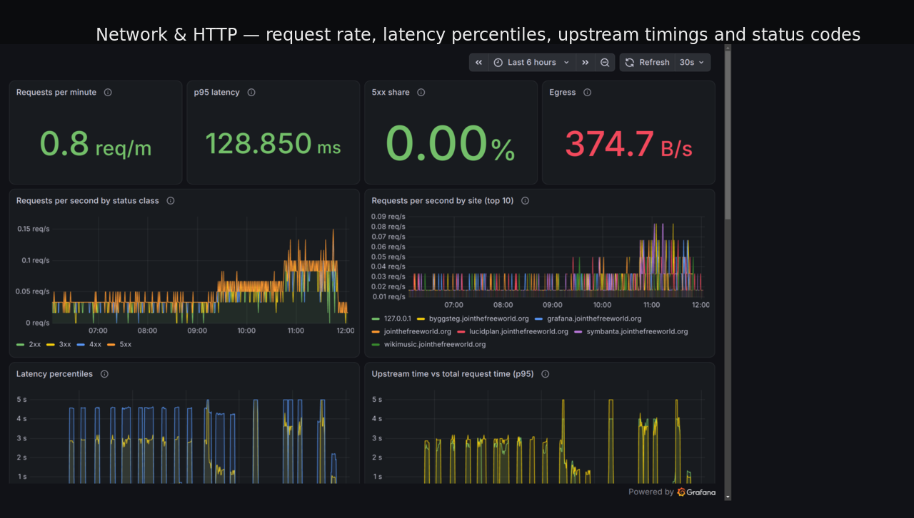
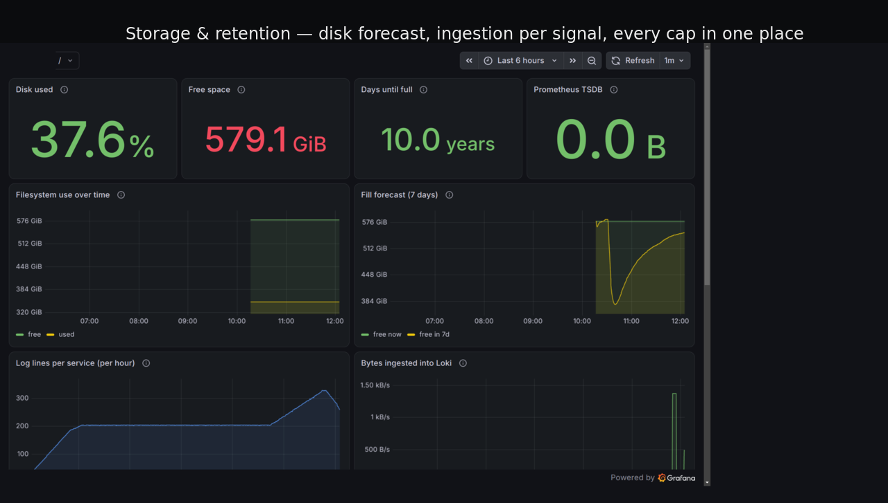
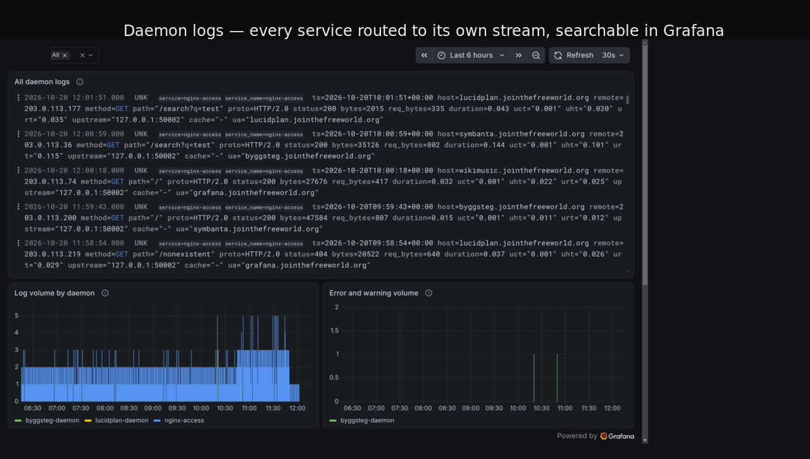
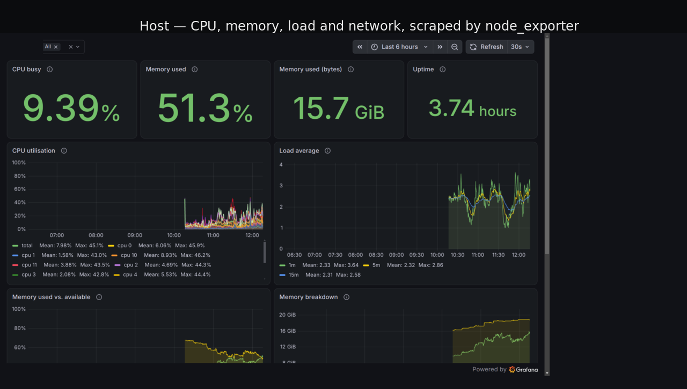

#+title: wolk-jjba
#+subtitle: my personal cloud, written as a Guile program
#+author: Josep Bigorra
#+email: jjbigorra@gmail.com
#+language: en
#+options: toc:nil num:nil

#+begin_export html

  
  
  
  

#+end_export

#+attr_html: :width 160 :alt wolk-jjba logo

/A Lisp machine for the 21st century, a server and my own cloud/

#+attr_html: :width 100%

#+begin_quote
A tour of the dashboards this repository provisions: request rate and
latency per site, disk and retention budgets, per-daemon logs, and host
CPU/memory.  Every panel is generated from the same config you are
reading — see [[file:docs/monitoring.org][Monitoring and observability]].
#+end_quote

wolk-jjba is a complete web and build server — nginx vhosts, automatic
HTTPS, a CI runner, six web applications, PostgreSQL, a Minecraft
server, an Opus radio stream, encrypted backups and a full
Prometheus/Loki/Tempo/Grafana observability stack — all described by the
Guile Scheme in this repository and deployed with GNU Guix.  There is no
Ansible tree, no Dockerfiles, no shell script that drifts: =config.scm=
*is* the server, and =guix system reconfigure= turns the code into the
running machine, atomically and reversibly.

It is also my playground. 🇳🇱 /Wolk/ is the Dutch word for cloud, /jjba/
are my initials, and the machine is where I experiment with treating a
server as a Lisp machine: every capability is a module, every operational
task is a Scheme program, and the whole system can be rebuilt from a
pinned Guix channel and a git commit.

If this repository is useful to you, you can
[[https://bmc.link/jjbigorra][buy me a cup of coffee ☕]] — it buys more of these experiments.

*Screenshots:*  ·
 ·
 ·

* Documentation

The manual is in [[file:docs/index.org][docs/]]: one page per capability, each naming
the modules it describes and linking to the pages that depend on it.
[[file:docs/index.org][The index]] lists every page; these are the ways in.

| I want to…                          | Read                                                                                                      |
|-------------------------------------+-----------------------------------------------------------------------------------------------------------|
| understand what this machine is     | [[file:docs/about.org][About this project]], [[file:docs/architecture.org][Architecture]]                 |
| try the configuration without a VPS | [[file:docs/getting-started.org][Getting started]]                                                        |
| build my own                        | [[file:docs/deployment.org][Deploying a new machine]]                                                     |
| host a site                         | [[file:docs/nginx.org][Web hosting with nginx]], [[file:docs/services-and-ports.org][Services and ports]] |
| keep the data                       | [[file:docs/backups.org][Backups and retention]], [[file:docs/storage-box.org][The Storage Box]]          |
| watch the machine                   | [[file:docs/monitoring.org][Monitoring and observability]], [[file:docs/logging.org][Logging]]            |
| harden it, or hear about a CVE      | [[file:docs/security.org][Security]]                                                                      |
| fix something                       | [[file:docs/troubleshooting.org][Troubleshooting]]                                                        |
| contribute                          | [[file:docs/contributing.org][Contributing]]                                                              |

The repository itself is in =src/wolk-jjba/=, one module per capability;
[[file:docs/repository-layout.org][Repository layout]] maps every file, and
[[file:docs/about.org::#configuration-map][the configuration map]] says which
file to edit for the usual changes.

Licensing, support and scope are in [[file:docs/project.org][The project]].
